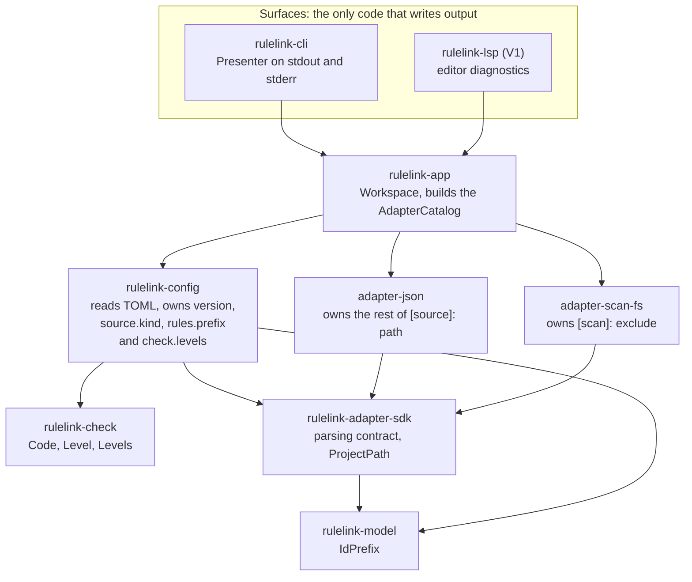
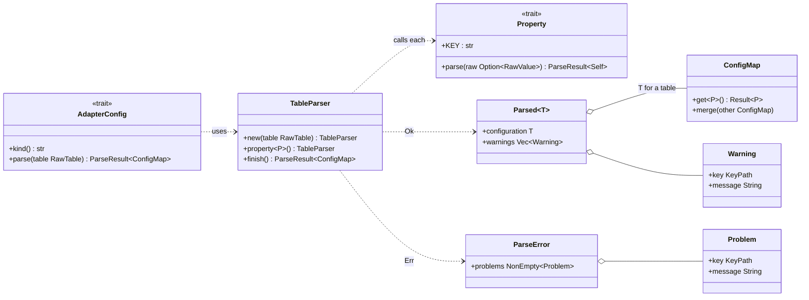
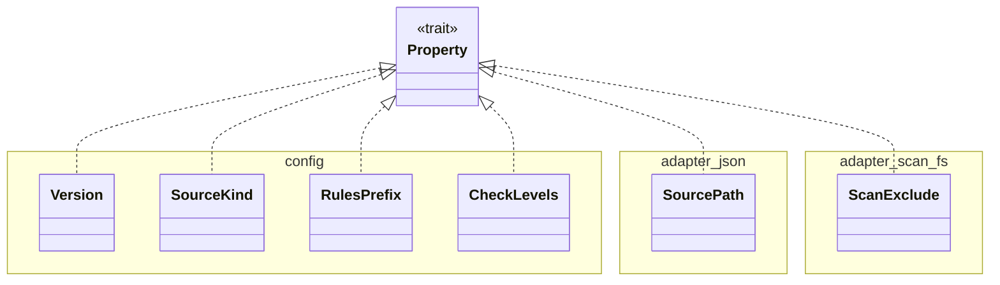
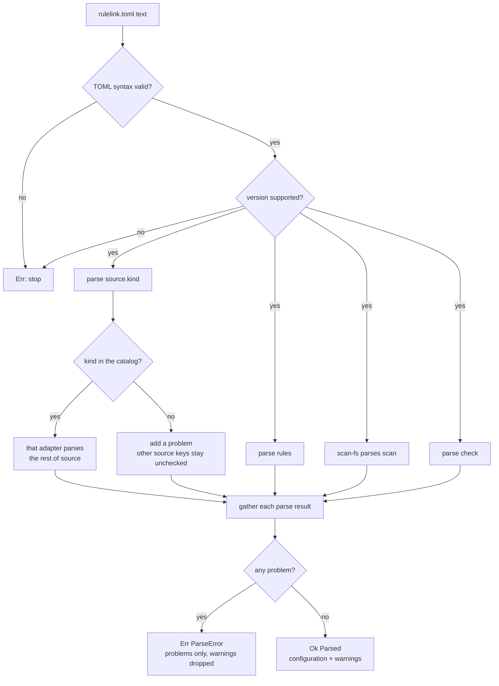
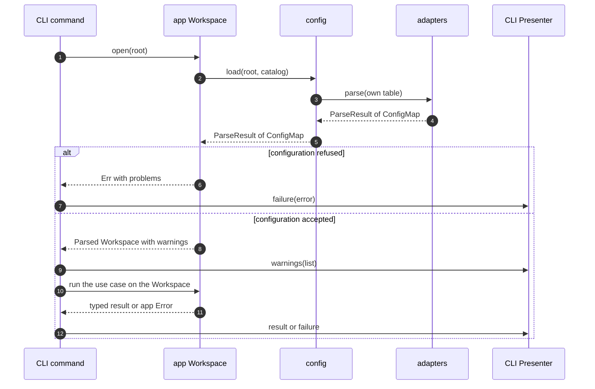
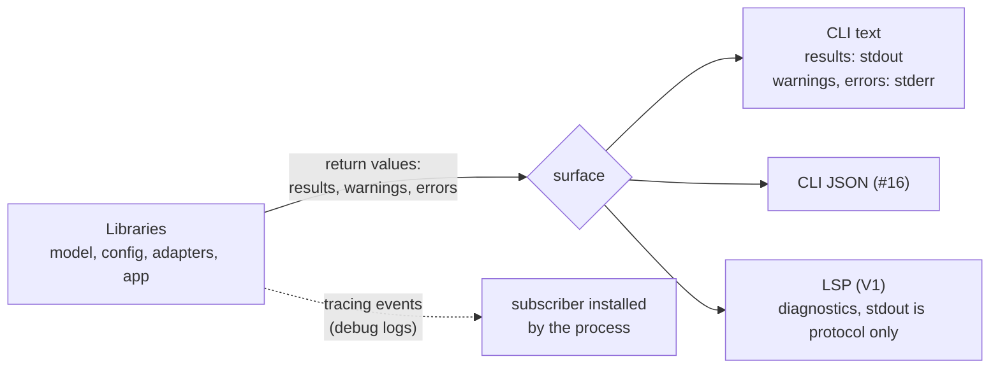

# Configuration parsing and output: target architecture

Design only, nothing is implemented. Signatures are proposals. **D1** to **D6** are decided and the diagrams show them, but **D3 must be confirmed again**: it was chosen from an outdated description of the code. Checked against `main` at `3519619`.

## Goals

1. Each configuration property parses and validates itself.
2. Each adapter parses and validates its own settings.
3. Parsing returns `Result<{ configuration: Map, warnings: Vec<Warning> }, Error>`.
4. No library assumes that output goes to stdout.

## What changes

| Today | Target |
| --- | --- |
| `Config::parse` validates every key in one place | Each property is a type with its own `parse` |
| `rulelink-config` validates `source.path` | The JSON adapter validates it |
| `scan.exclude` is checked in `config`, then its glob syntax at scan time in `scan-fs` | `scan-fs` checks all of it at load time |
| The first problem stops parsing | Independent problems are all collected |
| Unknown keys give a warning (top level, `[rules]`, `[scan]`), an error (`[check]`) or nothing (`[source]`) | Unknown keys are errors everywhere (D3, to confirm) |
| `app::configuration::warnings` loads the configuration a second time and returns sentences | Warnings come as data from the one parse |
| `Bootstrap`, in the `app` library, calls `eprintln!` | Only a surface (CLI, later LSP) writes output |

## 1. Who owns what



- `rulelink-config` never depends on an adapter. `app` passes it the list of available adapters.
- New edges: `config → adapter-sdk`, `app → adapter-sdk`, `scan-fs → adapter-sdk`. `json → adapter-sdk` already exists.
- The contract lives in `adapter-sdk` because adapter authors must implement it.
- `ProjectPath` (relative, no `..`) moves to the SDK so that later path-based adapters reuse it. Like today's check, it does not follow symbolic links.
- The SDK has its own `RawValue`, so `toml` is not part of its public interface. `config` converts TOML into it. The SDK's allowed dependencies stay as documented.

## 2. The parsing contract



```rust
pub type ParseResult<T> = Result<Parsed<T>, ParseError>;
```

A property returns `ParseResult<Self>`. A table, an adapter and the whole file return `ParseResult<ConfigMap>`.

**A property** decides everything about itself: whether it is required, its default, its type, normalisation, validation and its warnings. It receives `None` when the key is absent.

**`TableParser`** is where the shared behaviour sits, so no property or adapter repeats it:

- it runs every declared property, even after one fails;
- it collects problems and warnings;
- it reports a problem for each key that no property claimed;
- it returns a map only if there is no problem.

### What the parser guarantees

An `Ok` result means the data respects every rule below, so no reader checks it again.

| Guarantee | How it is enforced |
| --- | --- |
| Every declared property is in the map, an absent optional one with its default | `finish` returns a map only when each declared property parsed |
| Each value is valid | A property type has private fields, and parsing is the only way to build it from configuration |
| `get::<P>()` returns a `P`, never another type | Each entry is stored under its Rust type, by `TableParser` only |
| Nobody can add or replace a value | `ConfigMap` has no public insert or constructor. `merge` only joins parsed maps |

```rust
impl ConfigMap {
    /// Fails only if `P` was never declared to the parser: a bug, not a user mistake.
    pub fn get<P: Property>(&self) -> Result<&P, UndeclaredProperty>;
}
```

The compiler cannot prove that a property was declared, so `get` still returns a `Result`. The workspace denies `unwrap`, and `app` converts `UndeclaredProperty` to an internal error (exit code 10). A test for each owner reads every one of its properties from a parsed map, which catches a forgotten declaration before release.

### Properties and owners



| Property | Required | Validates |
| --- | --- | --- |
| `version` | yes | equals `1` |
| `source.kind` | yes | non-empty text |
| `rules.prefix` | yes | `IdPrefix::parse`, which stays in `model` |
| `check.levels` | no, none set by default | each name is a Finding code, each value is `error`, `warning` or `off` |
| `source.path` | yes | `ProjectPath` |
| `scan.exclude` | no, empty by default | trimmed, not blank, no leading `!`, valid glob |

Whether a kind exists is the one check `source.kind` cannot make alone: the `AdapterCatalog` makes it, and its error lists the available kinds.

## 3. Parsing flow



Only two failures stop at once: invalid TOML and an unsupported version, because nothing after them can be trusted. A top-level key or section that nobody owns is a problem too. As documented in 09 §3, its message suggests the closest known key, and `x-*` keys and the content of `[adapters.*]` are accepted without a message.

## 4. One command run



`Workspace::open` is the only way to get a `Workspace`, and every use case that needs configuration takes one, so the order cannot be wrong. The surface receives the warnings before the use case runs, so a later failure (a missing Source, for example) cannot lose them, and use case results need no warning field. `init` takes no `Workspace`, because there is no configuration yet. This replaces `app::configuration::warnings` and the CLI's `warn_about_configuration`.

The scan also skips the rules file, so `app` reads `SourcePath` from the map and passes it to `scan-fs`. A later Source that is not a file will need another way to say what to skip.

## 5. Output



- **User-facing output is returned data.** The app has no `Printer` or `Logger` trait: the surfaces differ in what they do with the data, so returning it is enough.
- **Debug logs use `tracing`**, as already documented (00 §9.4). They never carry something the user must see.
- **CLI `Presenter`** receives its two writers (`impl Write`), so tests read what it wrote without starting a process.
- **`Bootstrap`** stops printing: `Entrypoint` gains a `report_failure(error)` hook that each surface implements.

## Behaviour changes to expect

- Every command that opens a Workspace now refuses an invalid `scan.exclude` glob. Today only a scanning command does. The class stays configuration error, exit code 2.
- One run can report several configuration problems.
- If D3 is confirmed, a file with an unknown key that only warns today, or is ignored under `[source]`, is refused (configuration error, exit code 2).
- In that case no property produces a warning yet. `Parsed.warnings` is there for the first one, such as a deprecated key.
- `rulelink init` keeps its template. The test that loads it back moves to `app`, where the adapters are known.

## Not in this design

- The `AdapterFamily` and `AdapterRegistry` of 02 §5.2. `AdapterCatalog` is only the list of settings parsers. It can grow into the registry when a second Source kind exists.
- Layered configuration (09 §5.1). Layers could merge into one raw table before parsing; provenance would need more work.
- Line and column in `Problem` and `Warning`. An editor surface will want them, and `RawValue` would have to carry them. TOML syntax errors keep the parser's full message, with its line, as today.

## Dependent tickets

| Ticket | Reuses | Still missing |
| --- | --- | --- |
| #60 `doctor` | all problems from one parse, or all warnings when it succeeds | Source checks. If only another section fails, `doctor` needs the Source location from a failed parse, which `ParseError` does not give for now (see D6) |
| #63 property reference | one owner per property, one page section per owner | the public pages |
| #16 `check --format json` | warnings as data | whether the report schema includes them |

## Decisions

### D1. What is the `Map`? Decided: a typed map

`map.get::<SourcePath>()` returns a checked `SourcePath`. The parser must ensure that the data is respected: see [What the parser guarantees](#what-the-parser-guarantees).

Rejected: a text map (`map["source.path"]`), where every reader converts the value again, and one struct per owner, which is not a map.

### D2. Do warnings survive a failed parse? Decided: no

`ParseError` holds problems only, and warnings come only with an `Ok` result. This keeps the code simpler.

Accepted cost: a warning that would explain a problem appears only once the problem is fixed.

### D3. What does an unknown key do? Chosen: an error. To confirm

**The choice was made from wrong information.** The description given was that 09 §3 requires an error and the code ignores unknown keys. That was read on an outdated branch. On `main`, since #62:

| Where | Today |
| --- | --- |
| Top level, `[rules]`, `[scan]` | warning, the key is ignored |
| `[check]` | configuration error |
| `[source]` | ignored without a warning, until its keys have an owner |
| `x-*` names, `[adapters]` | accepted without a message |

09 §3 states that this is the MVP behaviour, without a suggestion of the closest key, and the public page `docs/public/concepts/configuration.md` promises it. That page also says no warning is printed when the configuration is invalid, which already matches D2.

| Option | Consequence |
| --- | --- |
| **A. Keep today's levels, and warn in `[source]`** | No shipped warning becomes an error. This design settles who owns the `[source]` keys, so they can be checked too. `TableParser` needs to know whether an unknown key in a table warns or fails. 09 §3 and the public page change only for `[source]` |
| B. Error everywhere (current choice) | One behaviour, and no typo is ignored. It reverses what #62 shipped. 09 §3 and the public page must change, and a suggestion of the closest key is new work |

If B stays, the diagrams stand. If A is chosen, the `TableParser` bullet, section 3 and the behaviour changes must be updated.

### D4. How does an adapter describe its settings? Decided: its `parse` is the validation

An adapter has no `config_schema()`. `doctor` uses the same `parse` as every other command, so they cannot disagree. A schema may be added later for editor completion only.

Documents to update with the implementation: 02 §5.2 (`config_schema()`), and 09 §3, whose generated configuration schema cannot cover adapter settings for now.

External adapters (V1) fit this if the protocol gets a request that sends them their settings and returns either problems, or the accepted settings with their warnings. 02 §6 describes a `config_schema` in `initialize`, to revisit then.

Rejected: a schema next to `parse`, two rule sets that can disagree.

### D5. Who owns `[scan]`? Decided: `scan-fs`, the whole section

`scan.exclude` validates itself completely, next to the library that reads the patterns.

09 §4 also plans `scan.tag` and `scan.kinds`. Their owner is chosen when they are added: one that is needed without walking files (the marker, for an editor reading an unsaved file) moves to shared code and stays under `[scan]` in the file.

Rejected: `config` owning the section with `scan-fs` checking the globs, validation in two places.

### D6. What does `doctor` get when parsing fails? Decided: problems only, for now

`doctor` skips the Source checks when the configuration is invalid, even if `[source]` is fine. #60 accepts that an invalid configuration "may hide" the Source.

Planned later: more rules will be added so that `ParseError` also carries the values that did parse (the rejected option for now). They are not defined yet, and will have to say how this fits the parser's guarantees, since such a map is incomplete.
