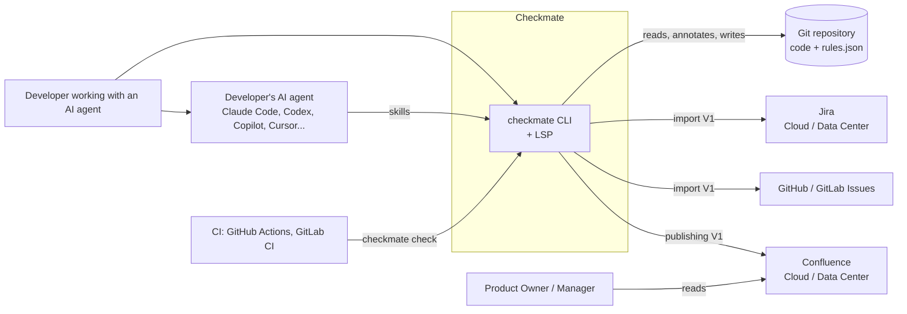
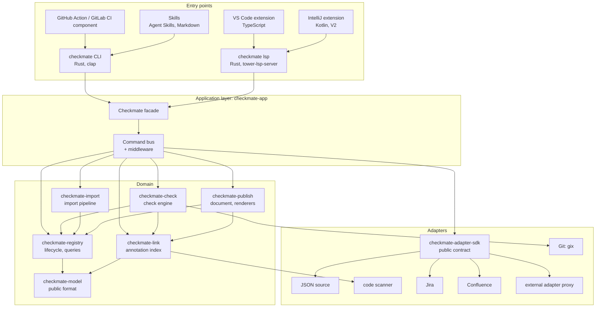
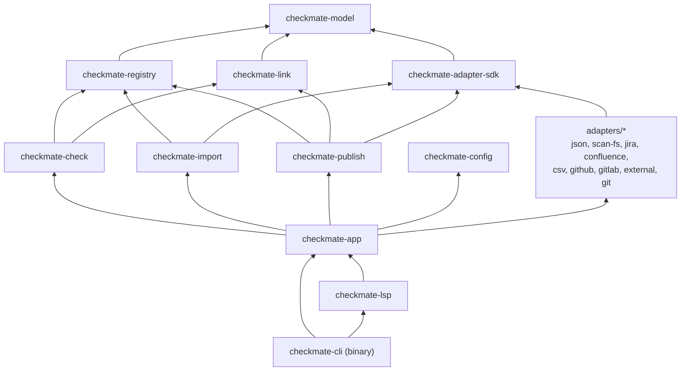
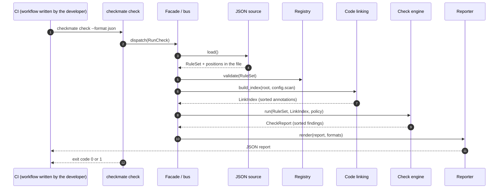
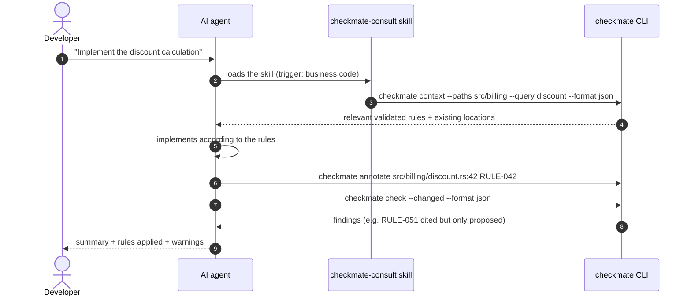
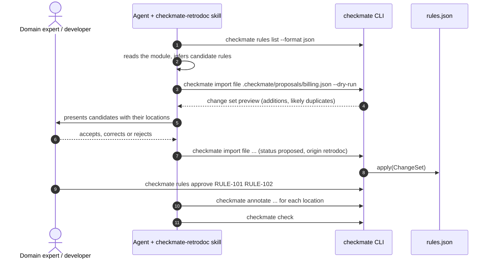
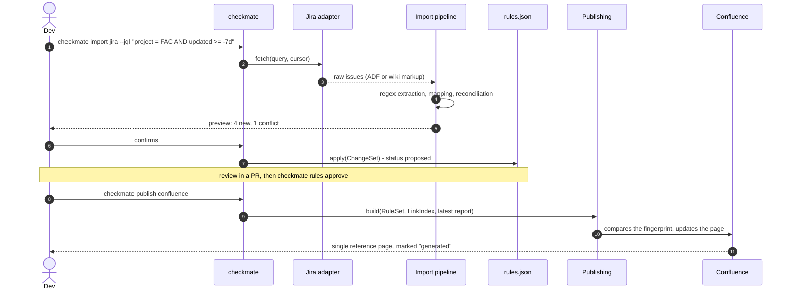

# Checkmate — Global Architecture

> Design dossier, without implementation. This document describes the systems, their responsibilities, their constraints and their interactions. Each business component has its own file with the detailed design, GoF patterns, APIs and entry points.
>
> Source: *Product brief — Business rule traceability* (31 October 2026) and `projet.svg`.
> Written on 12 November 2026.

## Architecture contents

| # | File | Business component | First release |
|---|---|---|---|
| 00 | `00-global-architecture.md` | Overview, interactions, cross-cutting choices | — |
| 01 | [`01-rule-registry.md`](01-rule-registry.md) | Rule model, lifecycle, validation, search | MVP |
| 02 | [`02-sources-of-truth.md`](02-sources-of-truth.md) | Persistence, adapter contract, external adapters | MVP |
| 03 | [`03-code-linking.md`](03-code-linking.md) | Annotations, code scanning, `explain`, `where` | MVP |
| 04 | [`04-checks.md`](04-checks.md) | `check`, severities, reports, CI integration | MVP |
| 05 | [`05-import.md`](05-import.md) | File, Jira, CSV, GitHub/GitLab issues import | MVP (file) |
| 06 | [`06-publishing-export.md`](06-publishing-export.md) | File export, Confluence publishing | V1 |
| 07 | [`07-agent-integration.md`](07-agent-integration.md) | Skills, agent context | MVP |
| 08 | [`08-ide-integration.md`](08-ide-integration.md) | LSP server, VS Code and IntelliJ extensions | V1 |
| 09 | [`09-project-configuration.md`](09-project-configuration.md) | `init`, configuration, wiring, command bus | MVP |
| 10 | [`10-runtime-lifecycle.md`](10-runtime-lifecycle.md) | Cross-cutting: process bootstrap, signals, server states, resources | MVP |

Related documentation outside this folder:

| Folder | File | Content |
|---|---|---|
| Product | [`01-product-overview.md`](../product/01-product-overview.md) | Need, target users, principles, journeys, positioning, business model, success criteria |
| Product | [`02-features-and-releases.md`](../product/02-features-and-releases.md) | Release frames, features by release, exit criteria |
| Repository | [`01-repository-structure.md`](../repository/01-repository-structure.md) | Monorepo layout, tooling (Cargo + moon), crate conventions, CI gates |
| Repository | [`02-release-lifecycle.md`](../repository/02-release-lifecycle.md) | Versioning, release pipeline, channels, deprecation, supply chain |

## 1. Need and architecture drivers

Checkmate answers two questions: **which business rule does this code implement**, and **which rules no longer have any code**. The product rests on three elements: a source of truth, a rule identifier in the code (`// @rule RULE-042`) and a deterministic check in CI.

The drivers below come straight from the brief:

| Driver | Architectural consequence |
|---|---|
| Solo side project | Few components to operate, no server to run, one code base for CLI and LSP |
| Installed by a developer, with no purchase or approval | Single binary with no runtime, no account, works offline |
| Deterministic `check` in CI | The core makes no network or AI calls; outputs are sorted and stable |
| A single source of truth | Adapters have three distinct roles: source, import, publishing. No two-way synchronisation |
| Public rule format | The model is a separate, versioned crate described by a JSON Schema |
| Community-contributed connectors | Public adapter contract, native Rust or external process in any language |
| AI only through skills run by the developer's agent | The binary embeds no LLM. Skills call the CLI with `--format json` |
| Less than 15 minutes to the first `check` | `checkmate init` generates configuration and rules file; skills are installed by hand in the MVP |

## 2. Technology choice: Rust

**Verdict: Rust is a good fit for the core, the CLI and the LSP server.** The IDE extensions stay in their ecosystems' languages.

| Criterion | What Rust brings |
|---|---|
| Installs anywhere | Single static binary (Linux musl, macOS, Windows), no JVM or Node |
| Fast code scanning | `ignore` and `grep-searcher` crates from ripgrep: parallel traversal that honours `.gitignore` |
| One core, several entry points | The same library serves the CLI and the LSP server (`tower-lsp-server`) |
| Public format | `serde` for serialisation, `schemars` to generate the JSON Schema from the types |
| Determinism | No garbage collector or reflection, ordered collections (`BTreeMap`, `IndexMap`) |
| Distribution | `cargo-dist`: GitHub releases and npm package in the MVP; shell and PowerShell installers, Homebrew in V1 |

Risks and mitigations:

| Risk | Mitigation |
|---|---|
| Barrier to entry for contributors | External adapter protocol (JSON-RPC over stdio): a connector can be written in Python, TypeScript or Go |
| Compile times | Workspace split into crates, one Cargo feature per adapter |
| Thinner Atlassian ecosystem than Java or TypeScript | Hand-written REST clients on `reqwest`, limited to the few endpoints needed |

Language per container:

| Container | Language | Reason |
|---|---|---|
| CLI, LSP, core, official adapters | Rust | Single binary, shared core |
| VS Code extension | TypeScript | Thin LSP client, bundles the platform binary |
| IntelliJ extension | Kotlin | Thin LSP client via LSP4IJ or the platform LSP API |
| Skills | Markdown (Agent Skills format) | Portable, distributed through `npx skills` and APM |

## 3. Context view

## 4. Container view

## 5. Hexagonal architecture and crate breakdown

The domain depends on no I/O technology. It defines **ports** (Rust traits) that **adapters** implement. The application layer orchestrates use cases as **commands**. Entry points only translate a request (command line, LSP request) into a command.

Dependency rules, enforced in CI with `cargo deny` and an architecture test:

1. `checkmate-model`, `checkmate-registry`, `checkmate-link` and `checkmate-check` have **no network or async dependency** (no `tokio`, no `reqwest`).
2. An adapter depends only on `checkmate-adapter-sdk` (and therefore `checkmate-model`), never on `checkmate-app`.
3. Only `checkmate-app` knows the concrete adapters. It wires them from the configuration (see 09).
4. Entry points contain no business rule logic.

A single `checkmate` binary exposes the LSP server: `checkmate lsp` is a subcommand. One installation therefore covers the CLI and the IDE.

## 6. Business component responsibilities

| Component | Responsibility | Does not | Crates |
|---|---|---|---|
| 01 Rule registry | Defines the rule, its lifecycle (`proposed`, `validated`, `obsolete`), identifier allocation, rule set validation and search | Any I/O | `checkmate-model`, `checkmate-registry` |
| 02 Sources of truth | Reads and writes the rule set in the configured source. Publishes the adapter contract and the external protocol | Decide status transitions | `checkmate-adapter-sdk`, `adapters/json`, `adapters/external` |
| 03 Code linking | Finds `@rule` annotations in the code, builds the rule ↔ location index, answers `explain` and `where`, inserts annotations | Judge whether the code is correct | `checkmate-link`, `adapters/scan-fs` |
| 04 Checks | Cross-references registry and index, produces findings with severities, renders CI reports | Any network call or AI | `checkmate-check`, `adapters/git` |
| 05 Import | Fetches external items, extracts candidate rules, reconciles them with existing rules and produces a change set of `proposed` rules | Write a `validated` rule | `checkmate-import`, `adapters/jira`, `adapters/csv`, `adapters/github`, `adapters/gitlab` |
| 06 Publishing and export | Builds a readable document (application, module, scope, status, links to code) and renders it as Markdown, HTML, CSV or Confluence | Read a publication back as a source | `checkmate-publish`, `adapters/confluence` |
| 07 Agent integration | Serves context to agents (`checkmate context`), the skills, their installation | Embed an LLM | `skills/` folder of the monorepo ([repository/01](../repository/01-repository-structure.md)) |
| 08 IDE integration | LSP server: hover, diagnostics, completion, navigation. VS Code and IntelliJ extensions | Duplicate logic in the extension | `checkmate-lsp`, `vscode-checkmate`, `intellij-checkmate` |
| 09 Project and configuration | Discovers the workspace, loads layered configuration, wires adapters, exposes the facade and the command bus, `init` and `doctor` | Any business rule logic | `checkmate-config`, `checkmate-app`, `checkmate-cli` |

## 7. Interactions between components

### 7.1 Matrix

| Caller ↓ / Callee → | 01 Registry | 02 Source | 03 Linking | 04 Checks | 05 Import | 06 Publishing | 07 Agents |
|---|---|---|---|---|---|---|---|
| 02 Source | validates the loaded model | | | | | | |
| 03 Linking | reads ID patterns | | | | | | |
| 04 Checks | validates the set, reads statuses | loads | reads the index | | | | |
| 05 Import | reconciles, creates `proposed` | writes the change set | | | | | |
| 06 Publishing | reads and groups | loads | reads locations | reads the latest report | | | |
| 07 Agents (skills) | searches | loads, proposes | `explain`, `where`, annotate | runs `check` | file import | | |
| 08 IDE (LSP) | hover, completion | loads, watches | incremental index | diagnostics | | | |

### 7.2 MVP flow: pull request check

### 7.3 MVP flow: development with an agent

### 7.4 MVP flow: bootstrapping legacy code (retro-documentation)

### 7.5 V1 flow: Jira → JSON → Confluence

## 8. Design patterns

### 8.1 GoF patterns used

| Pattern | Category | Where | Why |
|---|---|---|---|
| Adapter | Structural | 02, 05, 06: `JsonFileSource`, `JiraImporter`, `ConfluencePublisher` | Translate each tool to the rule model and the domain ports |
| Proxy | Structural | 02: `ExternalAdapterProxy` | Represent an out-of-process adapter behind the same trait |
| Decorator | Structural | 02: `CachedSource`, `ReadOnlySource`; 09: bus middleware | Add caching, read-only mode, tracing or locking without touching the classes |
| Facade | Structural | 09: `Checkmate` | A single entry point for CLI and LSP |
| Bridge | Structural | 05, 06: Atlassian client × Cloud or Data Center edition | Vary the use case and the remote API independently |
| Composite | Structural | 04: `CheckSuite`; 06: document sections; 01: filter expression | Treat a check or a group, a section or a rule, uniformly |
| Flyweight | Structural | 03: `LanguageProfile` shared per extension | Thousands of files share a handful of comment profiles |
| Command | Behavioral | 09: every action (`RunCheck`, `ImportRules`, `PublishRules`...) | Same action from CLI and LSP; preview, logging |
| Chain of Responsibility | Behavioral | 09: configuration layers | Each link completes or handles, then passes on |
| Strategy | Behavioral | 01: ID allocation; 03: comment syntax; 04: reporters; 05: extraction and merge; 07: skill installer | Choose an algorithm through configuration |
| Template Method | Behavioral | 05: `ImportPipeline`; 06: `PublishPipeline`; 07: managed `AGENTS.md` section | Fixed skeleton, steps specialised per adapter |
| State | Behavioral | 01: rule lifecycle | Allowed transitions carried by the state |
| Observer | Behavioral | 09: event bus; 08: LSP refresh | Decouple reactions (diagnostics) from actions |
| Visitor | Behavioral | 06: document rendering; 05: ADF conversion; 04: index traversal | Add an output format without changing the structure |
| Interpreter | Behavioral | 01: filter language `status:validated module:vat`; 03: `@rule` grammar | Small, documented, testable domain languages |
| Memento | Behavioral | 02, 05: snapshot before writing, rollback | Atomic write of a change set |
| Iterator | Behavioral | 03: annotation stream; 05: Jira pagination | Traverse large volumes without loading everything |
| Builder | Creational | 01: `RuleQuery`; 06: `DocumentBuilder`; 09: `ConfigBuilder` | Build rich, immutable objects step by step |
| Abstract Factory | Creational | 02: `AdapterFamily` (Jira: importer + source; Confluence: publisher) | Create consistent adapters from configuration |
| Factory Method | Creational | 02: `AdapterRegistry::create`; 03: language profile per extension | Instantiate without knowing the concrete class |
| Prototype | Creational | 09: `init` templates (legacy, greenfield, business application) | Copy a reference configuration, then adjust it |

The **Singleton** pattern is deliberately rejected: shared state (configuration, adapter registry) goes through an explicit, injected `AppContext`. This keeps tests parallel and lets the LSP server handle several workspaces.

### 8.2 Complementary patterns (non-GoF)

| Pattern | Where | Role |
|---|---|---|
| Ports and adapters (hexagonal) | Everywhere | Isolate the domain from I/O |
| Repository | 02 | The `RuleSource` port acts as a repository for the `RuleSet` aggregate |
| Unit of Work | 02, 05 | `ChangeSet` groups changes and applies them at once |

## 9. Cross-cutting conventions

### 9.1 CLI

Binary name: `checkmate`. Noun or verb tree, in the style of `cargo` and `gh`.

| Group | Commands | Release |
|---|---|---|
| Project | `init`, `config`, `doctor`, `migrate`, `completions`, `version`, `schema` | MVP |
| Rules | `rules list`, `rules show`, `rules search`, `rules add`, `rules edit`, `rules approve`, `rules obsolete`, `rules reject`, `rules next-id`, `rules lint` | MVP |
| Labels | `labels list`, `labels add`, `labels remove` | V1 |
| Code | `explain`, `where`, `annotate`, `scan` | MVP |
| Checks | `check`, `status`, `baseline` | MVP (`baseline` in V1) |
| Import | `import file`, `import csv`, `import jira`, `import github`, `import gitlab`, `import <external>` | MVP for `file` |
| Output | `export`, `publish confluence`, `publish <external>` | V1 |
| Source | `source info`, `source pull`, `source migrate` | V1 |
| Agents | `context` (MVP), `skills install`, `skills list`, `skills update` (V1) | MVP |
| IDE | `lsp` | V1 |
| Adapters | `adapters list`, `adapters check` | V1 |

Common global options: `-C, --directory <DIR>`, `--config <FILE>`, `--format <human|json|...>`, `--color <auto|always|never>`, `-q`, `-v` (repeatable), `--log-format <text|json>`, `--no-input` (never prompt; implied in CI).

### 9.2 Exit codes

| Code | Meaning |
|---|---|
| 0 | Success, no blocking finding |
| 1 | `check`: at least one error-level finding |
| 2 | Invalid usage or configuration |
| 3 | Source unreadable, invalid or not found |
| 4 | Remote adapter error (network, authentication, quota) |
| 5 | Write conflict (source changed between read and write, Confluence page edited by hand) |
| 10 | Unexpected internal error (panic) |
| 130 | Interrupted by Ctrl-C (SIGINT), see [10](10-runtime-lifecycle.md) |
| 143 | Terminated (SIGTERM), see [10](10-runtime-lifecycle.md) |

### 9.3 Outputs

- `human` by default in a terminal, `json` for agents and scripts. Every JSON output follows a published, versioned schema (`checkmate schema <name>`).
- All lists are **sorted** (identifier in natural order, then path, then line). Two runs on the same state produce byte-identical output.
- Human diagnostics use `miette`: code excerpt, underline, suggestion.

### 9.4 Errors and logging

- Libraries: typed errors with `thiserror`, one enum per crate, converted to `AppError` at the application boundary.
- Binary: `miette` rendering, `tracing` logs to stderr. stdout is reserved for results so pipes stay clean.
- No telemetry. The brief's main indicator (repositories where `check` has run for 30 days) is measured through public dependents of the GitHub Action and the GitLab component, not through data collection.

### 9.5 Security

| Topic | Rule |
|---|---|
| Secrets | Never in `checkmate.toml`. Environment variables (`CHECKMATE_JIRA_TOKEN`), `${env:VAR}` interpolation, or the OS keychain through `checkmate auth` (V1, `keyring` crate) |
| Network | Only remote adapters open connections. `check`, `explain`, `where` and `context` never call the network |
| External adapters | Run only when declared in the configuration, with an explicit path or command. No automatic `PATH` discovery in CI |
| Writes | Atomic writes (temporary file, then rename), file lock while writing |
| Imported content | Text from Jira or issues is data. Skills present it to the agent as such |

### 9.6 Performance

| Operation | Target (50,000-file repository, standard workstation) |
|---|---|
| Cold `check` | < 3 s |
| `check --changed` | < 500 ms |
| `explain`, `where` | < 300 ms |
| LSP hover, completion | < 50 ms (in-memory index) |
| Memory | < 200 MB |

### 9.7 Versioning and compatibility

- The **rule format** has its own version (`"format": 1`), independent of the binary's. A binary reads all earlier formats, and `checkmate migrate` rewrites the file to the current format.
- The **external adapter protocol** is versioned (`protocol: "1.0"`) and negotiated at initialisation.
- **Skills** declare the minimum CLI version. `checkmate doctor` checks compatibility.
- The binary follows SemVer. JSON outputs are stable within a major version.
- The full versioning matrix, release pipeline and deprecation policy are specified in [Release lifecycle](../repository/02-release-lifecycle.md), section 4.

### 9.8 Distribution

| Channel | Content | Release |
|---|---|---|
| GitHub releases via release-plz + dist (see [Release lifecycle](../repository/02-release-lifecycle.md)) | Binaries for Linux x86_64 and arm64 (musl), macOS x86_64 and arm64, Windows x86_64 | MVP |
| `curl \| sh` and PowerShell installers | Same | V1 |
| Homebrew, Scoop, winget | Same | V1 |
| npm (`npx checkmate`) | Thin package that downloads the platform binary. The only user-facing installer in the MVP | MVP |
| Docker image `ghcr.io/.../checkmate` | For CI without a download step | V1 |
| GitHub Action, GitLab CI component | `check` in a few lines | V2 |
| Skills | `skills/` folder of the monorepo, installable with `npx skills add` and `apm install` (see [Repository structure](../repository/01-repository-structure.md)) | MVP |
| `cargo install checkmate-cli` | For contributors | MVP |

### 9.9 Test strategy

| Level | Tool | Target |
|---|---|---|
| Unit | `cargo test`, `proptest` | State transitions, `@rule` grammar, filters, ID allocation |
| Snapshot | `insta` | CLI outputs (`human`, `json`, `sarif`), Markdown and Confluence renderings |
| Adapter contract | `checkmate-adapter-sdk::conformance` kit | Every native or external adapter passes the same suite |
| HTTP integration | `wiremock` | Jira and Confluence, Cloud and Data Center editions |
| End to end | The brief's example repository | `init` → retro-documentation → `check` → publishing |
| Architecture | Test reading `cargo metadata` | Dependency rules from section 5 |
| Performance | `criterion` + synthetic repository | Targets from section 9.6 |

## 10. Release frames

Release frames (MVP, V1, V2), the feature-by-release table and the exit criteria are product decisions. They are specified in [Features and releases](../product/02-features-and-releases.md). Every component file of this folder repeats the release of its own features.

## 11. Architecture decisions

| # | Decision | Status | Rationale |
|---|---|---|---|
| ADR-001 | Rust for the core, CLI and LSP | Proposed | Single binary, offline, one shared core |
| ADR-002 | Hexagonal architecture, synchronous core, asynchronous adapters | Proposed | Core determinism and testability |
| ADR-003 | Every technical element is in English only: format keys, CLI, configuration, reports, skills. No localisation. Rule values (title, statement...) may be written in any language | Accepted | Public, international format. Values are data, never checked by the tool; only agents may read them to verify a rule. The brief's French field names are mapped in 01 |
| ADR-004 | A single binary, with LSP as a subcommand | Proposed | One installation, one version |
| ADR-005 | Native adapters (crates) and external adapters (JSON-RPC over stdio) | Accepted | Confirmed choice: contributions in any language |
| ADR-006 | Linking by `@rule` comment, lexical scan in the MVP, tree-sitter in V2 | Proposed | Works in every language from day one |
| ADR-007 | Identifiers never reused, thanks to sequences and a list of retired identifiers in the source | Proposed | Guarantee required by the brief, verifiable offline |
| ADR-008 | Remote sources read offline through a versioned snapshot | Proposed | `check` stays deterministic even with Jira as the source |
| ADR-010 | Skills in Agent Skills format, distributed through `npx skills` and APM, with a direct copy as fallback | Accepted | Confirmed choice: support every agent through community tooling |
| ADR-011 | Jira and Confluence: Cloud and Data Center editions behind a Bridge | Accepted | Confirmed choice |
| ADR-012 | MIT licence | Proposed | Direction suggested by the brief |
| ADR-013 | Single monorepo for every component, deliverable and the documentation | Proposed | One source, atomic changes across CLI, skills and extensions ([repository/01](../repository/01-repository-structure.md)) |
| ADR-014 | Cargo workspace orchestrated by moon; Cargo alone stays sufficient for Rust contributors | Proposed | Polyglot project graph and affected-only CI without replacing Cargo ([repository/01](../repository/01-repository-structure.md)) |
| ADR-015 | Dependency rules enforced by `cargo xtask arch` and moon tag constraints | Proposed | Hexagonal rules that do not rely on review discipline ([repository/01](../repository/01-repository-structure.md)) |
| ADR-016 | Releases with release-plz (versions, changelogs, crates.io) and dist (binaries, installers) | Proposed | PR-driven releases; dist replaceable by a hand-written matrix if it stops being maintained ([repository/02](../repository/02-release-lifecycle.md)) |
| ADR-017 | Lockstep version for the binary and internal crates; independent versions for public contracts | Proposed | Contracts (model, SDK, format, protocol) have external consumers and their own pace ([repository/02](../repository/02-release-lifecycle.md)) |

## 12. Risks and open questions

| Topic | Risk | Way forward |
|---|---|---|
| Git conflicts on a single `rules.json` | Frequent in practice when several people add or edit rules | Canonical line-oriented formatting applied on every write (one property per line), `checkmate rules format` to repair a hand-merged file, `check` reports a non-canonical file; `json-dir` source in V1 |
| False positives from the lexical scan | `@rule` inside a string literal or a documentation example | Language profiles restricted to comments; `scan.exclude`; tree-sitter in V2 |
| Changes to Atlassian APIs | Jira Cloud search endpoints and the ADF format keep evolving | Bridge per edition, `wiremock` tests on recorded responses, documented minimum version |
| Young skill tooling (`npx skills`, APM) | Changing flags and formats | Installer as a Strategy, fallback copy embedded in the binary |
