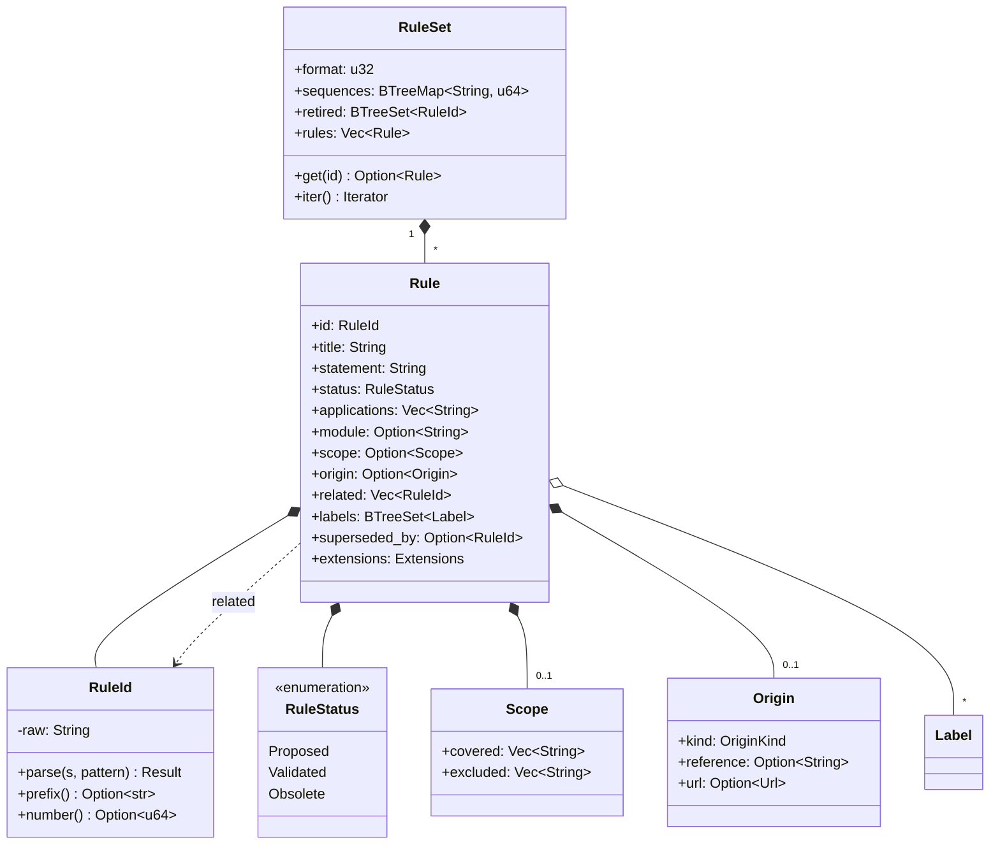
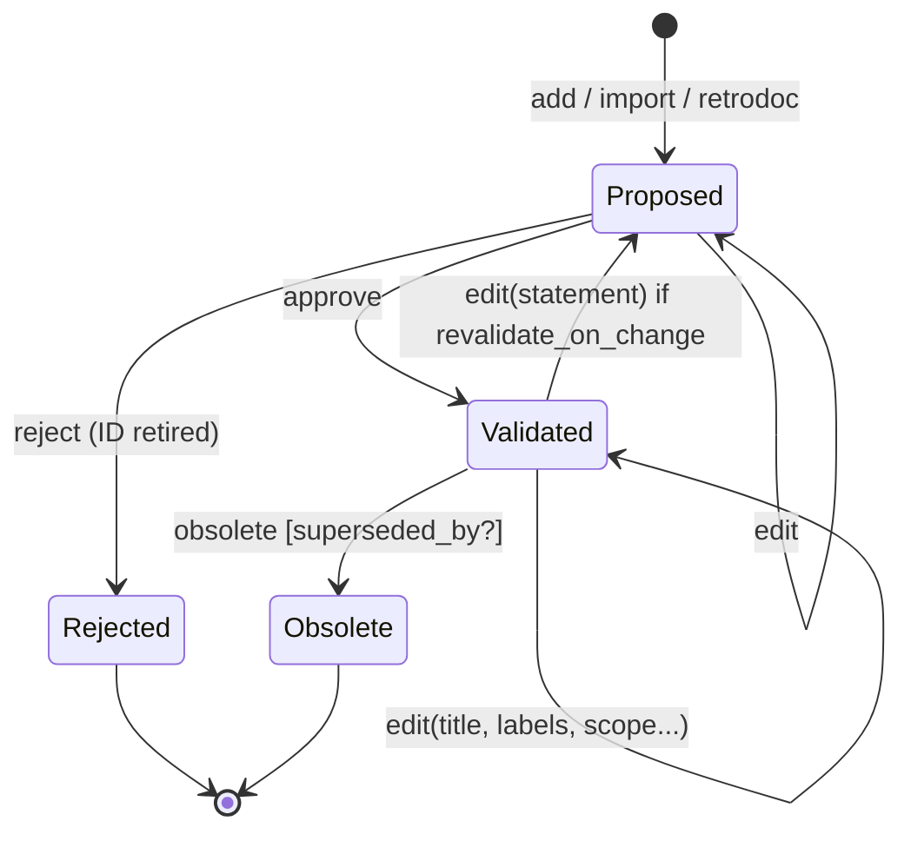
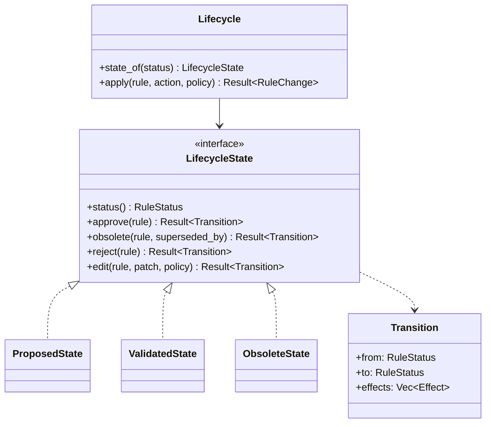
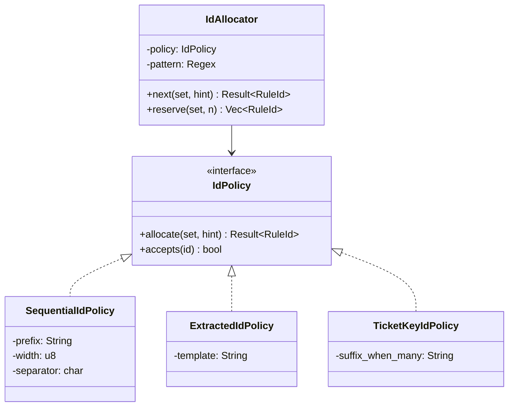
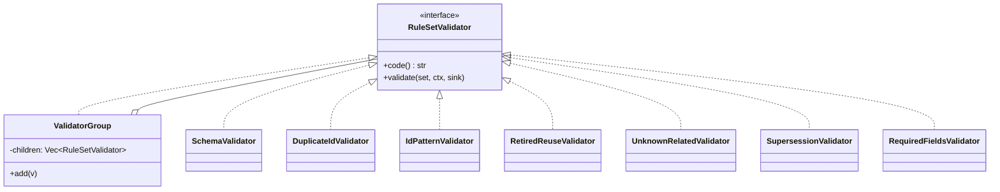
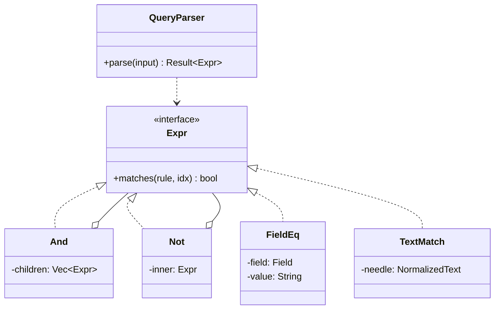
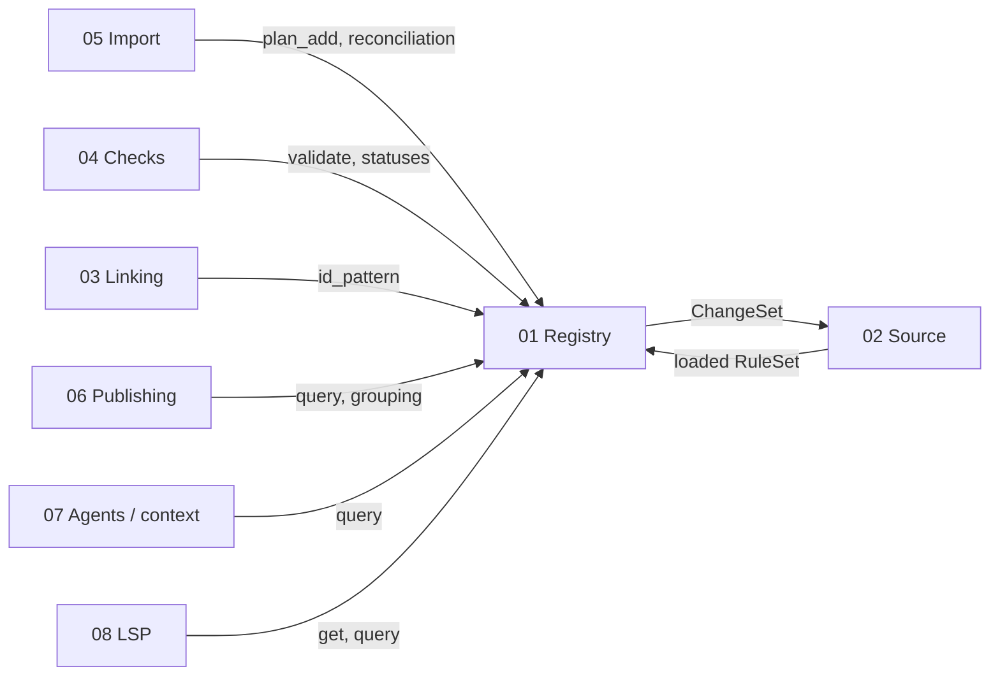

# 01 — Rule registry

> The central business component: it defines **what a rule is**. Every other component translates to this model or reads it.
> Crates: `checkmate-model` (public format) and `checkmate-registry` (domain services).
> See also: [00 Global architecture](00-global-architecture.md).

## 1. Role and scope

**Responsibilities**

- Define the rule model and the public, versioned file format, with its JSON Schema.
- Enforce the `proposed` → `validated` → `obsolete` lifecycle, with `proposed` → `rejected` for declined proposals and reject forbidden transitions.
- Allocate stable identifiers and guarantee they are never reused.
- Validate the integrity of a rule set: schema, duplicates, unknown `related` references, identifier pattern.
- Search and filter rules (keyword, status, application, module, label).
- Produce change sets (`ChangeSet`) that sources apply.

**Out of scope**

- Reading or writing a file, calling a network (see 02).
- Knowing where a rule is cited in the code (see 03).

## 2. Release frame

| Feature | MVP | V1 | V2 |
|---|:-:|:-:|:-:|
| Model v1: the brief's fields + `labels`, `superseded_by`, `extensions` | ● | | |
| Generated and published JSON Schema | ● | | |
| Lifecycle (State) and `approve`, `obsolete`, `reject` commands | ● | | |
| `rules format`: rewrite the source in canonical form (repairs a hand-merged file) | ● | | |
| Sequence-based ID allocation, list of retired IDs | ● | | |
| ID policies: extracted from the source, ticket key | | ● | |
| Basic search (substring, accent- and case-insensitive) | ● | | |
| Filter language (`status:validated module:vat "rounding"`) | | ● | |
| Labels: commands and filter | | ● | |
| Related-rule checks (unknown references, supersession cycles) | ● unknown | ● cycles | |
| Revert to `proposed` when the statement of a validated rule changes | | ● | |

## 3. Technical constraints

- `checkmate-model` depends only on `serde`, `serde_json`, `schemars` and `thiserror`. It is published on crates.io so it can be reused without the rest of the tool.
- `checkmate-registry` is synchronous, performs no I/O and knows no adapter.
- Every collection is ordered: rules sorted by identifier in **natural order** (`RULE-2` before `RULE-10`), JSON keys in a fixed order. The serialised file is **line-oriented** (see 02, canonical writes).
- The model accepts unknown fields prefixed with `x-` under `extensions`, preserved on round trips. An adapter can therefore carry its own metadata without breaking the format.
- Search: Unicode NFKD normalisation, diacritics removed, case ignored. "Énoncé" matches "enonce".

## 4. Rule model

### 4.1 Mapping to the brief (ADR-003, accepted)

| Brief field | JSON key | Type | Required | Note |
|---|---|---|:-:|---|
| `id` | `id` | `RuleId` | Yes | Matches the configured pattern, never reused |
| `titre` | `title` | string, 1 to 120 characters | Yes | |
| `énoncé` | `statement` | string, restricted Markdown | Yes | |
| `statut` | `status` | `proposed`, `validated`, `obsolete`, `rejected` | Yes | |
| `application` | `applications` | list of strings | No | Names declared in `[applications]` of `checkmate.toml` (09). Empty or absent: the rule applies to the whole project |
| `module` | `module` | string | No | |
| `périmètre` | `scope` | `{ covered: [], excluded: [] }` | No | Covered and excluded cases, as required by the brief |
| `origine` | `origin` | `{ kind, ref?, url? }` | No | `kind`: `jira`, `github`, `gitlab`, `url`, `retrodoc`, `manual`, `spec`, or an adapter name |
| `liées` | `related` | list of `RuleId` | No | |
| *(addition)* | `labels` | list of lower-case strings | No | Advanced feature from `projet.svg`, V1 |
| *(addition)* | `superseded_by` | `RuleId` | No | For an `obsolete` rule that has been replaced |
| *(addition)* | `extensions` | `x-*` object | No | Free-form adapter metadata |

All keys are English (ADR-003, accepted). The tool does not localise anything. Values such as `title` and `statement` can be written in any language; they are data and are never validated beyond their length and Markdown subset.

### 4.2 Rules file

```json
{
  "$schema": "https://checkmate.dev/schemas/rules/v1.json",
  "format": 1,
  "sequences": { "RULE": 43 },
  "retired": ["RULE-007"],
  "rules": [
    {
      "id": "RULE-042",
      "title": "Line-level VAT rounding",
      "statement": "VAT is calculated and rounded to the cent on each invoice line, then summed.",
      "status": "validated",
      "applications": ["billing"],
      "module": "VAT calculation",
      "scope": {
        "covered": ["B2B invoices", "Credit notes"],
        "excluded": ["Non-EU export invoices"]
      },
      "origin": { "kind": "jira", "ref": "FAC-1289", "url": "https://acme.atlassian.net/browse/FAC-1289" },
      "related": ["RULE-017"],
      "labels": ["vat", "rounding"]
    }
  ]
}
```

The schema URL is indicative (domain to be registered). `sequences` holds the highest number allocated per prefix and `retired` the identifiers that were removed. Together, these two fields guarantee offline that an identifier is never reused (ADR-007).

### 4.3 Model class diagram



## 5. Detailed design

### 5.1 Lifecycle — **State** pattern

**Problem.** Allowed transitions depend on the current status, and each transition has side effects (`superseded_by`, reverting to `proposed` after an edit). A `match` scattered across commands would quickly become inconsistent.

**Solution.** Each status is a state object that knows which transitions it accepts. `RuleStatus` stays a serialisable enum; behaviour lives in a state object obtained from it.





Interface sketch (signatures only):

```rust
pub trait LifecycleState: Send + Sync {
    fn status(&self) -> RuleStatus;
    fn approve(&self, rule: &Rule) -> Result<Transition, LifecycleError>;
    fn obsolete(&self, rule: &Rule, superseded_by: Option<&RuleId>) -> Result<Transition, LifecycleError>;
    fn reject(&self, rule: &Rule) -> Result<Transition, LifecycleError>;
    fn edit(&self, rule: &Rule, patch: &RulePatch, policy: &LifecyclePolicy) -> Result<Transition, LifecycleError>;
}

pub enum LifecycleError {
    Forbidden { id: RuleId, from: RuleStatus, action: Action },
    SupersededByUnknown(RuleId),
    SupersededBySelf(RuleId),
    SupersededByNotValidated(RuleId),
}
```

The states hold no data: three shared static instances are enough.

### 5.2 Identifier allocation — **Strategy** pattern

**Problem.** The brief accepts several conventions: an in-house sequence (`RULE-042`), a code extracted from a ticket (`RULE-FACT_3`), a Jira ticket key. The choice belongs to the team.



| Strategy | Example | Use |
|---|---|---|
| `sequential` (default) | `RULE-043` after `sequences.RULE = 42` | Rules created locally, retro-documentation |
| `extracted` | `RULE-{code}` → `RULE-FACT_3` | Jira import with the "RULE XXXX_N : ..." pattern |
| `ticket-key` | `FAC-1289`, then `FAC-1289.2` if the ticket holds several rules | Teams whose standard is the Jira key |

Invariants, whatever the strategy:

1. The identifier matches `rules.id_pattern` (default: `RULE-[A-Z0-9_]+`).
2. It belongs neither to `rules[*].id` nor to `retired`.
3. For a sequential prefix, `sequences[prefix]` never decreases.

### 5.3 Rule set validation — **Composite** pattern

Leaf validators and groups share the same interface. The check engine (04) reuses this composite as its "source integrity" family.



| Validator | Finding code | Default level | Release |
|---|---|---|---|
| `SchemaValidator` | `CM100` invalid schema | Error | MVP |
| `DuplicateIdValidator` | `CM003` duplicate identifier (brief) | Error | MVP |
| `IdPatternValidator` | `CM101` identifier outside the pattern | Error | MVP |
| `RetiredReuseValidator` | `CM102` retired identifier reused | Error | MVP |
| `UnknownRelatedValidator` | `CM103` unknown related rule | Warning | MVP |
| `SupersessionValidator` | `CM104` supersession to an unknown or obsolete rule, or in a cycle | Warning | V1 |
| `RequiredFieldsValidator` | `CM105` empty required field | Error | MVP |
| `CanonicalFormatValidator` | `CM106` source file not in canonical form (fix with `checkmate rules format`) | Warning | MVP |

The `sink` collects findings: validation does not stop at the first error.

### 5.4 Search — **Builder** and **Interpreter** patterns

**Builder.** Programmatic callers (LSP) build an immutable query.

```rust
let q = RuleQuery::builder()
    .text("rounding")
    .status(RuleStatus::Validated)
    .module("VAT calculation")
    .label("vat")
    .limit(20)
    .build();
```

**Interpreter (V1).** Humans and agents write the same query as text. Grammar:

```
query    := term ( WS term )*
term     := "-"? ( field ":" value | value )
field    := "status" | "app" | "module" | "label" | "origin" | "id" | "related"
value    := WORD | QUOTED
```

Example: `status:validated module:"VAT calculation" label:vat -label:legacy rounding`.



`And` and `Not` make the expression tree a **Composite**; `RuleQuery::build()` produces the same tree. Ranking: exact identifier match, then title, then statement, then scope. On equal scores, natural identifier order breaks ties.

### 5.5 Change set — Unit of Work and **Memento**

Every write goes through a `ChangeSet`, computed by the domain and applied by the source (02). The `ChangeSet` also serves as a preview (`--dry-run`) and as the basis for rollback.

```rust
pub struct ChangeSet {
    pub base_fingerprint: Fingerprint,   // fingerprint of the source as read
    pub changes: Vec<RuleChange>,        // sorted by identifier
    pub sequences: BTreeMap<String, u64>,
    pub retire: BTreeSet<RuleId>,
}

pub enum RuleChange {
    Add(Rule),
    Update { id: RuleId, patch: RulePatch, transition: Option<Transition> },
    Remove { id: RuleId, reason: RemovalReason }, // not used by `reject`: a rejected rule stays in the source with status `rejected`
}
```

`base_fingerprint` lets the source detect a concurrent modification (exit code 5).

## 6. Public API

### 6.1 `checkmate-registry` crate

```rust
pub struct Registry<'a> { /* borrowed RuleSet + policies */ }

impl<'a> Registry<'a> {
    pub fn new(set: &'a RuleSet, policy: &'a RegistryPolicy) -> Self;
    pub fn get(&self, id: &RuleId) -> Option<&Rule>;
    pub fn query(&self, q: &RuleQuery) -> Vec<&Rule>;
    pub fn validate(&self, sink: &mut dyn FindingSink);

    pub fn plan_add(&self, draft: RuleDraft) -> Result<ChangeSet, RegistryError>;
    pub fn plan_edit(&self, id: &RuleId, patch: RulePatch) -> Result<ChangeSet, RegistryError>;
    pub fn plan_approve(&self, ids: &[RuleId]) -> Result<ChangeSet, RegistryError>;
    pub fn plan_obsolete(&self, id: &RuleId, superseded_by: Option<RuleId>) -> Result<ChangeSet, RegistryError>;
    pub fn plan_reject(&self, ids: &[RuleId]) -> Result<ChangeSet, RegistryError>;
    pub fn plan_labels(&self, id: &RuleId, add: &[Label], remove: &[Label]) -> Result<ChangeSet, RegistryError>;
    pub fn next_ids(&self, n: usize, hint: Option<&str>) -> Result<Vec<RuleId>, RegistryError>;
}
```

The `plan_*` methods change nothing: they return a `ChangeSet`. Application-layer commands (09) apply it through the source.

### 6.2 CLI commands

| Command | Arguments and options | Effect | Release |
|---|---|---|---|
| `checkmate rules list` | `--status`, `--app`, `--module`, `--label`, `--filter <EXPR>`, `--format human\|json\|csv` | Sorted list | MVP (`--filter`, `--label` in V1) |
| `checkmate rules show <ID>...` | `--with-locations`, `--format` | Details; with code locations (03) | MVP |
| `checkmate rules search <TEXT>` | `--limit <N>`, `--status`, `--format` | Ranked full-text search | MVP |
| `checkmate rules add` | `--title`, `--statement`, `--app`, `--module`, `--covered <TXT>`..., `--excluded <TXT>`..., `--related <ID>`..., `--origin <KIND:REF>`, `--id <ID>`, `--status proposed\|validated`, `--dry-run` | Creates a rule; ID allocated if absent. Without options: interactive input | MVP |
| `checkmate rules edit <ID>` | same fields as `add`, `--keep-validated`, `--dry-run` | Edits; may revert to `proposed` (V1) | MVP |
| `checkmate rules approve <ID>...` | `--all-proposed`, `--dry-run` | `proposed` → `validated` | MVP |
| `checkmate rules obsolete <ID>` | `--superseded-by <ID>`, `--dry-run` | `validated` → `obsolete` | MVP |
| `checkmate rules format` | `--check` | Rewrites the source in canonical form; with `--check`, exits 1 if it is not canonical | MVP |
| `checkmate rules reject <ID>...` | `--reason <TXT>`, `--dry-run` | `proposed` → `rejected`: the rule stays in the source, its ID is retired, a later import of the same candidate is reported as previously rejected | MVP |
| `checkmate rules next-id` | `--count <N>`, `--hint <CODE>` | Shows the next IDs, without reserving them | MVP |
| `checkmate rules lint` | `--format` | Runs only the validators from section 5.3 | MVP |
| `checkmate labels list` | `--format` | Labels in use, with their rule count | V1 |
| `checkmate labels add <ID> <LABEL>...` | `--dry-run` | Adds labels | V1 |
| `checkmate labels remove <ID> <LABEL>...` | `--dry-run` | Removes labels | V1 |
| `checkmate schema rules` | `--output <FILE>` | Writes the JSON Schema of the current format | MVP |

Example output of `checkmate rules show RULE-042 --format json`:

```json
{
  "schema": "checkmate/rule-show/v1",
  "rules": [
    {
      "id": "RULE-042",
      "title": "Line-level VAT rounding",
      "status": "validated",
      "statement": "VAT is calculated and rounded to the cent on each invoice line, then summed.",
      "applications": ["billing"],
      "module": "VAT calculation",
      "scope": { "covered": ["B2B invoices", "Credit notes"], "excluded": ["Non-EU export invoices"] },
      "related": ["RULE-017"],
      "labels": ["vat", "rounding"],
      "locations": [
        { "path": "src/billing/vat.rs", "line": 88, "kind": "impl" },
        { "path": "tests/billing/vat_test.rs", "line": 12, "kind": "test" }
      ]
    }
  ]
}
```

## 7. Interactions



## 8. Tests and acceptance criteria

- Properties (`proptest`): no sequence of actions reuses an identifier; `sequences` never decreases; serialisation round trips are lossless, `extensions` included.
- Every transition in section 5.1 is tested, allowed and forbidden alike.
- The generated JSON Schema validates the example repository's file and rejects 20 recorded invalid cases.
- `rules search "enonce"` finds "énoncé".

## 9. Open points

No open points remain.
