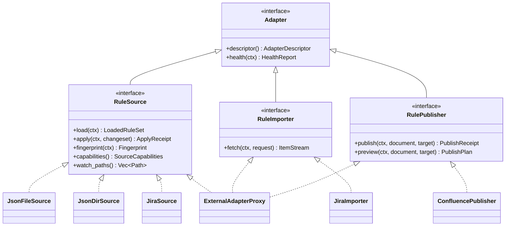
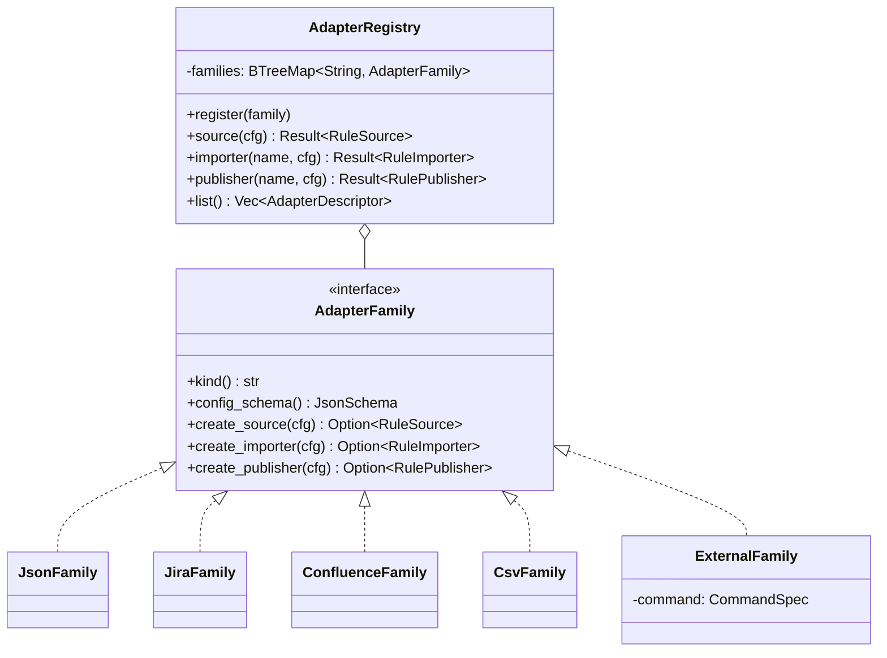
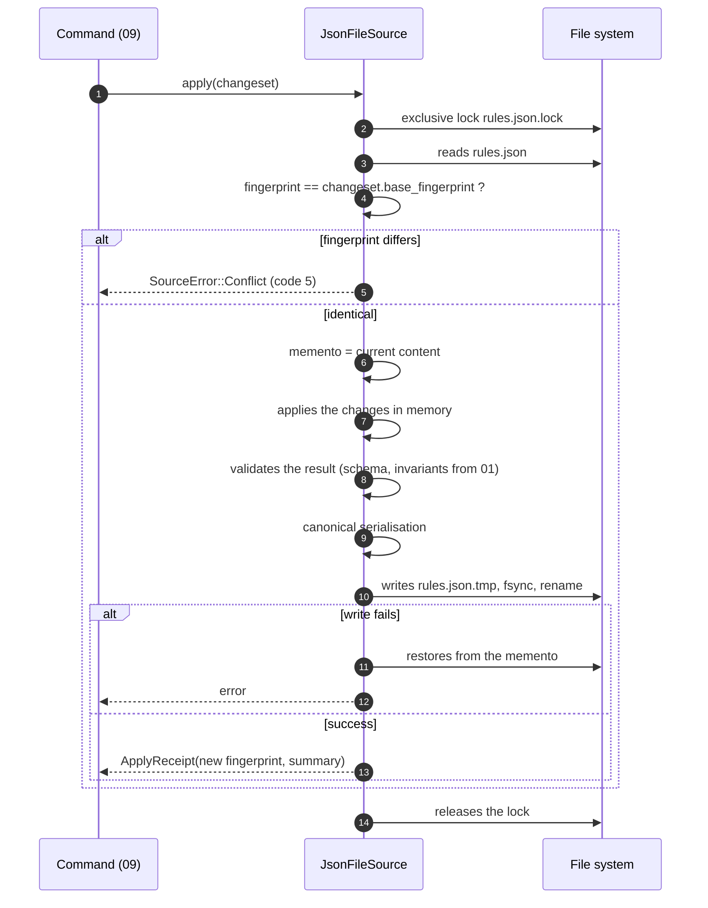
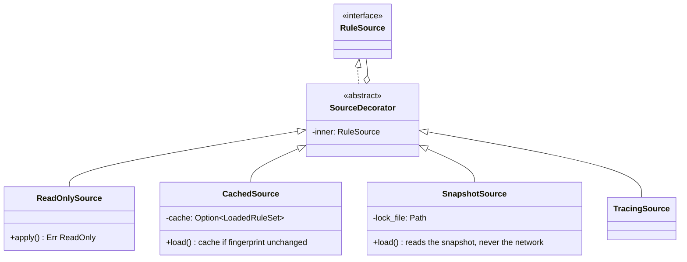
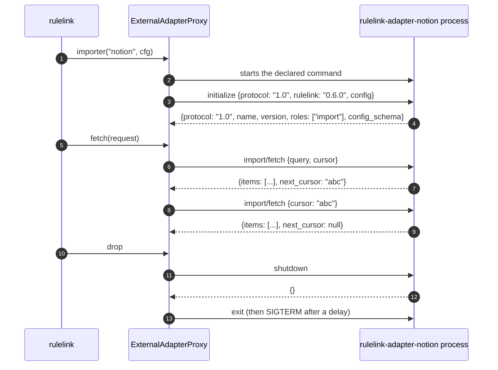
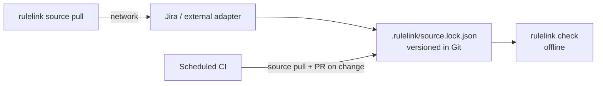
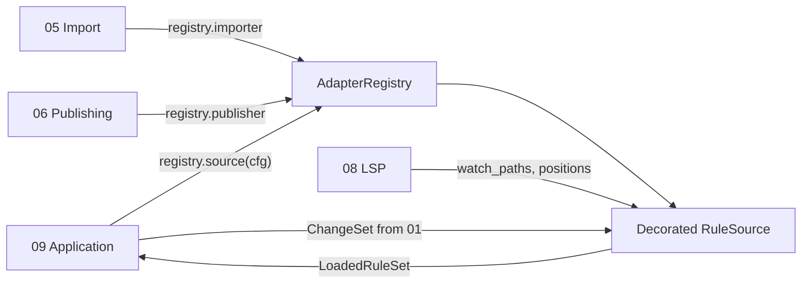

# 02 — Sources of truth and adapter contract

> This component connects business rules to persistence mechanisms, as the Adapter pattern did in the original design. It also publishes the **adapter contract**, which covers all three roles: source, import, publishing.
> Crates: `rulelink-adapter-sdk` (public contract), `adapters/json`, `adapters/external`, then `adapters/jira-source` in V2.
> See also: [01 Registry](01-rule-registry.md), [05 Import](05-import.md), [06 Publishing](06-publishing-export.md).

## 1. Role and scope

**Responsibilities**

- Load the rule set from **the** declared source, with the position of each rule in the file (for the LSP and diagnostics).
- Apply a `ChangeSet` atomically, with concurrent-modification detection.
- Define the three adapter roles (source, importer, publisher) and their common lifecycle.
- Host external adapters written in any language, through a JSON-RPC protocol over stdio.
- Provide a conformance kit that every adapter must pass.
- Migrate from one source to another (V1) and read a remote source offline through a snapshot (V2).

**Out of scope**

- Deciding status transitions: the source applies a `ChangeSet` already validated by the registry.
- Synchronising two sources: there is only one.

## 2. The three roles

The brief replaces "9 interfaces at the same level" with three roles. One tool can play several roles depending on the release.

| Tool | Source | Import | Publishing |
|---|:-:|:-:|:-:|
| Local JSON file | MVP | MVP (proposals file) | V1 (export) |
| JSON directory (one file per rule) | V1 | | |
| CSV | | V1 | V1 (export) |
| Jira Cloud / Data Center | V2 | V1 | |
| Confluence Cloud / Data Center | | | V1 |
| GitHub Issues, GitLab Issues | | V1 | |
| Markdown, HTML | | | V1 / V2 |
| SQL database | via external adapter | | |
| External adapter | V1 | V1 | V1 |

## 3. Release frame

| Feature | MVP | V1 | V2 |
|---|:-:|:-:|:-:|
| `RuleSource` port, single-file JSON source | ● | | |
| Canonical, line-oriented, atomic writes with lock and fingerprint | ● | | |
| Rule positions in the file | ● | | |
| Published `rulelink-adapter-sdk` contract (native traits) | ● | | |
| Adapter registry (Factory Method, Abstract Factory) | ● | | |
| JSON directory source | | ● | |
| External adapter protocol 1.0 + proxy | | ● | |
| Conformance kit, reference external adapter in Python | | ● | |
| `source migrate` (JSON → directory...) | | ● | |
| `CachedSource`, `ReadOnlySource` decorators | ● read-only | ● cache | |
| Remote sources: Jira | | | ● |
| Offline snapshot `.rulelink/source.lock.json` | | | ● |
| Several repositories sharing one source | | | ● |

## 4. Technical constraints

- `rulelink-adapter-sdk` depends only on `rulelink-model`, `serde`, `thiserror` and `async-trait` (or native `async fn` in traits, with boxed futures for `dyn`). Its public API is stable within a major version.
- **Canonical writes** for the JSON source: rules in natural order, keys in schema order, 2-space indentation, LF line endings, trailing newline. Formatting is **line-oriented**, so that two people editing different things touch different lines: every object property on its own line, every array element on its own line (never `["a", "b"]` on one line), every `sequences` and `retired` entry on its own line, no alignment padding, no trailing whitespace. Two writes of the same content produce the same bytes. A merge conflict then lands on the few lines that really differ and can be resolved by hand; `rulelink rules format` rewrites the file canonically afterwards, and `check` reports a file that is not canonical.
- **Atomicity**: write to a temporary file in the same directory, `fsync`, then rename. Advisory lock (`fd-lock`) held through the read → fingerprint comparison → write sequence.
- **Fingerprint**: SHA-256 of the content read. If the fingerprint changed since it was read, the write fails (code 5) and the command can be retried.
- **Positions**: the JSON loader keeps the range (line, column) of each rule and field. The LSP uses it for "go to definition", and schema diagnostics point to the right line.
- A remote adapter honours rate limits (`Retry-After` headers), with bounded exponential backoff and configurable timeouts.

## 5. Detailed design

### 5.1 Ports — **Adapter** pattern

Each role is a trait (the "target" of the Adapter pattern). Each tool provides an adapter that translates its API to that trait.



Signatures:

```rust
#[async_trait]
pub trait Adapter: Send + Sync {
    fn descriptor(&self) -> &AdapterDescriptor;
    async fn health(&self, ctx: &AdapterContext) -> HealthReport;
}

#[async_trait]
pub trait RuleSource: Adapter {
    fn capabilities(&self) -> SourceCapabilities;            // read, write, watch, remote
    async fn load(&self, ctx: &AdapterContext) -> Result<LoadedRuleSet, SourceError>;
    async fn fingerprint(&self, ctx: &AdapterContext) -> Result<Fingerprint, SourceError>;
    async fn apply(&self, ctx: &AdapterContext, cs: &ChangeSet) -> Result<ApplyReceipt, SourceError>;
    fn watch_paths(&self) -> Vec<PathBuf>;                   // empty for a remote source
}

pub struct LoadedRuleSet {
    pub set: RuleSet,
    pub fingerprint: Fingerprint,
    pub positions: SourcePositions,                          // RuleId -> range in the file
    pub origin: SourceLocator,                               // path or URL, for display
}

pub struct SourceCapabilities { pub write: bool, pub watch: bool, pub remote: bool, pub positions: bool }

pub enum SourceError {
    NotFound(SourceLocator),
    Parse { locator: SourceLocator, span: Option<Span>, message: String },
    UnsupportedFormat { found: u32, max: u32 },
    Conflict { expected: Fingerprint, actual: Fingerprint },
    ReadOnly,
    Remote(RemoteError),                                     // network, auth, quota
}
```

`AdapterContext` carries the adapter's configuration, secret access (`SecretStore`), a shared HTTP client, the cancellation token and the logger. An adapter never reads the environment directly, which keeps it testable and safe.

### 5.2 Creation from configuration — **Factory Method** and **Abstract Factory**

**Problem.** The configuration names a kind (`kind = "jira"`) and the application must obtain the right objects without knowing the concrete classes. Some tools form a consistent family: Jira provides an importer in V1, then a source in V2, sharing the same client and authentication settings.



- `AdapterFamily` is the **Abstract Factory**: each family creates consistent products (the Jira importer and source share `JiraClient`).
- `AdapterRegistry::source()`, `importer()` and `publisher()` are **Factory Methods** parameterised by `kind`.
- Native families are registered at compile time, each behind a Cargo feature (`adapter-jira`, `adapter-confluence`...). External families are registered from `[adapters.<name>]` in the configuration.
- `config_schema()` publishes the schema of the adapter's configuration section. `rulelink doctor` and `rulelink config` validate the configuration against it.

### 5.3 JSON source — **Adapter** + **Memento**



Here the **Memento** is the snapshot of the content before writing. For the directory source (`json-dir`), which writes several files, it holds the list of files touched and their original content; rollback restores each of them.

### 5.4 Source decorators — **Decorator** pattern



| Decorator | Used by | Effect | Release |
|---|---|---|---|
| `ReadOnlySource` | `check`, `explain`, `where`, `context` | Forbids any write | MVP |
| `TracingSource` | Always, at `-vv` | Durations and volumes in logs | MVP |
| `CachedSource` | LSP (long-running process) | Reloads only when the fingerprint changes | V1 |
| `SnapshotSource` | `check` with a remote source | Reads `.rulelink/source.lock.json`, guarantees offline operation (ADR-008) | V2 |

Typical composition for a `check` with Jira as the source (V2): `TracingSource(ReadOnlySource(SnapshotSource(JiraSource)))`.

### 5.5 External adapters — **Proxy** pattern

**Problem.** A connector contribution must stay small and must not require Rust (confirmed choice: native + external process).

**Solution.** `ExternalAdapterProxy` implements all three traits and relays each call to a child process, using JSON-RPC 2.0 over stdin/stdout (line-delimited messages, logs on stderr). To the application, an external adapter is indistinguishable from a native one: it is a **remote proxy** in the GoF sense.



**Protocol 1.0 methods**

| Method | Parameters | Result | Role |
|---|---|---|---|
| `initialize` | `protocol`, `rulelink_version`, `config`, `workspace_root`, `secrets` (only those declared) | `protocol`, `name`, `version`, `roles`, `config_schema?` | All |
| `health` | — | `{ status: ok\|degraded\|error, details }` | All |
| `source/load` | — | `{ ruleset, fingerprint, positions? }` | Source |
| `source/fingerprint` | — | `{ fingerprint }` | Source |
| `source/apply` | `{ changeset }` | `{ fingerprint, summary }` or a `conflict` error | Source |
| `import/fetch` | `{ query, cursor? }` | `{ items: [RawItem], next_cursor? }` | Import |
| `publish/preview` | `{ document, target }` | `{ plan }` | Publishing |
| `publish/run` | `{ document, target, expected_version? }` | `{ receipt }` | Publishing |
| `shutdown` | — | `{}` | All |
| `$/log` (notification) | `{ level, message }` | — | All |
| `$/progress` (notification) | `{ done, total? }` | — | All |

Specific JSON-RPC error codes: `-32001` conflict, `-32002` authentication, `-32003` quota, `-32004` target not found, `-32005` unsupported format.

Safeguards:

- Explicit declaration is mandatory; there is never any implicit discovery:
  ```toml
  [adapters.notion]
  command = ["python3", "-m", "rulelink_notion"]
  roles = ["import"]
  secrets = ["NOTION_TOKEN"]
  timeout = "60s"
  ```
- Only the listed secrets are passed on. The process is killed when the timeout expires.
- Messages are validated against the protocol's JSON Schema before they reach the domain.
- The SDK provides minimal helper libraries in Python and TypeScript (V1), plus a template repository.

### 5.6 Conformance kit — **Template Method** pattern

`rulelink-adapter-sdk::conformance` provides a test suite with a fixed skeleton. The adapter supplies only the hooks (factory, seed data, cleanup). The same suite runs against a native or an external adapter: `rulelink adapters check <name>`.

| Scenario | Source | Import | Publishing |
|---|:-:|:-:|:-:|
| `initialize` and `health` respond | ● | ● | ● |
| Round trip `load` → `apply(empty)` → `load` is identical | ● | | |
| `apply` with a stale fingerprint → conflict | ● | | |
| `extensions` fields preserved | ● | | |
| Pagination until exhaustion, with no duplicates | | ● | |
| `preview` has no side effects, `run` is idempotent | | | ● |
| Timeout and cancellation honoured | ● | ● | ● |

### 5.7 Source migration (V1)

`rulelink source migrate --to json-dir --path rules/` reads the current source, writes the target, checks that both `RuleSet`s are equal, then updates `rulelink.toml`. The command is a **Command** composed of reversible sub-commands: on failure, the target write is undone and the configuration is left untouched.

### 5.8 Remote source and snapshot (V2)



- `source pull` writes the canonical snapshot and its fingerprint. The snapshot is versioned, so a `check` is reproducible for a given commit.
- `check --fresh` forces a `pull` before the check, for teams that accept the network call.
- Several repositories can share the same remote source. Each repository has its own snapshot (V2).

## 6. API and entry points

### 6.1 CLI commands

| Command | Options | Effect | Release |
|---|---|---|---|
| `rulelink source info` | `--format` | Kind, location, fingerprint, capabilities, rule counts by status | MVP |
| `rulelink source pull` | `--check` (fails if the snapshot is stale) | Refreshes the snapshot of a remote source | V2 |
| `rulelink source migrate` | `--to <KIND>`, target options, `--dry-run` | Changes the source of truth | V1 |
| `rulelink adapters list` | `--format` | Native and external adapters, roles, versions | V1 |
| `rulelink adapters check <NAME>` | `--role`, `--format` | Conformance kit | V1 |
| `rulelink adapters new <NAME>` | `--lang python\|typescript\|rust` | Generates an adapter skeleton | V1 |

### 6.2 `rulelink-adapter-sdk` crate API

| Element | Kind |
|---|---|
| `Adapter`, `RuleSource`, `RuleImporter`, `RulePublisher` | Role traits |
| `AdapterFamily`, `AdapterDescriptor` | Factory and metadata |
| `AdapterContext`, `SecretStore`, `HttpClient`, `CancellationToken` | Injected services |
| `LoadedRuleSet`, `SourcePositions`, `Fingerprint`, `ApplyReceipt` | Source types |
| `RawItem`, `ImportRequest`, `ItemStream` | Import types (see 05) |
| `PublicationDocument`, `PublishTarget`, `PublishPlan`, `PublishReceipt` | Publishing types (see 06) |
| `protocol::*` | JSON-RPC messages and schemas of the external protocol |
| `conformance::*` | Conformance kit |

## 7. Interactions



## 8. Tests and acceptance criteria

- Writing the same `RuleSet` 1,000 times produces identical bytes.
- Simulated interruption during a write: the original file stays intact.
- Two processes writing in parallel: only one succeeds, the other gets exit code 5.
- The reference external adapter passes the conformance kit in CI on Linux, macOS and Windows.

## 9. Open points

No open points remain.

- **External protocol transport**: stdio only in 1.0. An HTTP transport could serve hosted adapters, but nothing requires it yet; revisit if a hosted adapter is requested.
- **Database as a source**: Rulelink ships no SQL adapter. A database with a mapping layer is an API, and the external adapter protocol already covers it. A team wraps its database in an external adapter that does the mapping and the writes. If demand appears, a template adapter project containing only the mapping code can be provided (a variant of the reference Python adapter).
