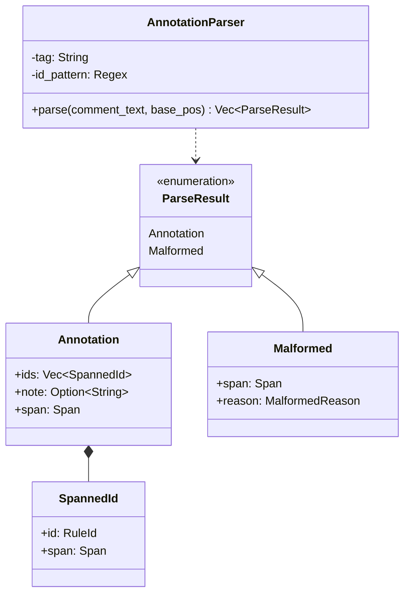
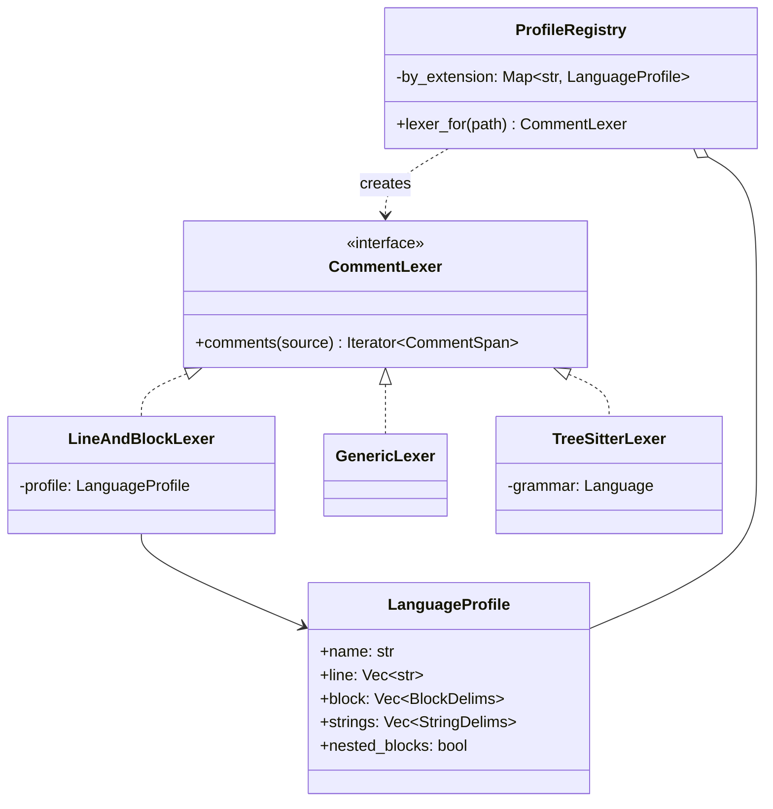
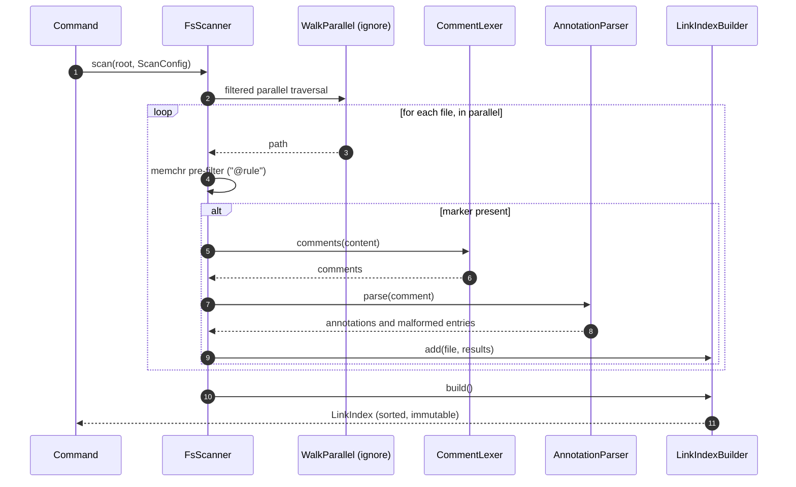
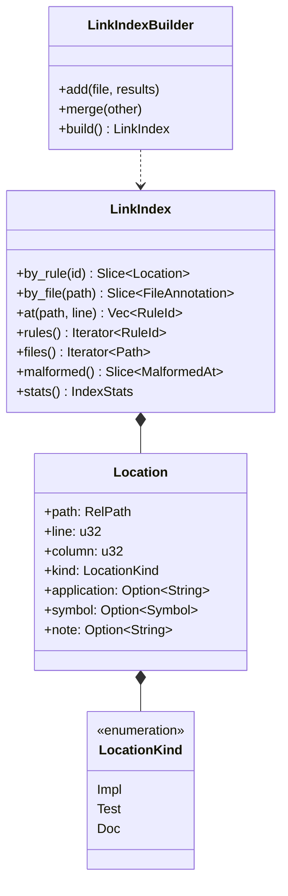
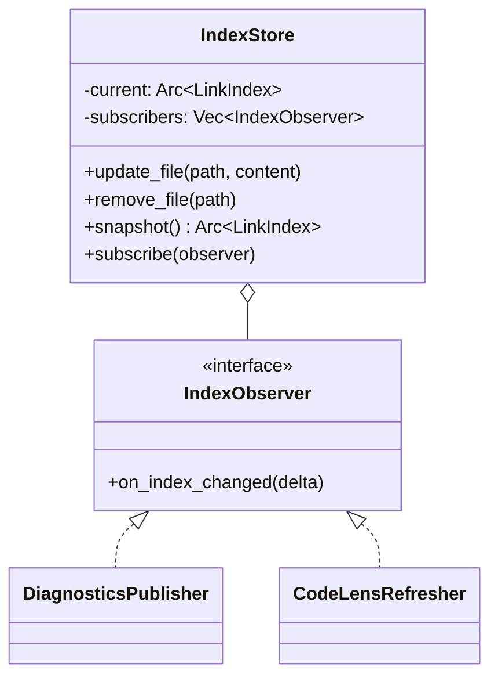
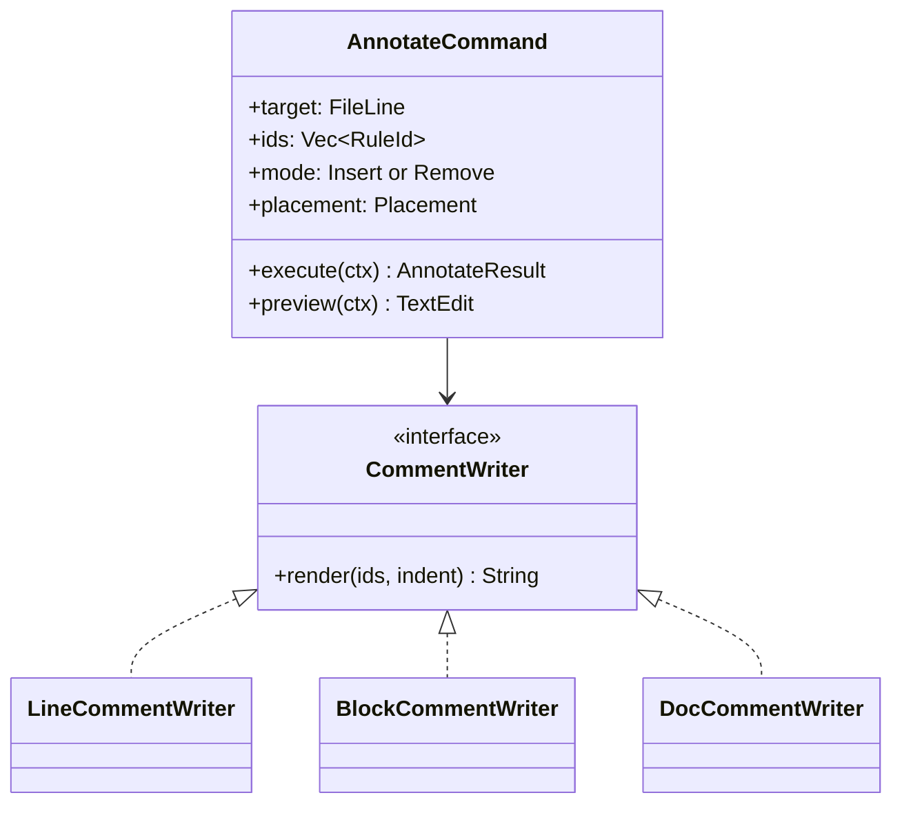
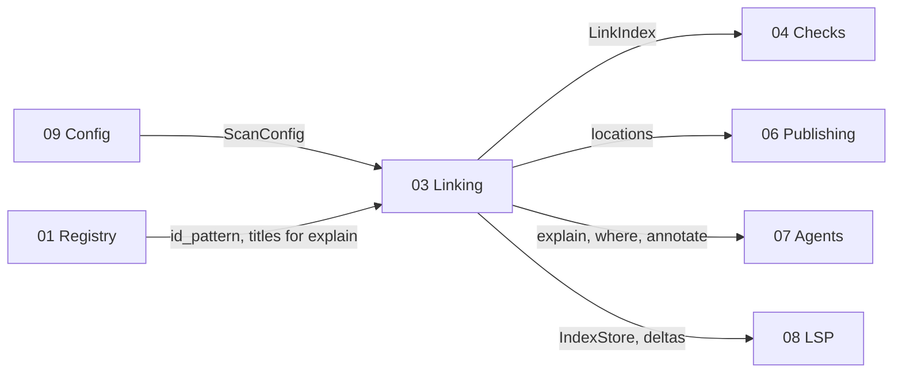

# 03 — Rule ↔ code linking

> The heart of the promise: every rule stays attached to its code. This component finds `@rule` annotations in the code, builds the two-way index, and answers "which rules are in this file?" and "where is this rule?".
> Crates: `checkmate-link` (domain: grammar, index, queries), `adapters/scan-fs` (file system traversal).
> See also: [01 Registry](01-rule-registry.md), [04 Checks](04-checks.md), [08 IDE](08-ide-integration.md).

## 1. Role and scope

**Responsibilities**

- Define and parse the annotation grammar (`// @rule RG-042`), in any language.
- Traverse the repository in parallel, honouring `.gitignore` and the configuration.
- Build a `LinkIndex`: rule → locations, file → rules, with the location kind (implementation or test).
- Answer `explain <file>[:line]` and `where <ID>`.
- Insert or remove an annotation with the right comment syntax (`annotate`).
- Update the index incrementally for the LSP server.

**Out of scope**

- Deciding whether an annotation is valid against the registry: that is the job of the checks (04).
- Verifying that the code honours the rule: the MVP proves the link, not the correctness.

## 2. Release frame

| Feature | MVP | V1 | V2 |
|---|:-:|:-:|:-:|
| `@rule` grammar with several IDs per line | ● | | |
| Lexical scan restricted to comments, 30 common languages | ● | | |
| Generic fallback for unknown extensions | ● | | |
| Implementation or test classification by path pattern | ● | | |
| `explain`, `where`, `scan` | ● | | |
| `annotate` (insertion and removal) | ● | | |
| On-disk index cache (`.checkmate/cache`) | | ● | |
| Incremental index for the LSP server | | ● | |
| Application mapping by path (monorepo) | | ● | |
| Labels shown on the implementation (`explain` output, LSP hover) | | ● | |
| Enclosing symbol (function, class) via tree-sitter | | | ● |
| Code permalinks (GitHub, GitLab) in outputs | | ● | |

## 3. Technical constraints

- Traversal via the `ignore` crate (`WalkParallel`): honours `.gitignore`, `.ignore`, `.checkmateignore`, and the `scan.include` / `scan.exclude` patterns.
- Reading with `grep-searcher` or `memchr`: look for the marker (`@rule`) as bytes first, and parse only candidate lines. Binary files and files above `scan.max_file_size` (default: 2 MB) are skipped.
- Encoding: UTF-8 expected; UTF-16 detected by BOM and converted; any other encoding skipped with a warning at `-v`.
- Index paths are relative to the root, with `/` as separator, including on Windows. Lines and columns start at 1.
- Results sorted by path, then line, then column. No dependency on the order of the parallel traversal.

## 4. Annotation grammar

### 4.1 Form

```
annotation := TAG WS id_list ( WS "--" WS note )?
id_list    := ID ( ( "," WS? | WS ) ID )*
TAG        := value of scan.tag, default "@rule"
ID         := matches rules.id_pattern, default "RG-[A-Z0-9_]+"
note       := rest of the line, free text ignored by check
```

Valid examples, all inside a comment:

```rust
// @rule RG-042
// @rule RG-042, RG-043
// @rule RG-042 -- rounding applied before the sum
```
```python
# @rule RG-017
```
```sql
-- @rule RG-101
```
```html
<!-- @rule RG-205 -->
```
```java
/**
 * @rule RG-042
 */
```

- Several annotations per file, and one rule in several places, tests included, as the brief requires.
- An annotation applies to its file and line. In V2, it is also attached to the symbol that follows (function, method, class).
- An `@rule` without a valid identifier produces a `CM006` malformed annotation finding (04).

### 4.2 **Interpreter** pattern

The grammar is small but public. It is therefore modelled as a testable interpreter rather than an opaque regex.



Each identifier keeps its own range (`Span`): the LSP underlines exactly the unknown identifier, and `annotate --remove` removes a single identifier from a list.

## 5. Detailed design

### 5.1 Comment syntax per language — **Strategy** + **Flyweight** + **Factory Method**

**Problem.** Comments must be recognised in dozens of languages, without false positives inside string literals, and without a per-file memory cost.



- **Strategy**: `CommentLexer` has three implementations. `LineAndBlockLexer` (MVP) reads a declarative profile. `GenericLexer` (MVP) is the fallback: it accepts `@rule` after any common comment prefix (`//`, `#`, `--`, `;`, `*`, `<!--`, `%`, `'`). `TreeSitterLexer` (V2) relies on the syntax tree.
- **Flyweight**: `LanguageProfile`s are shared static data (about 30 profiles for tens of thousands of files). Per-file state (position, string-in-progress state) stays in the lexer, created on the fly.
- **Factory Method**: `ProfileRegistry::lexer_for(path)` picks the strategy by extension, then by file name (`Dockerfile`, `Makefile`), then by shebang. Teams can add mappings in the configuration:

```toml
[scan.languages]
"*.tpl" = "html"
"*.pks" = "sql"
```

MVP profiles: Rust, C, C++, C#, Java, Kotlin, Scala, Go, JavaScript, TypeScript, Swift, Dart, PHP, Python, Ruby, Shell, PowerShell, SQL, PL/SQL, HTML, XML, Vue, Svelte, CSS/SCSS, YAML, TOML, Markdown (HTML comments), Terraform, Lua, Elixir, Haskell, COBOL (column 7 onwards, for legacy code).

### 5.2 Traversal and index construction — **Iterator** + **Builder**



- `FsScanner::scan` returns a lazy **Iterator** of `FileAnnotations`: the CLI can stop early (`where --first`), and the LSP server can process file by file.
- `LinkIndexBuilder` (**Builder**) accumulates from several threads, then produces an immutable, sorted index. Immutability lets LSP requests share the index without locking (`Arc<LinkIndex>`).



`LocationKind` comes from configurable path patterns:

```toml
[scan.kinds]
test = ["**/tests/**", "**/*_test.*", "**/*.spec.*", "**/*Test.java", "**/test_*.py"]
doc  = ["**/*.md", "docs/**"]
```

### 5.3 Incremental index (V1) — **Observer** pattern

The LSP server receives change notifications. The index is partitioned by file: replacing one file costs parsing that single file.



`IndexDelta` lists the files touched and the rules whose set of locations changed. The LSP server (08) recomputes diagnostics only for those rules (for example, a rule that becomes "without code").

The on-disk cache (V1) stores, per file, its fingerprint (size, modification time, fast hash) and its annotations. It is keyed by the grammar version and the scan configuration; any difference invalidates it.

### 5.4 Annotation insertion — **Command** + **Strategy**

`annotate` is used by the skills and by the LSP code action. The goal is that agents never invent the syntax.



Placement rules:

1. If the target line, or the line just above it, already carries an annotation, the identifier is appended to it (`@rule RG-042, RG-043`) rather than creating a new line.
2. Otherwise, a line is inserted above the target line, with the same indentation.
3. If a documentation block precedes the declaration (`/** ... */`, Python docstring), the annotation goes into that block (`DocCommentWriter`).
4. The file is rewritten only if the text changes. Original line endings (LF or CRLF) are preserved.

`preview` returns a `TextEdit` in LSP format: the same command serves the CLI (`--dry-run` prints the diff) and the IDE code action.

### 5.5 Enclosing symbol (V2) — **Adapter** over tree-sitter

`SymbolResolver` is a port. Its tree-sitter adapter loads the grammars of the main languages and returns the symbol that follows the annotation (qualified name, range). Without an available grammar, the resolver returns `None` and the file + line behaviour applies. This enables `explain src/vat.rs#compute_line_vat` and CodeLens placed on the function.

## 6. API and entry points

### 6.1 `checkmate-link` crate

```rust
pub struct ScanConfig { pub root: PathBuf, pub tag: String, pub id_pattern: Regex,
                        pub include: GlobSet, pub exclude: GlobSet, pub kinds: KindMatcher,
                        pub max_file_size: u64, pub languages: LanguageOverrides,
                        pub applications: ApplicationMatcher }

pub trait CodeScanner: Send + Sync {                    // port, implemented by scan-fs
    fn scan(&self, cfg: &ScanConfig) -> Box<dyn Iterator<Item = FileAnnotations> + Send + '_>;
    fn scan_paths(&self, cfg: &ScanConfig, paths: &[RelPath]) -> Box<dyn Iterator<Item = FileAnnotations> + Send + '_>;
}

pub fn parse_annotations(text: &str, path: &RelPath, cfg: &ScanConfig) -> FileAnnotations;
pub fn build_index(it: impl Iterator<Item = FileAnnotations>) -> LinkIndex;
pub fn plan_annotation(file_text: &str, path: &RelPath, line: u32, ids: &[RuleId], mode: AnnotateMode)
    -> Result<TextEdit, AnnotateError>;
```

### 6.2 CLI commands

| Command | Arguments and options | Output | Release |
|---|---|---|---|
| `checkmate explain <PATH>[:LINE]` | `--format human\|json\|markdown`, `--status <S>`, `--with-statement` | Rules cited in the file (or at the line), with title, status, labels, statement on request | MVP |
| `checkmate where <ID>...` | `--kind impl\|test\|doc`, `--format human\|json\|vimgrep`, `--first`, `--permalink` | `path:line:column` locations | MVP |
| `checkmate scan` | `--paths <P>...`, `--format json\|ndjson`, `--stats` | Raw index, for debugging and tooling | MVP |
| `checkmate annotate <PATH>:<LINE> <ID>...` | `--remove`, `--dry-run`, `--placement above\|inline\|doc` | Inserts or removes, prints the diff | MVP |

Example `checkmate explain src/billing/vat.rs`:

```
src/billing/vat.rs — 2 rules

  RG-042  validated  Line-level VAT rounding                          l.88
          Billing › VAT calculation · #vat #rounding
  RG-051  proposed   Reduced rate for essential goods                 l.131
          ⚠ rule still proposed (CM005)
```

Example `checkmate where RG-042 --format json`:

```json
{
  "schema": "checkmate/where/v1",
  "results": [
    {
      "id": "RG-042",
      "known": true,
      "status": "validated",
      "locations": [
        { "path": "src/billing/vat.rs", "line": 88, "column": 4, "kind": "impl" },
        { "path": "tests/billing/vat_test.rs", "line": 12, "column": 4, "kind": "test" }
      ]
    }
  ]
}
```

The `vimgrep` format (`path:line:column:text`) opens results in Vim, Emacs or the VS Code quick list.

## 7. Interactions



## 8. Tests and acceptance criteria

- Per-language file corpus: annotations in comments are found, `@rule` inside string literals is ignored.
- Property tests: `annotate` followed by `annotate --remove` restores the file byte for byte.
- Performance: a synthetic repository of 50,000 files and 5,000 annotations scanned in under 3 s cold.
- Identical output on Linux, macOS and Windows (paths, ordering, line endings).

## 9. Open points

- Should annotations outside comments be accepted, for example attributes (`#[rule("RG-042")]` in Rust, `@Rule("RG-042")` in Java)? They survive refactoring better, but require a dependency in production code. Proposal: plan them for V2 as an optional profile.
- Range annotations (`@rule-begin` / `@rule-end`): useful for legacy code, but they make the grammar heavier. Add them only if the retro-documentation test calls for them.
