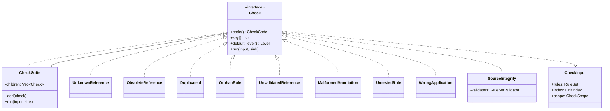
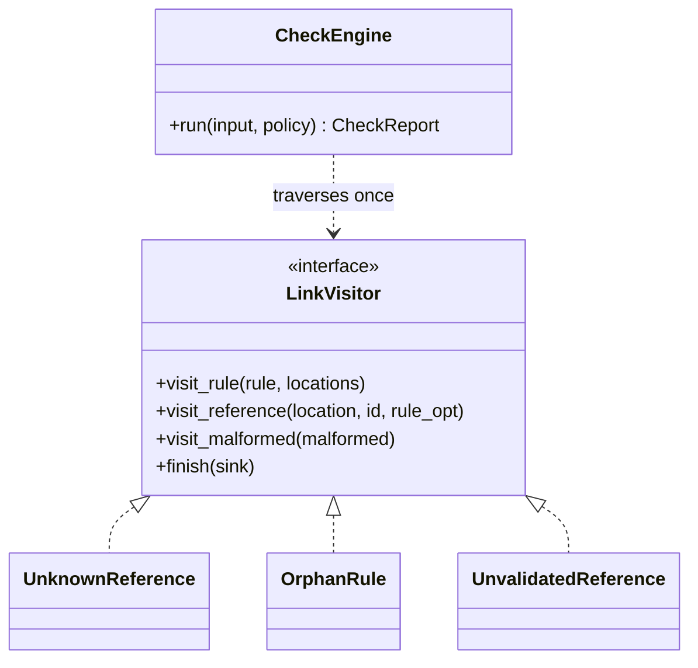
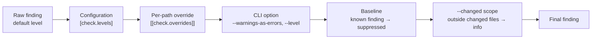
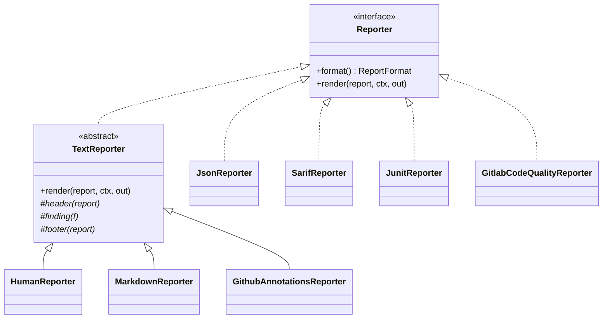
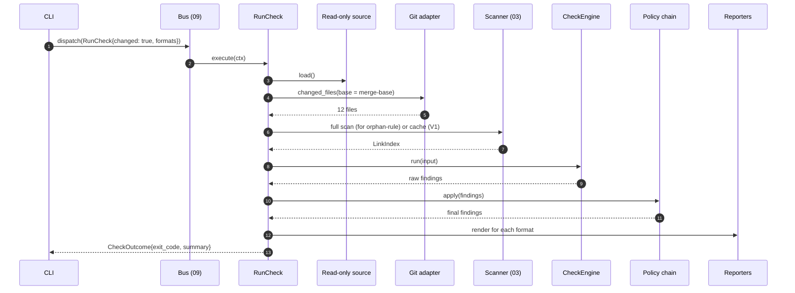
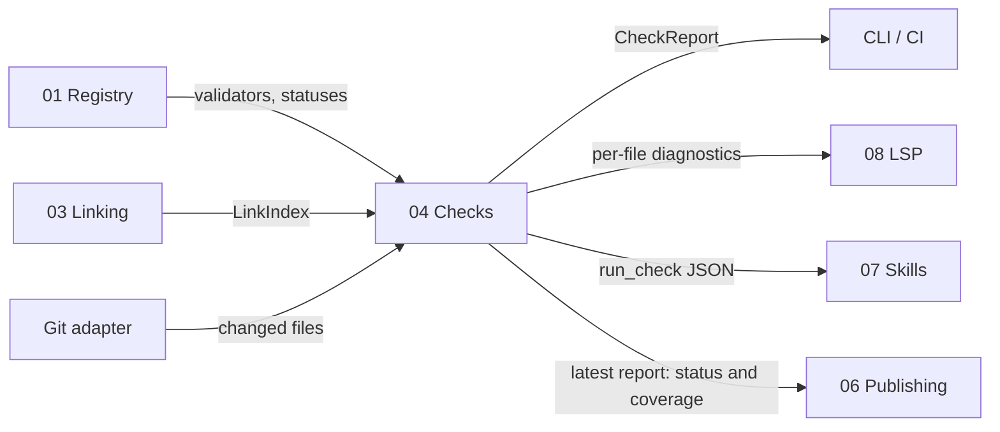

# 04 — Deterministic checks (`check`) and CI integration

> The check is what keeps Checkmate from becoming "yet more documentation". It cross-references the registry and the code index, offline and without AI, and produces findings that a human, a CI pipeline or an agent can read.
> Crates: `checkmate-check` (engine, checks, reports), `adapters/git` (changed files, via `gix`). Deliverables: GitHub Action, GitLab CI component, pre-commit hook.
> See also: [01 Registry](01-rule-registry.md), [03 Code linking](03-code-linking.md).

## 1. Role and scope

**Responsibilities**

- Run the brief's checks and the source integrity checks.
- Apply the team's severity policy (warning or error, disabled).
- Restrict the check to a PR's changes (V1) and hide existing findings with a baseline (V1).
- Render the report in the formats expected by CI systems and agents.
- Compute coverage indicators (share of validated rules linked to code), which feed the brief's success criteria.

**Out of scope, and the stated promise**

> `checkmate check` proves that **a link exists** between a rule and the code, **not that the implementation is correct**.

This sentence appears in the command help, in the CI summary and in the documentation. AI-assisted correctness checking (V2) is a separate skill and is never part of `check` (07).

## 2. Release frame

| Feature | MVP | V1 | V2 |
|---|:-:|:-:|:-:|
| The brief's 5 checks + source integrity | ● | | |
| Configurable severity policy | ● | | |
| `human`, `json`, `sarif`, `github` reports | ● | | |
| GitHub Action (annotations, SARIF, summary) | ● | | |
| GitLab CI component (codequality report) | ● | | |
| `checkmate status`: coverage and counters | ● | | |
| `junit`, `gitlab`, `markdown` (PR comment) reports | | ● | |
| `check --changed` (files changed since the PR base) | | ● | |
| Baseline for adoption on legacy code | | ● | |
| Pre-commit hook (pre-commit and lefthook frameworks) | | ● | |
| Additional checks: untested rule, rule outside its application, malformed annotation | | ● | |
| Symbol-level checks (rule moved out of its function) | | | ● |

## 3. Technical constraints

- **No network call** during `check`. A remote source goes through the snapshot (02, ADR-008).
- **Determinism**: findings sorted by (descending severity, code, rule identifier, path, line). No timestamp in the report, except with `--format json --with-timing`.
- The exit code depends only on error-level findings after the policy and baseline are applied.
- The engine is synchronous and stateless: `run(&RuleSet, &LinkIndex, &CheckPolicy) -> CheckReport`. The same code runs in the CLI and the LSP server.
- `--changed` uses `gix` (pure-Rust Git) to list files changed between `HEAD` and the merge base. No `git` binary is required.

## 4. Check catalogue

| Code | Name (config key) | Detected case | Default level | Release |
|---|---|---|---|---|
| `CM001` | `unknown-reference` | The code cites an identifier missing from the source | Error | MVP |
| `CM002` | `obsolete-reference` | The code still cites an `obsolete` rule (the message suggests `superseded_by` when present) | Error | MVP |
| `CM003` | `duplicate-id` | Two rules share the same identifier | Error | MVP |
| `CM004` | `orphan-rule` | A `validated` rule is cited nowhere | Warning | MVP |
| `CM005` | `unvalidated-reference` | The code cites a rule that is still `proposed` | Warning | MVP |
| `CM006` | `malformed-annotation` | `@rule` without a valid identifier | Warning | V1 |
| `CM007` | `untested-rule` | `validated` rule cited in the implementation but in no test | Off | V1 |
| `CM008` | `wrong-application` | Rule cited in a path mapped to another application | Off | V1 |
| `CM009` | `retired-reference` | The code cites a retired identifier | Error | MVP |
| `CM100`–`CM105` | source integrity | See 01, section 5.3 | As in 01 | MVP / V1 |

`CM007` reflects a sentence from the brief: "a test remains the best check of a rule". Checkmate does not replace tests; it can flag rules that no test cites.

## 5. Detailed design

### 5.1 Checks — **Strategy** inside a **Composite**



- Each check is an independent **Strategy**, testable on its own.
- `CheckSuite` is a **Composite**: the default suite holds two groups, "source" and "links". A client (the LSP server) can run only the "links" group on a single file.
- `SourceIntegrity` is an **Adapter** from the validator composite in 01 to the `Check` interface.
- An additional check (from the community or in V2) is added by implementing `Check`, without touching the engine.

### 5.2 Index traversal — **Visitor**

Several checks walk the same structures. To walk the index only once, the engine drives a visitor and each check reacts to the elements it cares about.



Purely source-level checks (`DuplicateId`) visit nothing and work in `finish`.

### 5.3 Severity policy — **Chain of Responsibility**

The final level of a finding goes through a chain of links. Each link may change it or pass it on.



```toml
[check.levels]
orphan-rule = "error"          # the team tightens
untested-rule = "warning"      # the team enables
unvalidated-reference = "off"

[[check.overrides]]
paths = ["legacy/**"]
levels = { orphan-rule = "off" }
```

Levels: `error`, `warning`, `info`, `off`.

### 5.4 Baseline (V1) — **Memento** pattern

`checkmate baseline create` records the current findings in `.checkmate/baseline.json` (versioned). Each finding is identified by a stable fingerprint (code, rule identifier, path, normalised line text) rather than a line number, so it survives line shifts. The baseline is a **Memento** of the findings' state: the engine does not know its internal format, it only asks whether a finding is in it.

| Command | Effect |
|---|---|
| `checkmate baseline create` | Writes the baseline from the current findings |
| `checkmate baseline update` | Removes resolved findings, never adds any |
| `checkmate baseline show` | Lists suppressed findings, by code |

### 5.5 Reports — **Strategy** + **Template Method**



- **Strategy**: the format is chosen with `--format`. Several formats can be produced in one run: `--format sarif=checkmate.sarif,github,markdown=summary.md`.
- **Template Method**: text formats share the header → grouped findings → footer skeleton. The footer always restates the promise ("link verified, not correctness").

| Format | Use | Release |
|---|---|---|
| `human` | Terminal, with colours and `miette` excerpts | MVP |
| `json` | Agents, scripts. Schema `checkmate/check-report/v1` | MVP |
| `sarif` | GitHub Code Scanning, SAST tools | MVP |
| `github` | `::error file=...` commands: inline annotations on the PR | MVP |
| `junit` | GitLab, Jenkins, Azure test reports | V1 |
| `gitlab` | GitLab Code Quality report | V1 |
| `markdown` | Job summary, PR comment | V1 |

### 5.6 Command — full run



With `--changed`, the scan stays complete, because a rule can become orphaned through a deletion in another file. What is reduced is the scope of findings reported as errors. The index cache (03, V1) keeps that scan under a second.

## 6. API and entry points

### 6.1 `checkmate-check` crate

```rust
pub struct CheckInput<'a> { pub rules: &'a RuleSet, pub index: &'a LinkIndex, pub scope: CheckScope }
pub enum CheckScope { All, Paths(BTreeSet<RelPath>), Rules(BTreeSet<RuleId>) }

pub struct CheckPolicy { pub levels: BTreeMap<CheckKey, Level>, pub overrides: Vec<PathOverride>,
                         pub baseline: Option<Baseline>, pub warnings_as_errors: bool }

pub fn default_suite() -> CheckSuite;
pub fn run(suite: &CheckSuite, input: &CheckInput, policy: &CheckPolicy) -> CheckReport;

pub struct CheckReport { pub findings: Vec<Finding>, pub stats: CoverageStats, pub promise: &'static str }
pub struct Finding { pub code: CheckCode, pub key: CheckKey, pub level: Level, pub rule: Option<RuleId>,
                     pub location: Option<Location>, pub message: String, pub help: Option<String>,
                     pub fingerprint: FindingFingerprint }
pub struct CoverageStats { pub rules_by_status: BTreeMap<RuleStatus, usize>,
                           pub validated_linked: usize, pub validated_tested: usize,
                           pub references: usize, pub files_with_references: usize }
```

### 6.2 CLI commands

| Command | Options | Effect | Release |
|---|---|---|---|
| `checkmate check` | `--format <F[=FILE]>...`, `--changed`, `--base <REF>`, `--paths <P>...`, `--rules <ID>...`, `--level <KEY>=<LEVEL>`, `--warnings-as-errors`, `--no-baseline`, `--fresh` (V2) | Runs the checks; exit code 0 or 1 | MVP (`--changed`, `--base` in V1) |
| `checkmate status` | `--format human\|json\|markdown` | Counters by status, coverage of validated rules by code and by tests | MVP |
| `checkmate baseline create\|update\|show` | `--format` | Baseline management | V1 |

Example `human` output:

```
error[CM001] unknown reference: RG-099
  ┌─ src/billing/discount.rs:42:12
42 │     // @rule RG-099
   │              ^^^^^^ not found in rules/rules.json
   = help: similar rules: RG-090, RG-009

warning[CM004] validated rule with no code: RG-017 "Cumulative discount cap"

2 findings (1 error, 1 warning) · 118 validated rules, 94 linked to code (80%)
Checkmate verifies the link between a rule and the code, not the correctness of the implementation.
```

### 6.3 GitHub Action (MVP)

```yaml
- uses: checkmate-dev/check-action@v1
  with:
    version: "0.4"            # CLI version, default: latest compatible
    args: "--changed"
    sarif: true               # uploads the SARIF to Code Scanning
    summary: true             # writes the job's Markdown summary
```

Internal steps: download the binary (cached per version), run `checkmate check --format github,sarif=checkmate.sarif,markdown=$GITHUB_STEP_SUMMARY`, upload the SARIF if `security-events: write` is granted, propagate the exit code.

### 6.4 GitLab CI component (MVP)

```yaml
include:
  - component: gitlab.com/checkmate-dev/ci/check@1
    inputs:
      args: "--changed"
```

The job produces `gl-code-quality-report.json` (`codequality` report) and `checkmate-junit.xml` (`junit` report, V1), both visible in the merge request.

### 6.5 Pre-commit hook (V1)

`.pre-commit-hooks.yaml` declaration in the tool's repository: `id: checkmate-check`, `entry: checkmate check --changed --base HEAD --format human`, `pass_filenames: false`. Same entry for lefthook.

## 7. Interactions



## 8. Tests and acceptance criteria

- One test repository per check, with the expected output snapshotted (`insta`) in every format.
- The generated SARIF is validated against the SARIF 2.1.0 schema.
- Same repository, two runs: byte-identical reports.
- Brief criterion, measured by `checkmate status`: at least 80% of validated rules linked to code on the recent build after 4 weeks.

## 9. Open points

- Should there be a "block only on new findings" mode without a baseline, by comparing with the base branch? It is easier to adopt, but requires two scans. Proposal: V2, if the baseline proves insufficient.
