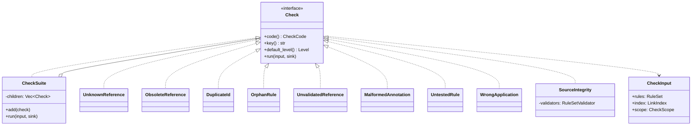
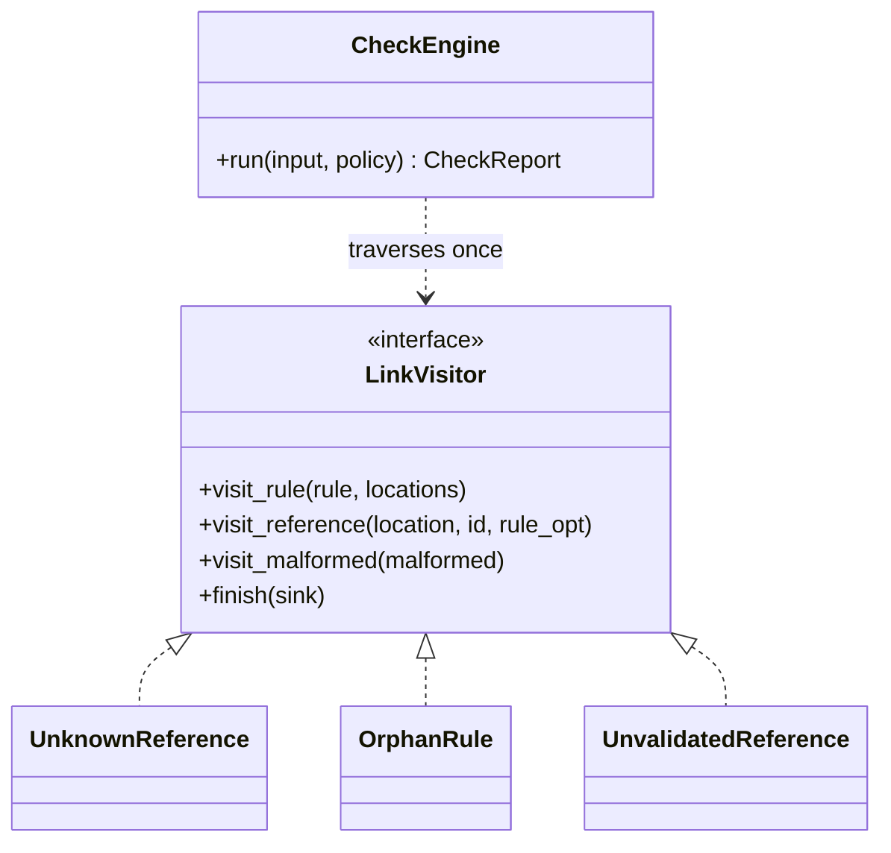
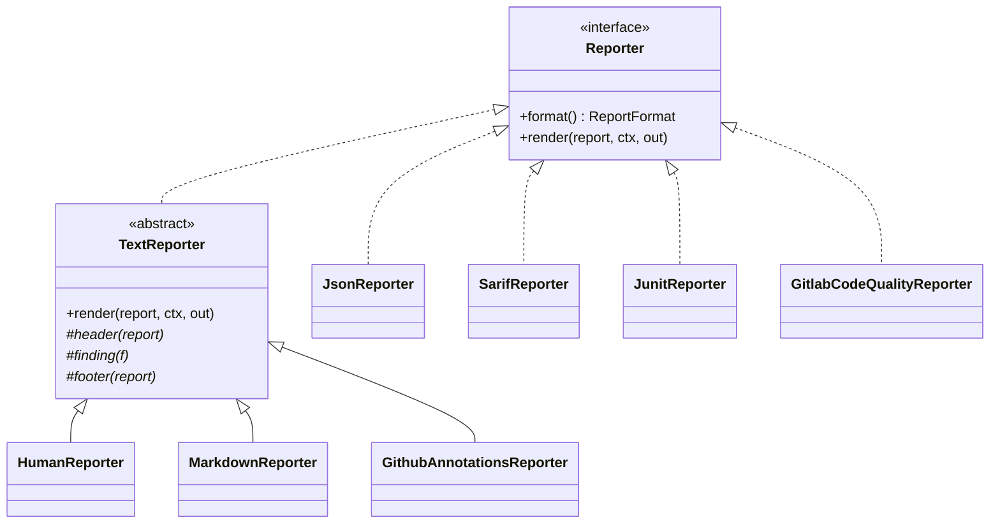
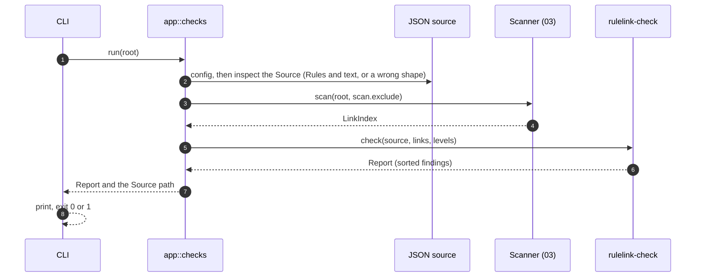
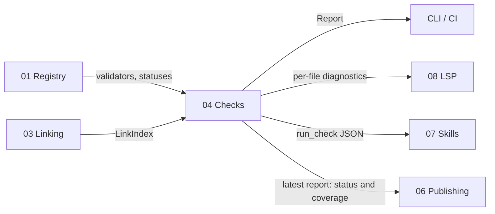

# 04 — Deterministic checks (`check`) and CI integration

> The check is what keeps Rulelink from becoming "yet more documentation". It cross-references the registry and the code index, offline and without AI, and produces findings that a human, a CI pipeline or an agent can read.
> Crates: `rulelink-check` (Findings and levels). `adapters/git` is not used by the MVP. Deliverables: pre-commit hook (V1), GitHub Action and GitLab CI component (V2).
> See also: [01 Registry](01-rule-registry.md), [03 Code linking](03-code-linking.md).

## 1. Role and scope

**Responsibilities**

- Run the brief's checks and the source integrity checks.
- Apply the team's severity policy (warning or error, disabled).
- Hide existing findings with a baseline (V1).
- Render the report in the formats expected by CI systems and agents.
- Compute coverage indicators (share of validated rules linked to code), which feed the brief's success criteria.

**Out of scope, and the stated promise**

> `rulelink check` proves that **a link exists** between a rule and the code, **not that the implementation is correct**.

This sentence appears in the command help, at the end of every text report and in the documentation. AI-assisted correctness checking (V2) is a separate skill and is never part of `check` (07).

## 2. Release frame

| Feature                                                                                     | MVP | V1  | V2  |
| ------------------------------------------------------------------------------------------- | :-: | :-: | :-: |
| The brief's 5 checks + source integrity                                                     |  ●  |     |     |
| Configurable severity policy                                                                |  ●  |     |     |
| `human`, `json` reports                                                                     |  ●  |     |     |
| `sarif`, `github` reports                                                                   |     |     |  ●  |
| GitHub Action (annotations, SARIF, summary)                                                 |     |     |  ●  |
| GitLab CI component (codequality report)                                                    |     |     |  ●  |
| `rulelink status`: coverage and counters                                                    |     |  ●  |     |
| `junit`, `gitlab`, `markdown` (PR comment) reports                                          |     |  ●  |     |
| Baseline for adoption on legacy code                                                        |     |  ●  |     |
| Pre-commit hook (pre-commit and lefthook frameworks)                                        |     |  ●  |     |
| Warning on a rule approved in the same commit that created it (agent self-approval control) |     |  ●  |     |
| Additional checks: untested rule, rule outside its application, malformed annotation        |     |  ●  |     |
| Symbol-level checks (rule moved out of its function)                                        |     |     |  ●  |

## 3. Technical constraints

- **No network call** during `check`. A remote source goes through the snapshot (02, ADR-008).
- **Determinism**: findings sorted by (descending severity, code, rule identifier, path, line). No timestamp in the report, except with `--format json --with-timing`.
- The exit code depends only on error-level findings after the policy and baseline are applied.
- The engine is synchronous and stateless: `check(Source, &LinkIndex, &Levels) -> Report`. The same code runs in the CLI and the LSP server.
- `check` always covers the whole project: there is no option that narrows it to changed files ([ADR-0001](../adr/0001-mvp-scope-cut.md)).

## 4. Check catalogue

| Code            | Name (config key)       | Detected case                                                                                                                       | Default level | Release  |
| --------------- | ----------------------- | ----------------------------------------------------------------------------------------------------------------------------------- | ------------- | -------- |
| `RL001`         | `unknown-reference`     | The code cites an identifier missing from the source                                                                                | Error         | MVP      |
| `RL002`         | `obsolete-reference`    | The code still cites an `obsolete` rule (the message suggests `superseded_by` when present)                                         | Warning       | MVP      |
| `RL003`         | `duplicate-id`          | Two rules share the same identifier                                                                                                 | Error         | MVP      |
| `RL004`         | `orphan-rule`           | A `validated` rule is cited nowhere                                                                                                 | Warning       | MVP      |
| `RL005`         | `unvalidated-reference` | The code cites a rule that is still `proposed`                                                                                      | Warning       | MVP      |
| `RL006`         | `malformed-annotation`  | `@rule` without a valid identifier                                                                                                  | Warning       | V1       |
| `RL007`         | `untested-rule`         | `validated` rule cited in the implementation but in no test                                                                         | Off           | V1       |
| `RL008`         | `wrong-application`     | Rule cited in a path mapped to an application not listed in the rule's `applications`                                               | Off           | V1       |
| `RL009`         | `retired-reference`     | The code cites a `rejected` rule, or an identifier retired without a rule in the source (an `obsolete` rule is reported by `RL002`) | Error         | MVP      |
| `RL100`         | `invalid-shape`         | The Source is JSON of the wrong shape (unknown key, missing field, wrong type, unknown status)                                      | Error         | MVP      |
| `RL101`         | `invalid-identifier`    | An `id`, `retired`, `related` or `superseded_by` entry does not follow the Identifier grammar, whatever the configured prefix       | Error         | MVP      |
| `RL102`         | `reused-retired-id`     | A `proposed` or `validated` rule has an identifier listed in `retired`                                                              | Error         | MVP      |
| `RL103`         | `unknown-related`       | `related` names an unknown rule                                                                                                     | Warning       | MVP      |
| `RL104`         |                         | Supersession to an unknown or obsolete rule, or in a cycle                                                                          | Warning       | V1       |
| `RL105`         | `empty-field`           | A required field (`id`, `title`, `statement`, `origin.kind`) is empty                                                               | Error         | MVP      |
| `RL106`         | `not-canonical`         | The Source is not in Canonical form                                                                                                 | Warning       | MVP      |

Known limits: `RL100` reports one problem only, and has no line when an array or a map stands where an object or a status belongs. A rule deleted and added again by hand under the same identifier, not listed in `retired`, is not detected.

`RL003`, `RL100`, `RL101`, `RL102` and `RL105` are errors in the Source: their level cannot be lowered or turned off, and while one stands `check` does not compare the Rules with the code. `RL103` and `RL106` can be raised or turned off, and never stop the code checks.

While the Source has no Rules (as right after `init`), `check` says so and still scans the code. `RL001` is then a warning by default; a level set in `[check.levels]` applies as set. A Source that is missing, unreadable, not JSON or of an unsupported `format` is not a Finding: `check` fails with exit code 3.

`RL007` reflects a sentence from the brief: "a test remains the best check of a rule". Rulelink does not replace tests; it can flag rules that no test cites.

## 5. Detailed design

The MVP engine is one function, `check`. It first runs the checks on the Source (one function per check, in `rulelink-check`), then, unless one of its errors stands, two passes over the links: one over the cited Identifiers, one over the `validated` Rules. The patterns of 5.1 and 5.2 are the target for when the V1 checks arrive; none of them exists yet.

### 5.1 Checks — **Strategy** inside a **Composite**



- Each check is an independent **Strategy**, testable on its own.
- `CheckSuite` is a **Composite**: the default suite holds two groups, "source" and "links". A client (the LSP server) can run only the "links" group on a single file.
- `SourceIntegrity` is an **Adapter** from the validator composite in 01 to the `Check` interface.
- An additional check (from the community or in V2) is added by implementing `Check`, without touching the engine.

### 5.2 Index traversal — **Visitor**

Several checks walk the same structures. To walk the index only once, the engine drives a visitor and each check reacts to the elements it cares about.



Purely source-level checks (`DuplicateId`) visit nothing and work in `finish`.

### 5.3 Severity policy

Each kind of Finding has a default level. In the MVP, `[check.levels]` in `rulelink.toml` is the only way to change one:

```toml
[check.levels]
orphan-rule = "error"          # the team tightens
unvalidated-reference = "off"
```

Levels: `error`, `warning`, `off`. There is no `info` level, no per-path override and no command-line option. An unknown name or level, any other key under `[check]`, or lowering an error in the Source (section 4) is a configuration error.

### 5.4 Baseline (V1) — **Memento** pattern

`rulelink baseline create` records the current findings in `.rulelink/baseline.json` (versioned). Each finding is identified by a stable fingerprint (code, rule identifier, path, normalised line text) rather than a line number, so it survives line shifts. The baseline is a **Memento** of the findings' state: the engine does not know its internal format, it only asks whether a finding is in it.

| Command                    | Effect                                        |
| -------------------------- | --------------------------------------------- |
| `rulelink baseline create` | Writes the baseline from the current findings |
| `rulelink baseline update` | Removes resolved findings, never adds any     |
| `rulelink baseline show`   | Lists suppressed findings, by code            |

### 5.5 Reports — **Strategy** + **Template Method**



- **Strategy**: the format is chosen with `--format`. Several formats can be produced in one run: `--format sarif=rulelink.sarif,github,markdown=summary.md`.
- **Template Method**: text formats share the header → grouped findings → footer skeleton. The footer always restates the promise ("link verified, not correctness").

| Format     | Use                                                       | Release |
| ---------- | --------------------------------------------------------- | ------- |
| `human`    | Terminal: one line per finding, then totals               | MVP     |
| `json`     | Agents, scripts. Schema `rulelink/check-report/v1`        | MVP     |
| `sarif`    | GitHub Code Scanning, SAST tools                          | V2      |
| `github`   | `::error file=...` commands: inline annotations on the PR | V2      |
| `junit`    | GitLab, Jenkins, Azure test reports                       | V1      |
| `gitlab`   | GitLab Code Quality report                                | V1      |
| `markdown` | Job summary, PR comment                                   | V1      |

### 5.6 Command: full run



## 6. API and entry points

### 6.1 `rulelink-check` crate

```rust
pub fn check(source: Source<'_>, links: &LinkIndex, levels: &Levels) -> Report;

pub enum Source<'a> { Rules { rules: &'a RuleSet, text: &'a str },
                      WrongShape { detail: &'a str, line: Option<u32> } }
pub struct Report { pub findings: Vec<Finding>, pub code_check: CodeCheck }
pub enum CodeCheck { Run, RunWithoutRules, Stopped }
pub struct Finding { pub severity: Severity, pub rule: Option<RuleId>, pub problem: Problem,
                     pub place: Place }
pub enum Place { Code(Location), RulesFile { line: Option<u32> } }
pub enum Code { UnknownReference, ObsoleteReference, DuplicateId, OrphanRule,
                UnvalidatedReference, RetiredReference, InvalidShape, InvalidIdentifier,
                ReusedRetiredId, UnknownRelated, EmptyField, NotCanonical }
pub enum Level { Error, Warning, Off }
impl Levels { pub fn set(&mut self, code: Code, level: Level) -> Result<(), FixedLevel>; }
```

### 6.2 CLI commands

| Command                                  | Options                           | Effect                                                               | Release |
| ---------------------------------------- | --------------------------------- | -------------------------------------------------------------------- | ------- |
| `rulelink check`                         | `--format human\|json`           | Reports the findings of the whole project; exit code 0 or 1          | MVP     |
| `rulelink status`                        | `--format human\|json\|markdown`   | Counters by status, coverage of validated rules by code and by tests | V1      |
| `rulelink baseline create\|update\|show` | `--format`                        | Baseline management                                                  | V1      |

Example `human` output:

```text
error RL001: RULE-099 is not a Rule of this project (src/billing/discount.rs:42)
warning RL004: RULE-017 is validated but no code cites it (rules/rules.json)
1 error, 1 warning
check verifies the link between a Rule and the code, not that the code is correct.
```

Findings are sorted by severity, code, Identifier (natural order), path and line. The report has no excerpt, colour, suggestion or coverage figure. Control characters coming from the Source or from file names are escaped, so one finding is always one line.

### 6.3 GitHub Action (V2)

```yaml
- uses: rulelink-dev/check-action@v1
  with:
    version: "0.4"            # CLI version, default: latest compatible
    sarif: true               # uploads the SARIF to Code Scanning
    summary: true             # writes the job's Markdown summary
```

Internal steps: download the binary (cached per version), run `rulelink check --format github,sarif=rulelink.sarif,markdown=$GITHUB_STEP_SUMMARY`, upload the SARIF if `security-events: write` is granted, propagate the exit code.

### 6.4 GitLab CI component (V2)

```yaml
include:
  - component: gitlab.com/rulelink-dev/ci/check@1
```

The job produces `gl-code-quality-report.json` (`codequality` report) and `rulelink-junit.xml` (`junit` report, V1), both visible in the merge request.

### 6.5 Pre-commit hook (V1)

`.pre-commit-hooks.yaml` declaration in the tool's repository: `id: rulelink-check`, `entry: rulelink check`, `pass_filenames: false`. Same entry for lefthook.

## 7. Interactions



## 8. Tests and acceptance criteria

- One test repository per check, with the expected output snapshotted (`insta`) in every format.
- The generated SARIF is validated against the SARIF 2.1.0 schema.
- Same repository, two runs: byte-identical reports.
- Brief criterion, measured by `rulelink status`: at least 80% of validated rules linked to code on the recent build after 4 weeks.

## 9. Open points

No open points remain.

- **"Block only on new findings" without a baseline**: deferred to V2, and only if the baseline proves insufficient. Comparing with the base branch is easier to adopt but requires two scans.
