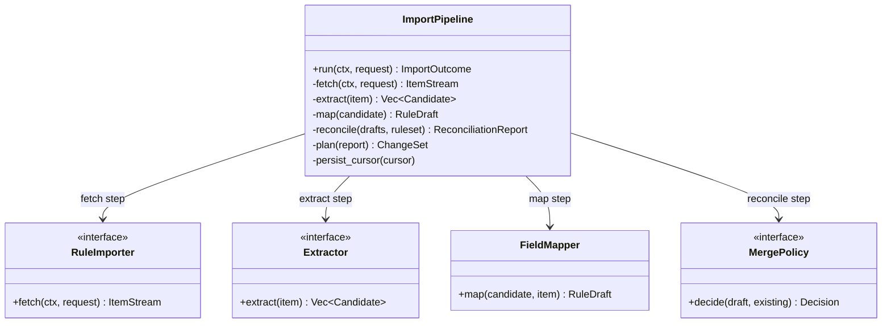
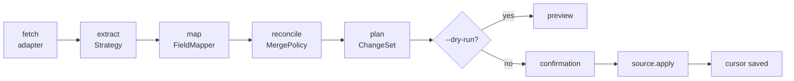
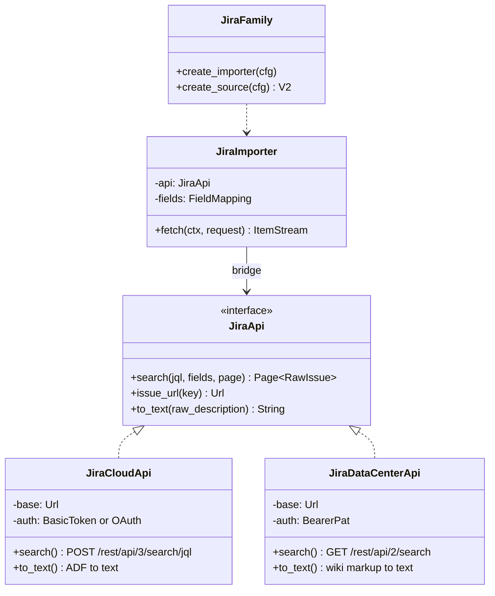
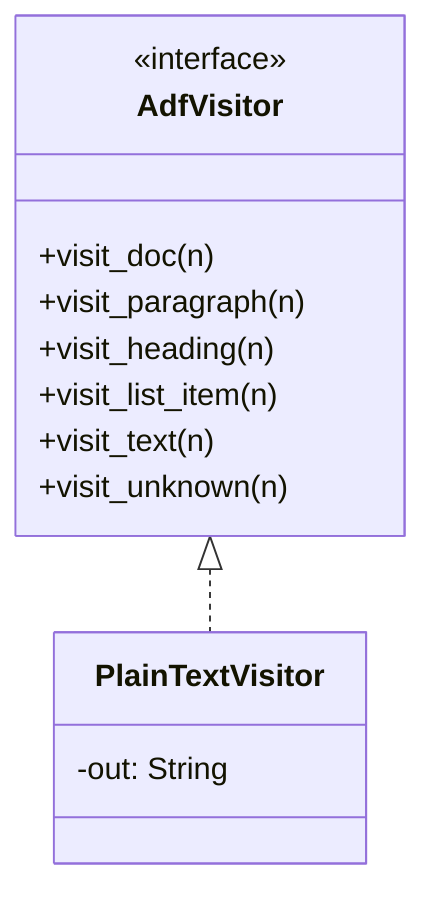
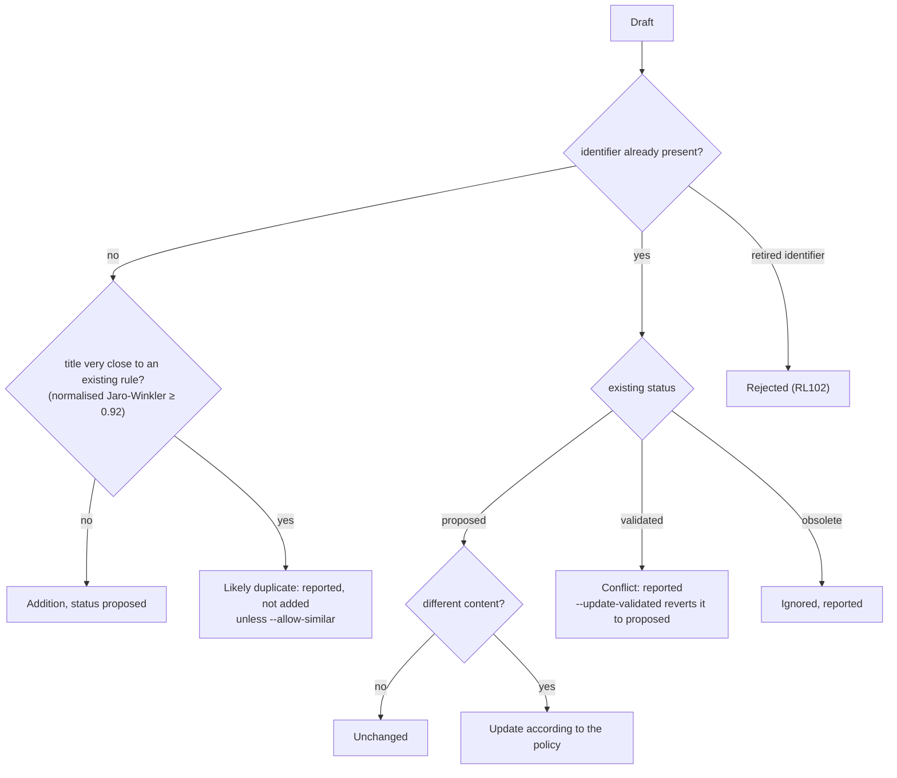
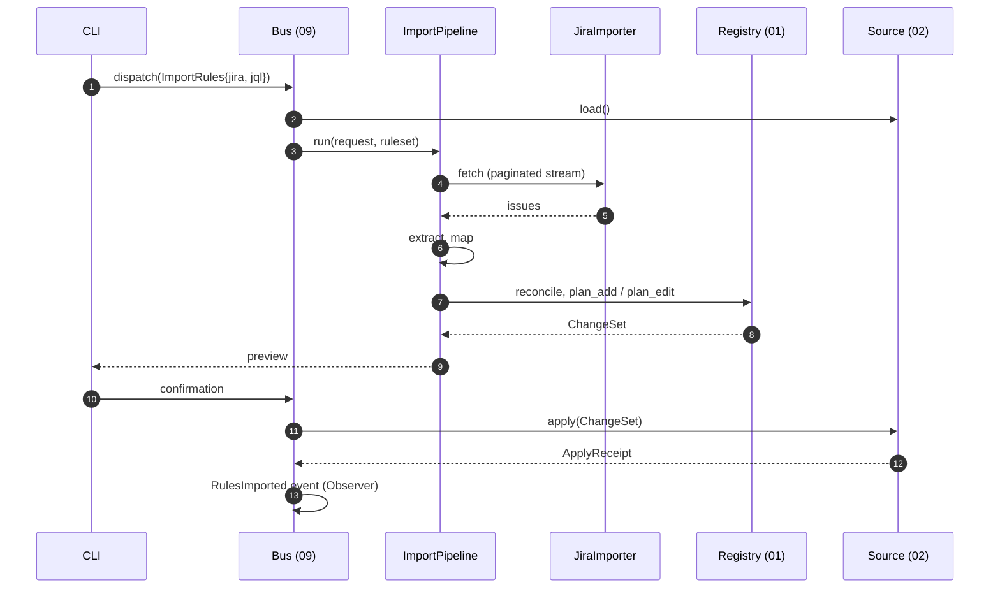

# 05 — Rule import

> Import feeds the source of truth without ever bypassing it: it creates `proposed` rules, which a human then validates. It is the "Jira feeds" step of the real-world flow, and the entry point for retro-documentation.
> Crates: `rulelink-import` (pipeline, extraction, reconciliation), `adapters/file`, `adapters/jira`, `adapters/csv`, `adapters/github`, `adapters/gitlab`.
> See also: [01 Registry](01-rule-registry.md), [02 Sources](02-sources-of-truth.md), [07 Agents](07-agent-integration.md).

## 1. Role and scope

**Responsibilities**

- Fetch raw items from an external tool or a file, with pagination and resumption.
- Extract candidate rules from them (configurable regex, field mapping, passthrough).
- Reconcile candidates with existing rules: new rule, duplicate, update of a proposal, conflict.
- Produce a `ChangeSet`, shown as a preview, then applied by the source.
- Keep a cursor per import for incremental runs.

**Invariants**

- An import only creates `proposed` rules. It never modifies a `validated` or `obsolete` rule, except with `--update-validated`, which reverts them to `proposed`.
- An import never writes back to the originating tool.
- The origin is always filled in (`origin.kind`, `origin.ref`, `origin.url`).

## 2. Release frame

| Feature                                                                                                                           | MVP | V1  | V2  |
| --------------------------------------------------------------------------------------------------------------------------------- | :-: | :-: | :-: |
| Import of a JSON proposals file (format from 01, or a list of drafts)                                                             |  ●  |     |     |
| Preview (`--dry-run`) and interactive confirmation                                                                                |  ●  |     |     |
| Reconciliation by identifier and by title similarity                                                                              |  ●  |     |     |
| Candidates matching a `rejected` rule: skipped, listed in the preview as "previously rejected", overridable with an explicit flag |  ●  |     |     |
| Jira Cloud (REST v3, ADF) and Data Center (REST v2, wiki markup) import                                                           |     |  ●  |     |
| Configurable regex extraction, several rules per issue                                                                            |     |  ●  |     |
| Mapping of Jira fields to application, module, labels                                                                             |     |  ●  |     |
| CSV import with column mapping                                                                                                    |     |  ●  |     |
| GitHub Issues and GitLab Issues import                                                                                            |     |  ●  |     |
| Incremental cursor                                                                                                                |     |  ●  |     |
| Import through an external adapter                                                                                                |     |  ●  |     |
| Scheduled CI import that opens a PR                                                                                               |     |     |  ●  |
| Import from a specification through the generation skill (07)                                                                     |     |     |  ●  |

## 3. Technical constraints

- Network adapters are asynchronous (`tokio`, `reqwest` with rustls). The pipeline is a stream (`Stream`): 10,000 issues are never all in memory at once.
- Pagination, rate limits (`429`, `Retry-After`), bounded exponential backoff and per-request timeouts are configurable per adapter.
- Authentication without secrets in the configuration:
  - Jira Cloud: email + API token with basic authentication, or OAuth 2.0 (3LO) in V2.
  - Jira Data Center: Personal Access Token as `Bearer`.
  - GitHub: `GITHUB_TOKEN` or `gh auth token`. GitLab: `GITLAB_TOKEN` or `CI_JOB_TOKEN`.
- Imported text is **data**. It is stored as is in `statement`, after conversion to plain text, and Rulelink never interprets it as an instruction. Skills also present it as data (07).

## 4. Detailed design

### 4.1 Pipeline — **Template Method**

The skeleton is the same for every import. Each adapter provides only the fetch step; extraction and mapping are configurable strategies.





The cursor is saved only after a successful `apply`. An interrupted import therefore resumes where the last successful import stopped.

### 4.2 Extraction — **Strategy**

| Strategy               | Input                              | Output                     | Use                                                    |
| ---------------------- | ---------------------------------- | -------------------------- | ------------------------------------------------------ |
| `RegexExtractor`       | Issue text converted to plain text | 0 to n candidates per item | Jira, issues: "RULE XXXX_N : my business rule" pattern |
| `FieldExtractor`       | Structured fields                  | 1 candidate per item       | CSV, a custom Jira "Business rule" field               |
| `PassthroughExtractor` | Drafts already in Rulelink format  | 1 candidate per draft      | Proposals file (retro-documentation, skills)           |

Default pattern, taken from the brief's decisions, with named groups:

```toml
[import.jira.extract]
strategy = "regex"
pattern = '(?m)^\s*RULE\s*(?P<code>[A-Z0-9]+_\d+)\s*:\s*(?P<title>.+)$'
id_template = "RULE-{code}"          # → RULE-FACT_3
statement = "title"                # or "following-paragraph": the next paragraph becomes the statement
```

Recognised groups: `id`, `code`, `title`, `statement`, `module`, `application`. An issue can contain several rules: each match yields a candidate, and all of them share `origin.ref` = the issue key.

### 4.3 Jira Cloud and Data Center — **Bridge**

**Problem.** Two editions, two APIs (confirmed choice: both). The differences lie in authentication, endpoints, pagination and text format. The use case ("fetch issues by JQL") is the same.



| Aspect         | Cloud                                                               | Data Center                                               |
| -------------- | ------------------------------------------------------------------- | --------------------------------------------------------- |
| Detection      | `edition = "auto"`: `GET /rest/api/2/serverInfo` → `deploymentType` | Same                                                      |
| Search         | v3 JQL search endpoint, `nextPageToken` pagination                  | `/rest/api/2/search`, `startAt` / `maxResults` pagination |
| Description    | Atlassian Document Format (JSON)                                    | Wiki markup (text)                                        |
| Authentication | Email + API token (basic)                                           | PAT (`Bearer`)                                            |
| Link           | `https://<site>.atlassian.net/browse/<KEY>`                         | `<base>/browse/<KEY>`                                     |

Exact endpoints are verified by `wiremock` tests on recorded responses. The adapter documentation states the minimum supported Data Center version.

### 4.4 ADF conversion — **Visitor**

ADF is a tree of nodes (`paragraph`, `bulletList`, `heading`, `table`, `mention`, `inlineCard`...). A **Visitor** produces the plain text used by extraction: one line break per paragraph and per list item, so the line-by-line pattern works. An unknown node is visited through its children, then ignored: a new node type on the Atlassian side does not break the import.



Data Center wiki markup goes through a simpler line-by-line converter (`WikiToText`), which strips `{code}`, `*bold*`, `h1.` markers and keeps the text.

### 4.5 Field mapping — **Adapter**

```toml
[import.jira.fields]
application = "project.name"                 # path within the issue
module      = "components[0].name"
labels      = "labels"
scope.covered  = "customfield_10231"         # custom field, if the team has one
```

`FieldMapper` translates a `RawItem` (generic JSON) into a `RuleDraft`, using simple field paths. Explicit values captured by the regex (`module`) take precedence over the mapping.

### 4.6 Reconciliation — merge **Strategy**



| Policy (`--merge`) | Existing proposed rule, different content                          |
| ------------------ | ------------------------------------------------------------------ |
| `skip` (default)   | Keeps the existing rule, reports the difference                    |
| `update`           | Replaces imported fields, keeps local fields (`labels`, `related`) |
| `replace`          | Replaces the whole rule                                            |

### 4.7 Import command — **Command** + **Memento**

```rust
pub struct ImportRules {
    pub importer: ImporterRef,          // "file", "jira", "csv", "github", "gitlab", or an external adapter
    pub request: ImportRequest,         // adapter-specific request (JQL, path, labels...)
    pub merge: MergeStrategy,
    pub dry_run: bool,
    pub assume_yes: bool,
}
// Output: ImportOutcome { plan: ChangeSet, report: ReconciliationReport, applied: Option<ApplyReceipt>, cursor: Option<Cursor> }
```

The command goes through the bus (09), and therefore through its middleware: source lock and logging. Cancelling during `fetch` leaves no trace. A failure during `apply` is caught by the source's Memento (02).

### 4.8 Proposals file format (MVP)

This is the format produced by the retro-documentation skill and accepted by `import file`.

```json
{
  "$schema": "https://rulelink.dev/schemas/proposals/v1.json",
  "proposals": [
    {
      "id": null,
      "title": "Discount capped at 30% of the pre-tax total",
      "statement": "The cumulative discount on an order cannot exceed 30% of the total excluding tax.",
      "module": "Discounts",
      "origin": { "kind": "retrodoc", "ref": "src/orders/discount.py:58" },
      "evidence": [ { "path": "src/orders/discount.py", "line": 58 } ],
      "confidence": "high"
    }
  ]
}
```

- `id: null`: the identifier is allocated by the registry (01).
- `evidence`: the locations from which the rule was inferred. The skill annotates them once the rule is validated.
- `confidence` is kept in `extensions.x-retrodoc` to measure the brief's criterion (at least 50% accepted without rewriting).

## 5. API and entry points

### 5.1 CLI commands

| Command                       | Specific options                                                                                                     | Release |
| ----------------------------- | -------------------------------------------------------------------------------------------------------------------- | ------- |
| `rulelink import file <FILE>` | `--origin <KIND>`                                                                                                    | MVP     |
| `rulelink import jira`        | `--jql <JQL>`, `--project <KEY>`, `--since <DATE\|cursor>`, `--edition auto\|cloud\|datacenter`, `--pattern <REGEX>` | V1      |
| `rulelink import csv <FILE>`  | `--map <COLUMN>=<FIELD>...`, `--delimiter`, `--encoding`                                                             | V1      |
| `rulelink import github`      | `--repo <OWNER/NAME>`, `--label <L>`, `--state open\|closed\|all`                                                    | V1      |
| `rulelink import gitlab`      | `--project <ID\|PATH>`, `--label <L>`, `--state`                                                                     | V1      |
| `rulelink import <external>`  | `--query <JSON>`                                                                                                     | V1      |

Common options: `--dry-run`, `--yes`, `--merge skip|update|replace`, `--allow-similar`, `--update-validated`, `--limit <N>`, `--format human|json`.

Example preview:

```
Import jira · project = FAC AND updated >= -7d · 23 issues read

  + RULE-FACT_12  Prorated subscription on cancellation                FAC-1402
  + RULE-FACT_13  No proration within 7 days                           FAC-1402
  ~ RULE-FACT_09  (proposed) statement changed                         FAC-1377
  ! RULE-FACT_02  validated, different content: not modified           FAC-1290
  ? "Loyalty discount cap" resembles RULE-031: ignored                 FAC-1388

2 additions · 1 update · 1 conflict · 1 likely duplicate
Apply? [y/N]
```

### 5.2 Configuration

```toml
[import.jira]
url = "https://acme.atlassian.net"
edition = "auto"
auth = { email = "${env:JIRA_EMAIL}", token = "${env:RULELINK_JIRA_TOKEN}" }
default_jql = "project = FAC AND labels = business-rule"
page_size = 100
timeout = "30s"
```

### 5.3 JSON output

Schema `rulelink/import-outcome/v1`: `plan` (changes), `report` (additions, updates, conflicts, duplicates, ignored items, each with its source reference), `applied` (fingerprint), `cursor`.

## 6. Interactions



## 7. Tests and acceptance criteria

- Recorded Jira Cloud and Data Center response sets, replayed with `wiremock`, including pagination, `429` and unknown ADF nodes.
- An issue containing 3 rules in the default format yields 3 candidates with the same origin.
- Replaying the same import produces no change (idempotence).
- The manual Jira → JSON flow of the recent build is reproduced with no manual touch-up (internal-use criterion).

## 8. Open points

No open points remain. One option was considered and rejected.

- **Importing issue comments**: rejected. A rule clarified in a comment must be folded back into the ticket description, which is the only text the importer reads. Comments add noise (discussion, acknowledgements) and per-tracker parsing cost, and they would hide incomplete tickets.
