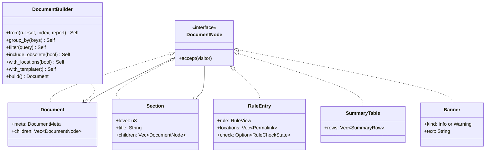
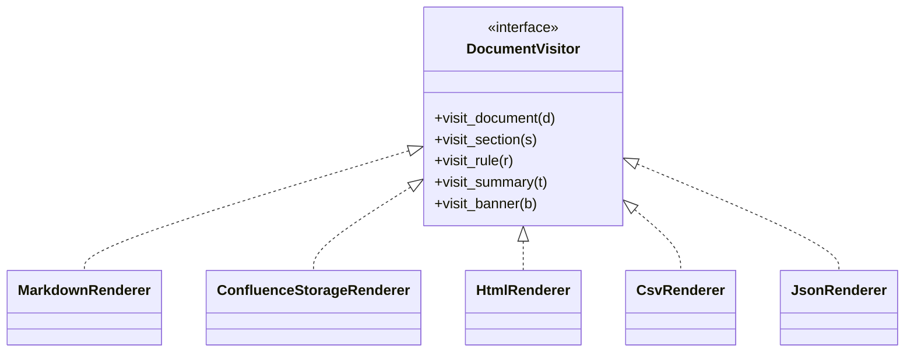
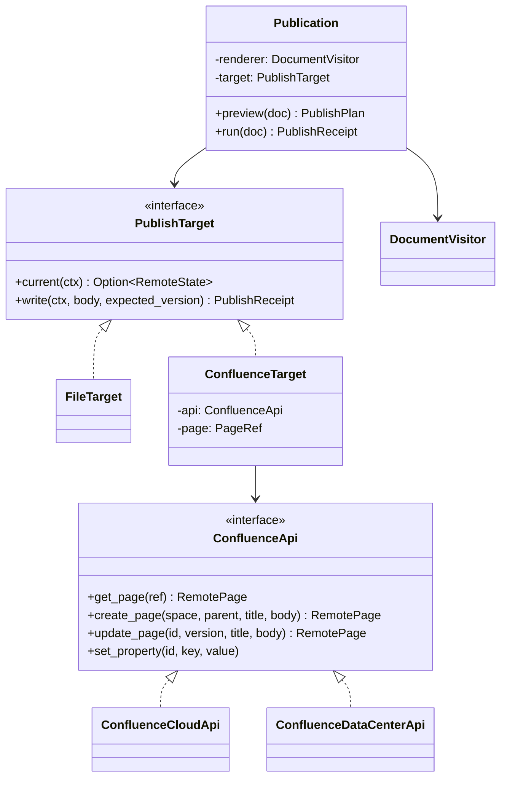
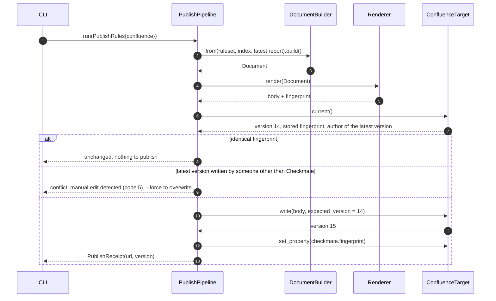
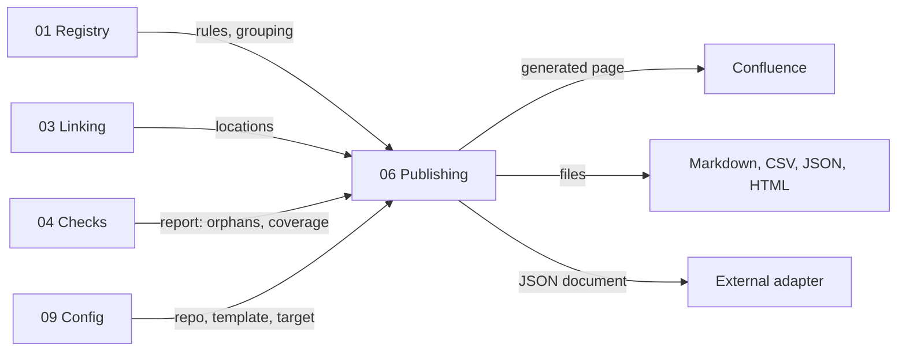

# 06 — Publishing and export

> Publishing is the "Confluence publishes" step of the real-world flow: a single reference page, readable by the PO, generated from the source and never edited by hand. Export produces the same content as files.
> Crates: `checkmate-publish` (document, renderers, pipeline), `adapters/confluence`, `adapters/file-export`.
> See also: [01 Registry](01-rule-registry.md), [03 Linking](03-code-linking.md), [04 Checks](04-checks.md).

## 1. Role and scope

**Responsibilities**

- Build a format-independent document: rules grouped by application then module, with title, statement, scope, status, labels, related rules, origin, links to code and status of the latest check.
- Render it as Markdown, CSV, JSON, HTML and Confluence storage format.
- Publish to a remote target idempotently, detecting manual edits.
- Meet the brief's PO needs: find a rule and its scope, know whether it still exists, follow its lifecycle.

**Invariants**

- A publication is **generated** and is not edited. It is never read back as a source.
- The page shows a banner: "Page generated by Checkmate from `<repository>@<commit>` — do not edit".

## 2. Release frame

| Feature | MVP | V1 | V2 |
|---|:-:|:-:|:-:|
| `rules list --format csv\|json` (raw export) | ● | | |
| Structured document + `export markdown`, `export csv`, `export json` | | ● | |
| Confluence Cloud and Data Center publishing, single page | | ● | |
| Status, coverage and code permalinks in the document | | ● | |
| Manual-edit detection, idempotent publishing | | ● | |
| Customisable templates (sections, columns, labels) | | ● | |
| One page per application or module (page tree) | | | ● |
| Self-contained static HTML export (client-side search) | | | ● |
| Publishing through an external adapter (Notion, SharePoint...) | | ● | |
| Automatic publishing in CI after merge | | ● | |

## 3. Technical constraints

- The document is built offline and deterministically. Only the sending step touches the network.
- Links to code are **permalinks** (pinned commit) built from the configuration: `repo.web_url` and `repo.permalink_template`, detected from the Git remote during `init`.
- Confluence storage format (XHTML): strict escaping, macros limited to `info`, `status`, `expand`, `toc` and `anchor`, all available on Cloud and Data Center.
- Size: a heavy Confluence page becomes slow. Beyond `publish.confluence.max_rules_per_page` (default: 500), content is split into sub-pages per application (V2), or publishing fails with an explicit message (V1).
- The fingerprint of the rendered content is stored in a page content property (`checkmate.fingerprint`) so unchanged content is not republished.

## 4. Detailed design

### 4.1 Document — **Builder** + **Composite**



- **Composite**: `Document` and `Section` contain other nodes. One section per application, one sub-section per module, then the rule entries.
- **Builder**: construction has many options (grouping, filter, obsolete rules, locations, template). The builder produces an immutable, sorted document.

Default page structure:

1. "Generated page" banner, date and source commit.
2. Summary: rule counts by status, share of validated rules linked to code, date of the latest `check`.
3. Table of contents.
4. For each application, then each module: one entry per rule with identifier (anchor), title, status, statement, scope (covered, excluded), labels, related rules (internal links), origin (Jira link), code locations (permalinks), and a warning if the rule is orphaned.
5. Collapsed appendix: obsolete rules and their replacements.

### 4.2 Rendering — **Visitor**

Adding a format must not require changing the document nodes.



| Renderer | Specifics |
|---|---|
| `MarkdownRenderer` | GitHub Flavored Markdown, stable anchors `#rg-042`, usable in a Git-based wiki |
| `ConfluenceStorageRenderer` | Coloured `status` macro (validated green, proposed yellow, obsolete grey), one `anchor` per rule, `expand` for scope and locations |
| `HtmlRenderer` | Self-contained page, embedded CSS, client-side search (V2) |
| `CsvRenderer` | One row per rule, configurable columns; ignores sections |
| `JsonRenderer` | Full document, schema `checkmate/publication/v1`, for external adapters |

Labels ("Scope", "Excluded cases") come from a translation catalogue (`en` and `fr`, selected per project) and can be overridden by a template.

### 4.3 Transport — **Bridge** between renderer and target

The renderer (what to produce) and the target (where to send it) vary independently: Confluence storage can be published to Cloud or Data Center, and Markdown to a file or a wiki.



| Aspect | Confluence Cloud | Confluence Data Center |
|---|---|---|
| API | REST v2 (`/wiki/api/v2/pages/{id}`) | REST `/rest/api/content/{id}` |
| Body | `body.representation = storage` | `body.storage` |
| Version | Version number incremented on each update | Same |
| Content property | v2 page properties | `/rest/api/content/{id}/property` |
| Authentication | Email + API token | PAT `Bearer` |

### 4.4 Publishing pipeline — **Template Method**



Fixed steps: build → render → read remote state → decide → write → mark. Only "read" and "write" depend on the target.

The "author of the latest version" is compared with the configured service account. If a PO has edited the page, publishing stops rather than silently erasing their work. The message suggests carrying the change over into the source.

### 4.5 Command — **Command**

```rust
pub struct PublishRules {
    pub target: TargetRef,          // "confluence", "file", or an external adapter
    pub renderer: RendererRef,      // inferred from the target if absent
    pub selection: DocumentOptions, // grouping, filter, obsolete rules, locations, template
    pub dry_run: bool,              // prints the PublishPlan and the content diff
    pub force: bool,
}
```

## 5. API and entry points

### 5.1 CLI commands

| Command | Options | Release |
|---|---|---|
| `checkmate export markdown` | `--output <FILE>`, `--group-by app,module`, `--filter <EXPR>`, `--include-obsolete`, `--no-locations`, `--template <FILE>` | V1 |
| `checkmate export csv` | `--output`, `--columns id,title,status,module,...`, `--filter` | V1 |
| `checkmate export json` | `--output`, `--document` (full document) or raw rules | V1 |
| `checkmate export html` | `--output <DIR>` | V2 |
| `checkmate publish confluence` | `--space <KEY>`, `--parent <ID>`, `--page <ID\|TITLE>`, `--dry-run`, `--force`, `--edition auto\|cloud\|datacenter` | V1 |
| `checkmate publish <external>` | `--target <JSON>`, `--dry-run` | V1 |

### 5.2 Configuration

```toml
[publish.confluence]
url = "https://acme.atlassian.net/wiki"
edition = "auto"
space = "FAC"
page = "Business rules — Billing"
parent = "123456789"
auth = { email = "${env:CONFLUENCE_EMAIL}", token = "${env:CHECKMATE_CONFLUENCE_TOKEN}" }
group_by = ["application", "module"]
include_obsolete = true
service_account = "checkmate-bot@acme.com"
locale = "fr"

[repo]
web_url = "https://github.com/acme/billing"
permalink_template = "{web_url}/blob/{commit}/{path}#L{line}"
```

### 5.3 CI: publishing after merge (V1)

```yaml
on: { push: { branches: [main], paths: ["rules/**", "src/**"] } }
jobs:
  publish:
    steps:
      - uses: checkmate-dev/check-action@v1
        with: { args: "--format json=report.json" }
      - run: checkmate publish confluence --report report.json
        env: { CHECKMATE_CONFLUENCE_TOKEN: ${{ secrets.CONFLUENCE_TOKEN }} }
```

`--report` reuses the `check` report to show statuses and coverage without rescanning.

## 6. Interactions



## 7. Tests and acceptance criteria

- Snapshots of every renderer on the example repository.
- The generated Confluence storage is validated as strict XHTML and accepted by both editions (`wiremock` tests, then a manual test on a demo instance).
- Two successive publications with no change: no write call.
- A manual edit of the page blocks the next publication.
- The PO of the recent build finds a rule, its scope and its status unaided (qualitative V1 criterion).

## 8. Open points

- The PO may want to comment on the page. Confluence comments survive body updates: this is acceptable.
