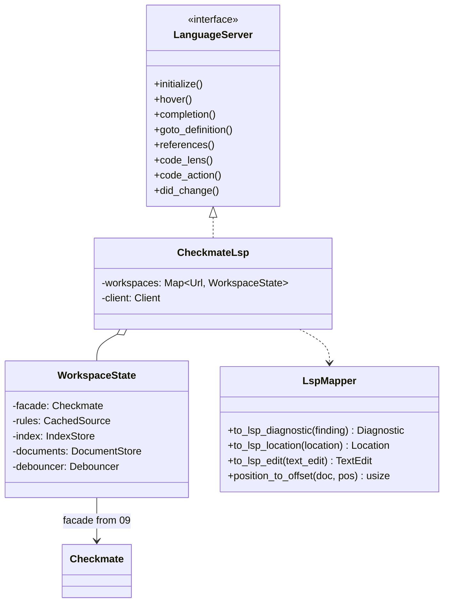
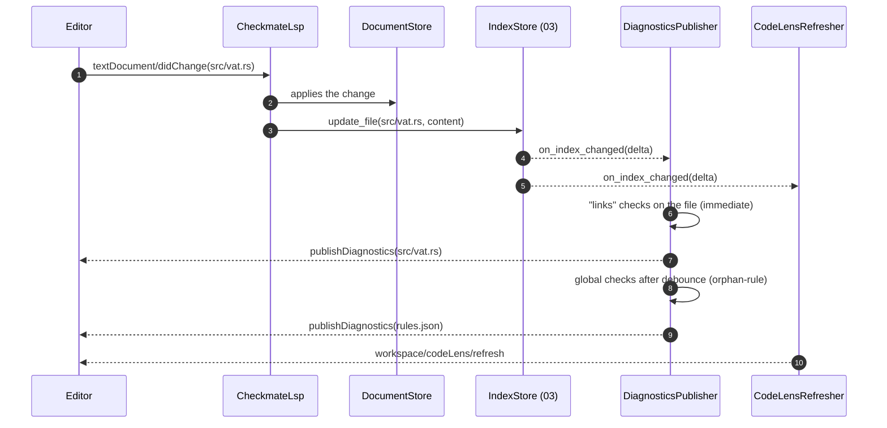
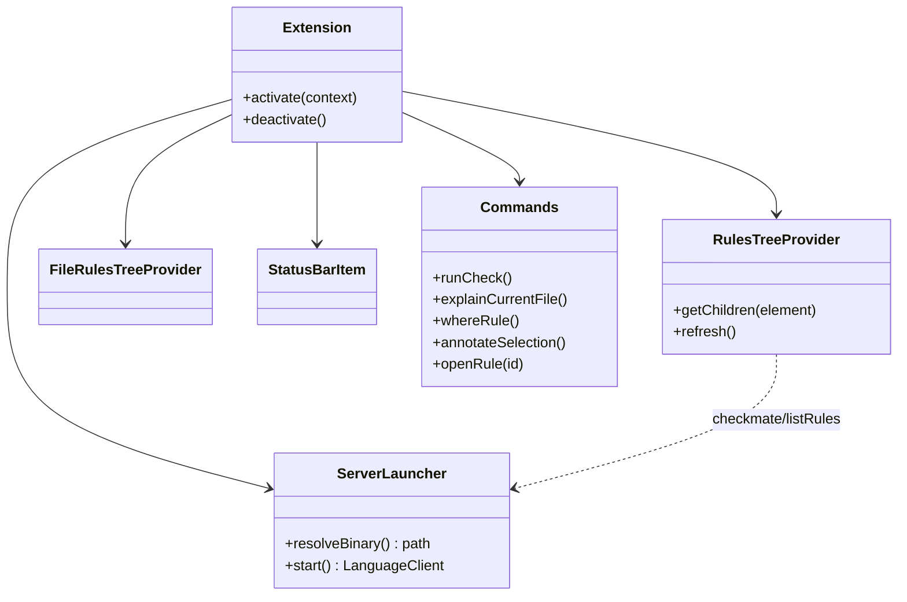
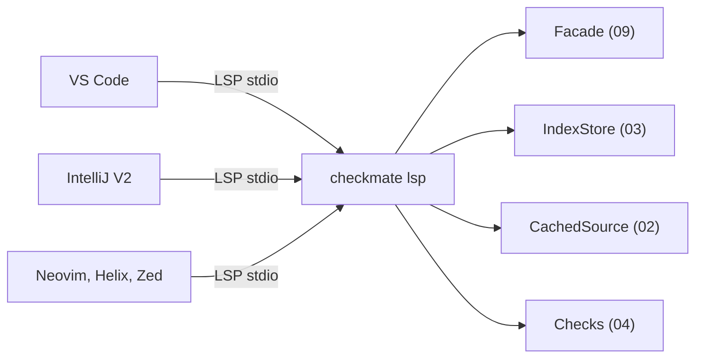

# 08 — IDE integration: LSP server and extensions

> The brief corrects `projet.svg`: TypeScript and the JVM cannot share one embedded library. All IDE intelligence therefore goes through an **LSP server** included in the binary (`checkmate lsp`). The VS Code and IntelliJ extensions are thin clients.
> Crates and deliverables: `checkmate-lsp`, `vscode-checkmate` extension (TypeScript, V1), `intellij-checkmate` plugin (Kotlin, V2).
> See also: [03 Linking](03-code-linking.md), [04 Checks](04-checks.md).

## 1. Role and scope

**Responsibilities**

- Show the rule behind an annotation without leaving the editor (the inline preview from `projet.svg`).
- Report unknown, obsolete or proposed references live.
- Complete identifiers after `@rule`, navigate between the code and the rule definition.
- Expose the core features (consultation, `explain`, `where`, `check`) in the IDE.

**Out of scope**

- Any business logic in the extension: it only translates IDE requests to the LSP server.
- Editing rules in a dedicated graphical interface (the JSON file stays the source; the LSP server helps edit it).

## 2. Release frame

| Feature | MVP | V1 | V2 |
|---|:-:|:-:|:-:|
| LSP server: hover, diagnostics, completion, definition, references | | ● | |
| CodeLens and inlay hints (title, status) | | ● | |
| Code actions "annotate with…", "replace the obsolete rule" | | ● | |
| Diagnostics in `rules.json` (schema, duplicates, unknown related rules) | | ● | |
| VS Code extension + "Rules" view + "Rules in this file" view | | ● | |
| Distribution on the VS Code Marketplace and Open VSX | | ● | |
| IntelliJ plugin (LSP4IJ or the platform LSP API) | | | ● |
| Symbol-level CodeLens (tree-sitter) | | | ● |
| Coverage view per folder | | | ● |

The MVP deliberately stays CLI-only; `explain` and `where --format vimgrep` already give access from any editor.

## 3. Technical constraints

- Rust server with `tower-lsp-server` (or `async-lsp`), over stdio. One instance per workspace root; multi-root workspaces supported.
- Shared in-memory index (`Arc<LinkIndex>`), updated file by file (03, section 5.3). Target: hover and completion under 50 ms.
- The server combines the content of open (unsaved) buffers with the disk: diagnostics reflect what the user is typing.
- Expensive diagnostics (`orphan-rule`, which depends on the whole repository) are recomputed after a debounce delay (default: 500 ms after the last keystroke).
- The VS Code extension is published as one VSIX per platform (`linux-x64`, `darwin-arm64`, `win32-x64`...) with the binary bundled. The `checkmate.path` setting allows an installed binary to be used instead.
- No network calls from the LSP server. A remote source goes through the snapshot (02).

## 4. Detailed design

### 4.1 Server — **Facade** + **Adapter**



- `CheckmateLsp` **adapts** the LSP protocol to the `Checkmate` facade (09).
- `LspMapper` converts domain types (1-based lines, columns in characters) to LSP types (0-based lines, columns in UTF-16 code units by default). This is a classic source of bugs: it is isolated and covered by property tests.

### 4.2 Reactivity — **Observer**



When `rules.json` changes (on disk or in a buffer), `CachedSource` (02) reloads and notifies the same observers: a rule that becomes `obsolete` immediately shows an error on all of its open annotations.

### 4.3 LSP features

| LSP request | Behaviour | Component called |
|---|---|---|
| `hover` on an identifier after `@rule` | Title, status, statement, scope, labels, links to the other locations | 01, 03 |
| `completion` after `@rule ` | Sorted identifiers: rules already cited in the file, then text close to the current symbol, then natural order. Obsolete rules excluded | 01, 03 |
| `definition` on an identifier | Opens `rules.json` at the rule's line (positions from 02) | 02 |
| `references` on an identifier, or on the `id` in `rules.json` | Every location (`where`) | 03 |
| `publishDiagnostics` | CM001, CM002, CM005, CM006, CM009 in the code; CM003, CM004, CM1xx in `rules.json` | 04 |
| `codeLens` | Above an annotation: "RULE-042 · validated · 3 locations". In `rules.json`: "3 locations · 1 test" or "no code" | 01, 03 |
| `inlayHint` | Short title after the identifier, can be disabled | 01 |
| `codeAction` | "Annotate with a rule…", "Replace RULE-007 (obsolete) with RULE-042", "Add an unknown identifier as a proposed rule" | 03, 01 |
| `workspace/symbol` | Rule search by identifier or title | 01 |
| `documentSymbol` in `rules.json` | File outline by application, module, rule | 01 |

Checkmate-specific requests (`checkmate/` prefix), used by the extension's views:

| Method | Parameters | Result |
|---|---|---|
| `checkmate/listRules` | `filter?` | Rules with status and location count |
| `checkmate/explainFile` | `uri` | Output of `explain` |
| `checkmate/whereRule` | `ids` | Output of `where` |
| `checkmate/runCheck` | `changed?` | Full report |
| `checkmate/status` | — | Coverage, for the status bar |

### 4.4 VS Code extension — **Proxy** for the server



The extension is a local **proxy** for the server: every view and command delegates to the LSP client (`vscode-languageclient`). It never reads `rules.json` itself.

| VS Code element | Content |
|---|---|
| "Rules" view (side bar) | Application → module → rule tree, status icon, filter |
| "Rules in this file" view | Rules cited in the active editor |
| Status bar | "Checkmate: 94/118 linked"; click: run `check` |
| Commands | `Checkmate: Run check`, `Explain current file`, `Where is rule…`, `Annotate selection with rule…`, `Open rule definition` |
| Settings | `checkmate.path`, `checkmate.inlayHints.enabled`, `checkmate.diagnostics.debounceMs`, `checkmate.trace.server` |
| Activation | Presence of `checkmate.toml` in the workspace |

### 4.5 IntelliJ plugin (V2)

Same principle: a thin LSP client, in Kotlin. Two integration options:

| Option | Advantage | Limitation |
|---|---|---|
| LSP4IJ (Red Hat) | Also works on Community editions, supports CodeLens and inlay hints | Depends on a third-party plugin |
| JetBrains platform LSP API | Native, maintained by JetBrains | Availability and feature coverage vary by IDE and edition |

Recommendation: LSP4IJ, to cover IntelliJ IDEA Community, which part of the Java teams use. The "Rules" view is a `ToolWindow` fed by `checkmate/listRules`.

## 5. Entry points

| Entry point | Description | Release |
|---|---|---|
| `checkmate lsp` | Starts the server over stdio. Options: `--log-file <F>`, `--root <DIR>` | V1 |
| `vscode-checkmate` | VS Code Marketplace and Open VSX extension | V1 |
| `intellij-checkmate` | JetBrains Marketplace plugin | V2 |
| Other editors | Neovim, Helix, Zed, Emacs: documented LSP configuration, no extension | V1 |

Example Neovim configuration:

```lua
vim.lsp.config("checkmate", { cmd = { "checkmate", "lsp" }, root_markers = { "checkmate.toml" } })
vim.lsp.enable("checkmate")
```

## 6. Interactions



## 7. Tests and acceptance criteria

- End-to-end server tests with a test LSP client: typing → diagnostic, completion, definition, file rename scenarios.
- Position conversion tested on lines containing emoji and characters outside the Basic Multilingual Plane.
- On a 50,000-file repository: hover and completion under 50 ms, startup with a cached index under 2 s.

## 8. Open points

No open points remain. One option was considered and rejected.

- **Renaming a rule identifier (`textDocument/rename`)**: rejected. An identifier is immutable once committed, and a rename would break the references of other branches and of published exports. To change a rule, the IDE offers "make obsolete and replace" instead. A reference to a `rejected` or `obsolete` rule left in the code is reported as an error (`CM009` and `CM002`, see [04](04-checks.md)).
