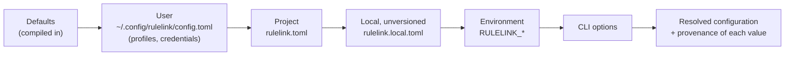
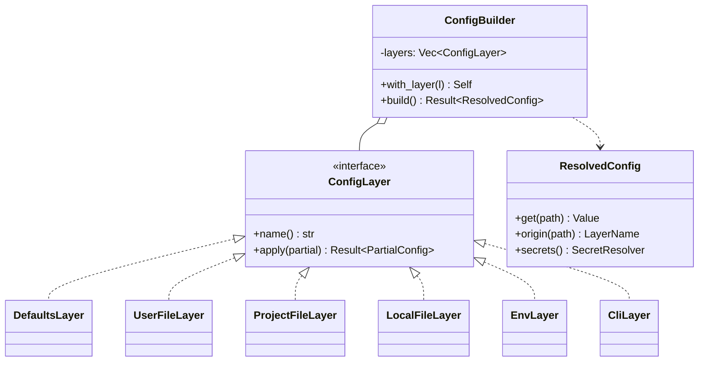
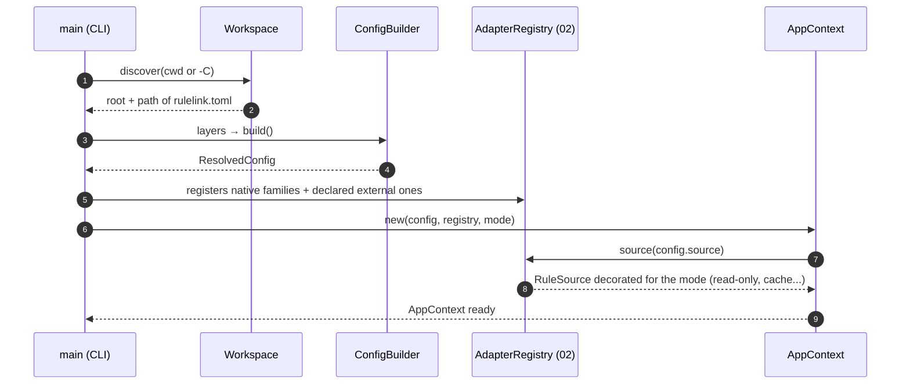
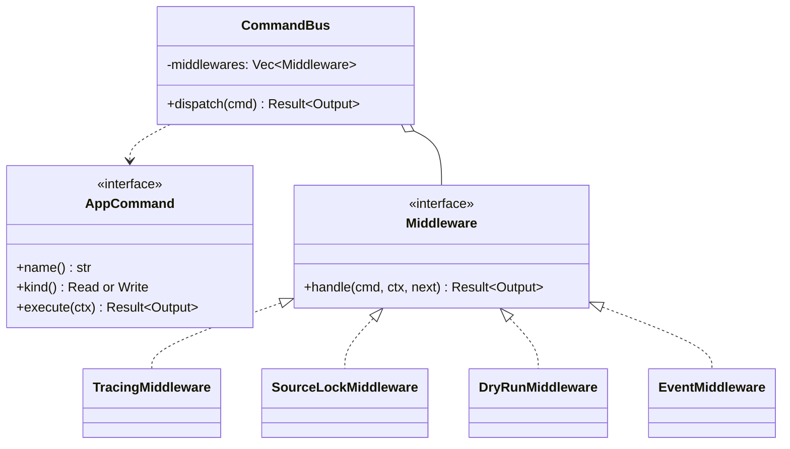
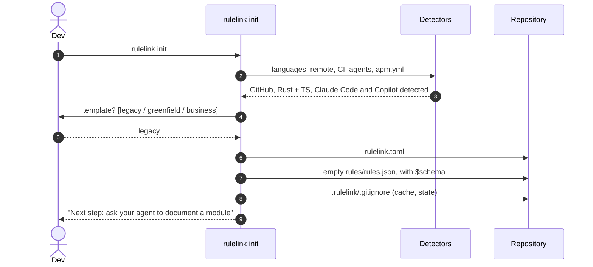
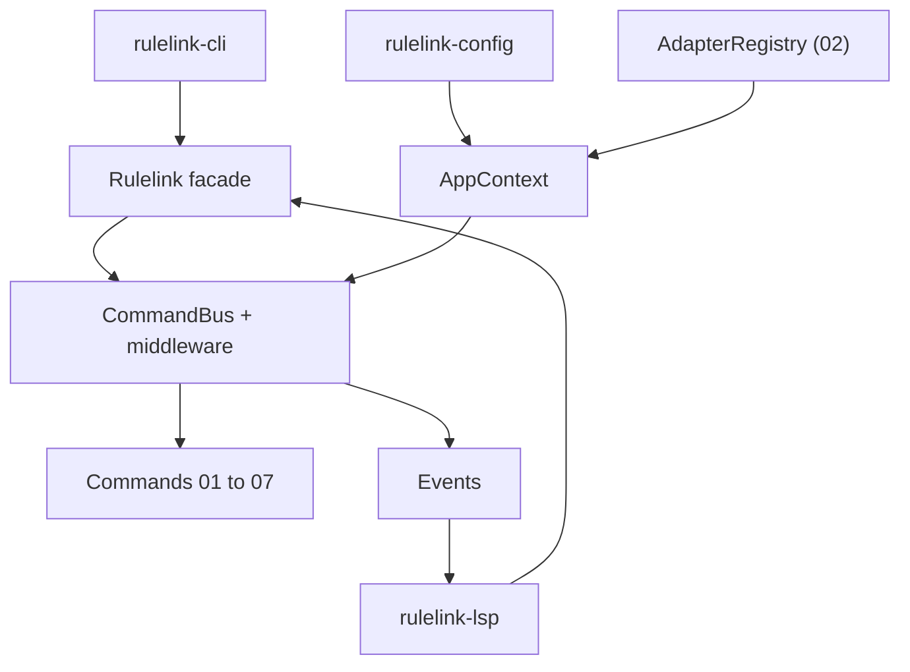

# 09 — Project, configuration and application layer

> This component holds everything together: it discovers the workspace, loads the configuration, wires the adapters, and exposes the **facade** and the **command bus** used by every entry point (CLI, LSP). It also owns `init`, the first contact with the tool (target: first `check` in under 15 minutes).
> Crates: `rulelink-config`, `rulelink-app`, `rulelink-cli` (binary).
> See also: [00 Global architecture](00-global-architecture.md).

## 1. Role and scope

**Responsibilities**

- Find the project root and the `rulelink.toml` file.
- Load layered configuration, validate it, resolve secrets.
- Build the application context: decorated source, scanner, adapters, check policy.
- Define every action as a command, execute it through a bus with middleware, publish events.
- Provide `init`, `config`, `doctor`, `migrate`, `completions`, `version`, `schema`.
- Handle monorepos (several applications in one repository, V1) and a source shared across repositories (V2).

**Out of scope**

- Any business rule logic: the application layer orchestrates, it does not decide.

## 2. Release frame

| Feature                                                                       | MVP | V1  | V2  |
| ----------------------------------------------------------------------------- | :-: | :-: | :-: |
| `rulelink.toml`, root discovery                                               |  ●  |     |     |
| Layered configuration + `${env:VAR}`                                          |  ●  |     |     |
| Interactive and non-interactive `init`, templates                             |  ●  |     |     |
| CI workflow generation (GitHub, GitLab) by `init`                             |     |     |  ●  |
| `doctor`, `config show`, `config get/set`, `version`, `completions`, `schema` |  ●  |     |     |
| Command bus, middleware, events                                               |  ●  |     |     |
| `migrate` (configuration and rule format)                                     |     |  ●  |     |
| `rulelink auth`: secrets in the OS keychain                                   |     |  ●  |     |
| Monorepo: `[applications]` by path                                            |     |  ●  |     |
| Environment profiles (`--profile ci`)                                         |     |  ●  |     |
| Source shared across repositories                                             |     |     |  ●  |

## 3. Technical constraints

- TOML format (`toml_edit` for writes: comments and ordering are preserved when `config set` changes the file).
- The configuration is described by Rust types, from which a JSON Schema is generated (`rulelink schema config`), usable in editors through Taplo or `#:schema`. It does not cover adapter settings for now, and it is never used to validate (see [02](02-sources-of-truth.md), section 5.2).
- Unknown keys are errors (with a suggestion of the closest key), except under `[adapters.*]` and `x-*`.
- Each setting is a type that parses itself. `[source]` apart from `kind` belongs to the source adapter, and `[scan]` to the scanning adapter. All independent problems are reported together; invalid TOML and an unsupported `version` are reported alone, and an unknown `source.kind` leaves the other `[source]` keys unchecked. Parsing returns a map read by setting type, with warnings; a failed parse carries problems only. `Workspace::open` is how use cases get it, and only a surface (CLI, LSP) writes what it says.
- No plain-text secret is accepted: a `token`, `password` or `secret` key whose value is not a reference (`${env:...}`, `${keyring:...}`) makes loading fail.
- The CLI detects CI (`CI=true` and provider-specific variables): no interactive prompts, no colour by default, and `github` format added automatically under GitHub Actions if no format is requested.

## 4. `rulelink.toml` file

```toml
#:schema https://rulelink.dev/schemas/config/v1.json
version = 1

[project]
name = "billing"

[source]
kind = "json"                       # json | json-dir (V1) | jira (V2) | external adapter name
path = "rules/rules.json"

[rules]
id_policy = { kind = "sequential", prefix = "RULE", width = 3 }
revalidate_on_change = true          # V1

[scan]
tag = "@rule"
include = ["**/*"]
exclude = ["vendor/**", "node_modules/**", "**/*.min.js"]
max_file_size = "2MB"

[scan.kinds]
test = ["**/tests/**", "**/*_test.*", "**/*.spec.*", "**/test_*.py"]

[applications]                       # V1, monorepo
billing = ["services/billing/**"]
catalog = ["services/catalog/**"]

[check.levels]
orphan-rule = "warning"
unvalidated-reference = "warning"

[agents]
skills_via = "auto"                  # auto | npx | apm | copy | none
agents_md = true

[repo]
web_url = "https://github.com/acme/billing"
permalink_template = "{web_url}/blob/{commit}/{path}#L{line}"

[import.jira]                         # V1, see 05
[publish.confluence]                  # V1, see 06
[adapters.notion]                     # V1, external adapter, see 02
```

## 5. Detailed design

### 5.1 Layered configuration — **Chain of Responsibility** + **Builder**



Each layer is a `ConfigLayer` link that completes the partial value and passes it on. `ConfigBuilder` (**Builder**) assembles the chain, then validates and produces an immutable `ResolvedConfig`. The provenance of each value is kept: `rulelink config show --resolved --origin` shows where each setting comes from.



Secrets are not resolved at load time but on demand (`SecretResolver`), and only by the adapter that needs them. A `check` therefore never touches the keychain.

### 5.2 Wiring — configuration-driven **Abstract Factory** (02)



`AppContext` is passed explicitly to every command. There is no Singleton: the LSP server keeps one context per workspace root, and tests create as many as they need.

### 5.3 Commands and bus — **Command** + **Chain of Responsibility** (middleware)

Every business action is a command, as in the original design for retrieval, import and export. The same command serves the CLI and the LSP server.



| Middleware             | Role                                                                        | Where      |
| ---------------------- | --------------------------------------------------------------------------- | ---------- |
| `TracingMiddleware`    | Duration, outcome, correlation identifier                                   | Everywhere |
| `SourceLockMiddleware` | Source lock for write commands                                              | CLI, LSP   |
| `DryRunMiddleware`     | For a write command in preview: returns the `ChangeSet` without applying it | Everywhere |
| `EventMiddleware`      | Publishes domain events after success                                       | Everywhere |

The bus applies middleware as a chain (**Chain of Responsibility**). Each middleware can also be seen as a **Decorator** of the command's execution.

Command catalogue:

| Command                                                              | Kind          | Component | Release    |
| -------------------------------------------------------------------- | ------------- | --------- | ---------- |
| `InitProject`                                                        | Write         | 09        | MVP        |
| `ListRules`, `ShowRules`, `SearchRules`                              | Read          | 01        | MVP        |
| `AddRule`, `EditRule`, `ApproveRules`, `ObsoleteRule`, `RejectRules` | Write         | 01        | MVP        |
| `ChangeLabels`                                                       | Write         | 01        | V1         |
| `Explain`, `Where`, `Scan`                                           | Read          | 03        | MVP        |
| `Annotate`                                                           | Write (code)  | 03        | MVP        |
| `RunCheck`, `Status`                                                 | Read          | 04        | MVP        |
| `ManageBaseline`                                                     | Write         | 04        | V1         |
| `ImportRules`                                                        | Write         | 05        | MVP (file) |
| `ExportRules`, `PublishRules`                                        | Read + send   | 06        | V1         |
| `BuildContext`                                                       | Read          | 07        | MVP        |
| `InstallSkills`                                                      | Write (files) | 07        | MVP        |
| `PullSource`, `MigrateSource`                                        | Write         | 02        | V2 / V1    |
| `PushSnapshot`                                                       | Read + send   | 10        | V2         |

### 5.4 Facade — **Facade**

```rust
pub struct Rulelink { ctx: AppContext, bus: CommandBus }

impl Rulelink {
    pub fn open(opts: OpenOptions) -> Result<Self, app::Error>;      // discovery + configuration + wiring
    pub async fn rules(&self, q: RuleQuery) -> Result<Vec<RuleView>, app::Error>;
    pub async fn show(&self, ids: &[RuleId]) -> Result<Vec<RuleView>, app::Error>;
    pub async fn explain(&self, target: FileTarget) -> Result<Explanation, app::Error>;
    pub async fn where_(&self, ids: &[RuleId], kind: Option<LocationKind>) -> Result<Locations, app::Error>;
    pub async fn check(&self, opts: CheckOptions) -> Result<CheckOutcome, app::Error>;
    pub async fn context(&self, req: ContextRequest) -> Result<AgentContext, app::Error>;
    pub async fn dispatch<C: AppCommand>(&self, cmd: C) -> Result<C::Output, app::Error>;
    pub fn events(&self) -> EventSubscription;
}
```

The named methods cover the common cases. `dispatch` gives access to every command.

### 5.5 Events — **Observer**

```rust
pub enum DomainEvent {
    RulesChanged { changeset: ChangeSetSummary, fingerprint: Fingerprint },
    RulesImported { importer: String, added: usize, updated: usize, conflicts: usize },
    RulesPublished { target: String, url: Option<Url>, version: Option<u64> },
    CheckCompleted { errors: usize, warnings: usize, coverage: CoverageStats },
    CodeAnnotated { path: RelPath, ids: Vec<RuleId> },
}
```

| Subscriber                                         | Reaction                                   | Release |
| -------------------------------------------------- | ------------------------------------------ | ------- |
| LSP (08)                                           | Refreshes diagnostics and CodeLens         | V1      |
| Configuration hooks `[hooks] after_import = "..."` | Runs a script (for example a notification) | V2      |

### 5.6 `init` — **Prototype** + **Template Method**

`init` starts from a project template (**Prototype**), cloned then adjusted according to the answers. The three templates match the brief's three entry points.

| Template     | Entry point                                             | Settings                                                                                     |
| ------------ | ------------------------------------------------------- | -------------------------------------------------------------------------------------------- |
| `legacy`     | Existing code without rules                             | `orphan-rule = off` at first, retro-documentation skill highlighted, baseline suggested (V1) |
| `greenfield` | Active project: new rules annotated as development goes | Default settings, consultation skill                                                         |
| `business`   | Existing rule repository imported                       | `[import.jira]` section or CSV import prepared                                               |

Fixed steps (**Template Method**): detect (languages, Git remote, CI, `apm.yml`, agents present) → choose a template → ask the missing questions → write the files → install the skills → print the next commands.



Interactive and non-interactive modes are both supported. Every question has a flag and a default, so a one-liner works: `rulelink init --template legacy --rules-path rules/rules.json --id-prefix RULE --yes`. Without a terminal, in CI, or with `--yes` or `--no-input`, `init` never prompts and uses the flag value or the default. In the MVP, `init` writes the configuration and the rules file only; CI workflows (V2) and skills (V1) are not touched.

## 6. CLI entry points

| Command                             | Options                                                                                                                                                                                                                                         | Effect                                                                                                                            | Release |
| ----------------------------------- | ----------------------------------------------------------------------------------------------------------------------------------------------------------------------------------------------------------------------------------------------- | --------------------------------------------------------------------------------------------------------------------------------- | ------- |
| `rulelink init`                     | `--template legacy\|greenfield\|business`, `--source json\|json-dir`, `--rules-path <P>`, `--id-prefix <PREFIX>` (default `RULE`), `--ci github\|gitlab\|none` (V2), `--skills auto\|npx\|apm\|copy\|none` (V1), `--no-agents-md` (V1), `--yes` | Initialises the repository                                                                                                        | MVP     |
| `rulelink config show`              | `--resolved`, `--origin`, `--format toml\|json`                                                                                                                                                                                                 | Effective configuration                                                                                                           | MVP     |
| `rulelink config get <KEY>`         |                                                                                                                                                                                                                                                 | Value of a key                                                                                                                    | MVP     |
| `rulelink config set <KEY> <VALUE>` | `--local`                                                                                                                                                                                                                                       | Edits the file, preserving comments and order                                                                                     | MVP     |
| `rulelink doctor`                   | `--format`                                                                                                                                                                                                                                      | Checks: configuration, readable source, ID pattern, installed and compatible skills, CI present, reachable adapters (`--network`) | MVP     |
| `rulelink migrate`                  | `--dry-run`                                                                                                                                                                                                                                     | Updates `rulelink.toml` and the rule format                                                                                       | V1      |
| `rulelink auth login <ADAPTER>`     | `--url`                                                                                                                                                                                                                                         | Stores a token in the keychain                                                                                                    | V1      |
| `rulelink auth logout <ADAPTER>`    |                                                                                                                                                                                                                                                 | Removes the token                                                                                                                 | V1      |
| `rulelink completions <SHELL>`      | bash, zsh, fish, powershell, elvish                                                                                                                                                                                                             | Shell completion                                                                                                                  | MVP     |
| `rulelink version`                  | `--json`                                                                                                                                                                                                                                        | Version, commit, supported formats and protocols                                                                                  | MVP     |
| `rulelink schema <NAME>`            | `rules`, `config`, `proposals`, `check-report`, `agent-context`...                                                                                                                                                                              | JSON Schema                                                                                                                       | MVP     |

Example `rulelink doctor`:

```
✔ rulelink.toml valid (version 1)
✔ json source: rules/rules.json, 118 rules (102 validated, 12 proposed, 4 obsolete)
✔ identifier pattern consistent with all 118 rules
✔ skills: rulelink-consult 0.3.0, rulelink-retrodoc 0.3.0 (via apm)
⚠ no CI workflow runs rulelink check → rulelink init --ci github
✔ AGENTS.md section up to date
```

Binary structure (`clap` in derive mode): one module per command group, each translating its arguments into an `AppCommand`. The binary contains no other logic.

## 7. Interactions



## 8. Tests and acceptance criteria

- `init` on 5 typical repositories (Rust, TypeScript, Java, Python, monorepo), followed by an immediate `check` with no error.
- The brief's installation test: 3 external developers, unaided, first `check` in under 15 minutes.
- Each configuration layer is tested on its own and in combination; the reported provenance is accurate.
- A plain-text secret in `rulelink.toml` is rejected with a message suggesting `${env:...}`.

## 9. Open points

No open points remain.

- **Several sources in a monorepo**: not allowed. A project has exactly one source. Each rule lists the applications it applies to (`applications`, 01), and the `[applications]` table maps those names to paths. Splitting a monorepo into separate projects, each with its own `rulelink.toml`, stays possible but is not the supported model.
