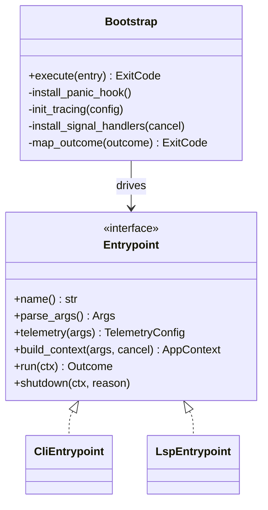
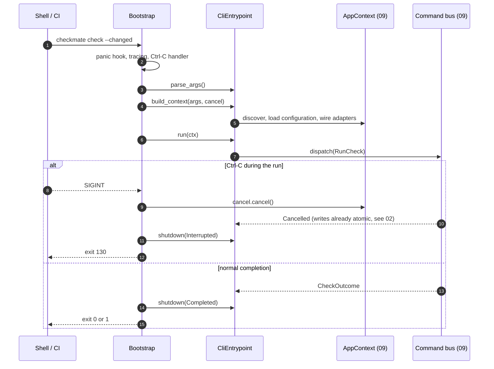
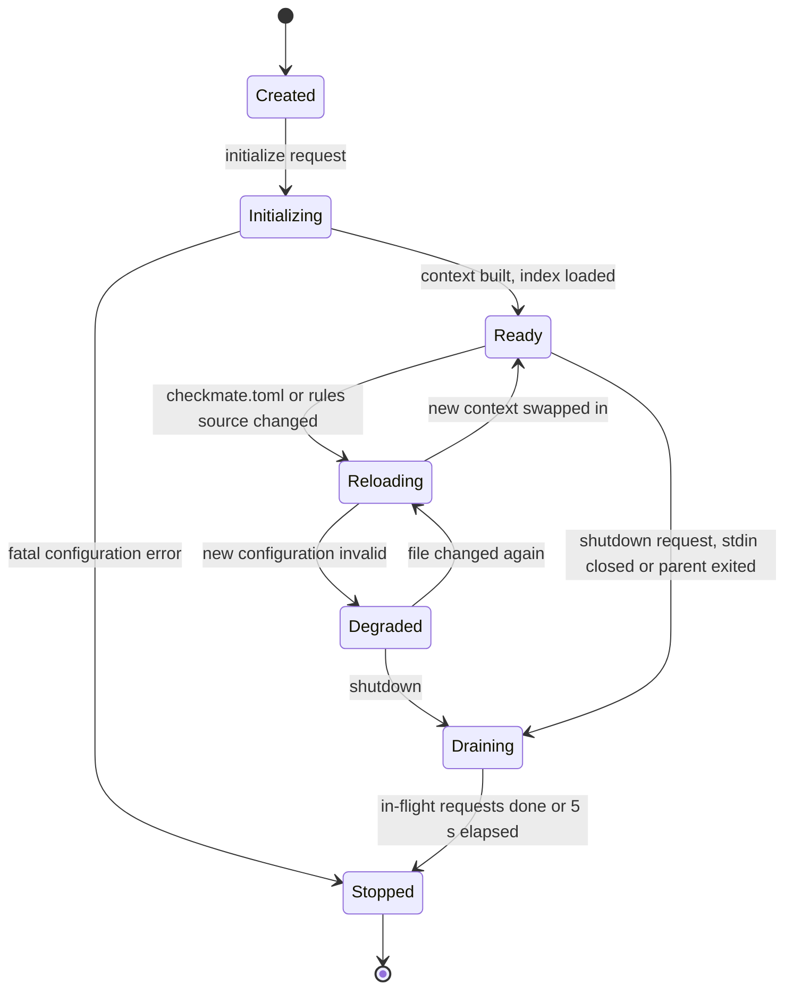
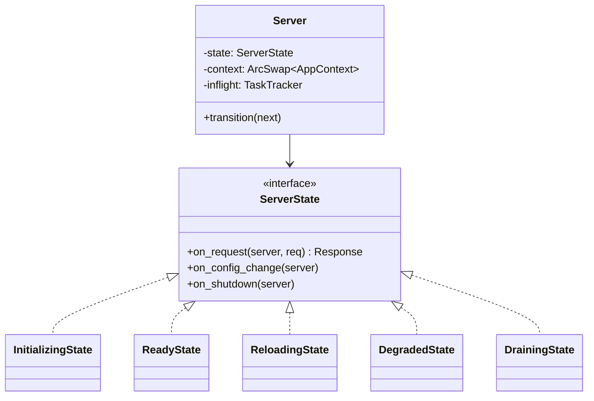
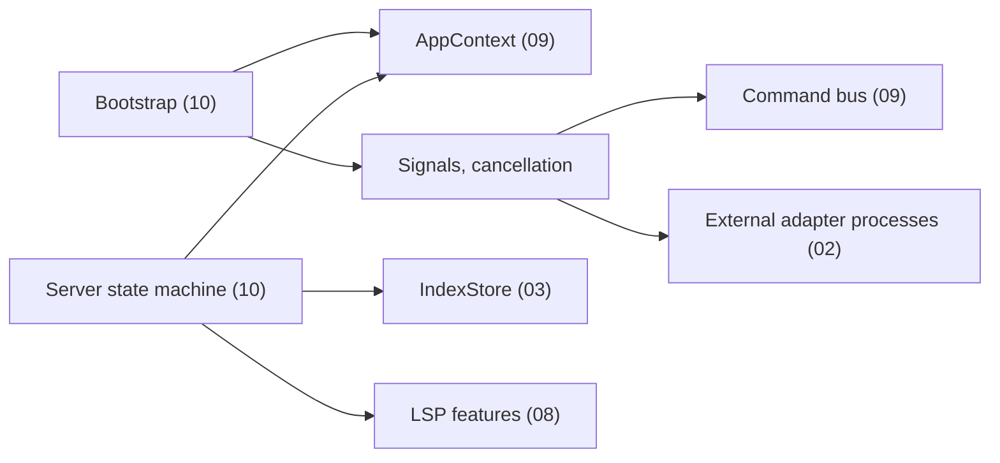

# 10 — Runtime lifecycle

> Cross-cutting architecture specification: how each process starts, runs, reloads and stops. It covers the CLI, the LSP server and external adapter processes.
> See also: [09 Project and configuration](09-project-configuration.md), [02 Sources of truth](02-sources-of-truth.md), [Release lifecycle](../repository/02-release-lifecycle.md).

## 1. Role and scope

**Responsibilities**

- Define a common bootstrap for every process (CLI, LSP server).
- Specify cancellation, signal handling, panic handling and exit codes.
- Specify the state machine of long-running servers, including configuration hot reload.
- Specify the ownership and release of resources: locks, child processes, temporary files, connections.

**Out of scope**

- What each command does: see the component files 01 to 11.
- Versioning, release and distribution: see [Release lifecycle](../repository/02-release-lifecycle.md).

## 2. Release frame

| Feature | MVP | V1 | V2 |
|---|:-:|:-:|:-:|
| Common bootstrap (`Entrypoint`) for the CLI | ● | | |
| Cancellation token, Ctrl-C handling, panic hook, exit codes | ● | | |
| Interrupt-safe writes (relies on 02) | ● | | |
| Long-running server state machine (LSP) | | ● | |
| Configuration hot reload in servers | | ● | |
| External adapter process reuse with idle timeout | | ● | |

## 3. Technical constraints

| Topic | Target |
|---|---|
| CLI cold start to first output (`checkmate version`) | < 30 ms |
| Graceful stop after first Ctrl-C (CLI) | < 1 s, no partially written file |
| LSP server: `initialize` to `initialized` with cached index | < 2 s on 50,000 files |
| Configuration reload in a server | < 500 ms, no request lost |

- **Async runtime**: Tokio is created only by entry points, never by domain crates (00, section 5, rule 1). The CLI uses a current-thread runtime; CPU-bound scanning runs on the `ignore` / `rayon` thread pools, outside the runtime. Servers use a multi-thread runtime.
- **Cancellation**: one `CancellationToken` (`tokio-util`) per process, passed down through `AppContext` (09) and `AdapterContext` (02). Every loop over files, pages or items checks it.
- **Standard streams**: results on stdout, diagnostics and logs on stderr (00, section 9.4). The LSP server uses stdout exclusively for protocol messages.

## 4. Runtime lifecycle

### 4.1 Common bootstrap — **Template Method**

**Problem.** Two processes (CLI, LSP) share the same start-up and shutdown steps, but differ in what "running" means. Duplicating the skeleton would let signal handling, logging and exit codes drift apart.

**Solution.** An `Entrypoint` trait fixes the skeleton; each process implements only its hooks.



```rust
pub trait Entrypoint {
    type Args;
    fn name(&self) -> &'static str;
    fn parse_args(&self) -> Result<Self::Args, UsageError>;
    fn telemetry(&self, args: &Self::Args) -> TelemetryConfig;
    fn build_context(&self, args: &Self::Args, cancel: CancellationToken) -> Result<AppContext, app::Error>;
    fn run(&self, ctx: &AppContext) -> impl Future<Output = Outcome>;
    fn shutdown(&self, ctx: &AppContext, reason: ShutdownReason) -> impl Future<Output = ()>;
}

pub enum Outcome { Success, ChecksFailed, Failed(app::Error) }
pub enum ShutdownReason { Completed, Interrupted, Terminated, ParentExited, ClientRequested }
```

The `Entrypoint` trait and `Bootstrap` live in the `runtime` module of `checkmate-app`. `checkmate-cli` owns the only `main()`: it picks the `Entrypoint` from the subcommand (`CliEntrypoint`, or `LspEntrypoint`, implemented by the `checkmate-lsp` library crate) and hands it to `Bootstrap` ([repository/01](../repository/01-repository-structure.md), section 6.3).

Fixed steps of `Bootstrap::execute`: install the panic hook → parse arguments → initialise tracing → install signal handlers bound to the cancellation token → build the context (discovery, configuration, wiring from 09) → run → shut down → map the outcome to an exit code (00, section 9.2).

### 4.2 CLI one-shot lifecycle



Signal and failure handling:

| Event | Behaviour | Exit code |
|---|---|---|
| First SIGINT (Ctrl-C) | Cancel the token; commands stop at the next checkpoint; locks and temporary files released | 130 |
| Second SIGINT | Immediate exit; atomic writes guarantee that no file is half-written | 130 |
| SIGTERM | Same as the first SIGINT | 143 |
| SIGPIPE (output piped to `head`) | Stop quietly, no error message | 0 |
| Panic | Panic hook prints a short message, the version and a link to report the issue; full backtrace with `RUST_BACKTRACE=1` | 10 |

Windows maps Ctrl-C and Ctrl-Break to the same token.

### 4.3 Long-running server (LSP) — **State**

**Problem.** A server goes through a handshake, serves requests, reloads its configuration, and must stop cleanly whether the client asks for it, disappears, or closes its input stream. Ad-hoc flags would let requests reach a half-reloaded context.





| State | Requests | Notes |
|---|---|---|
| `Initializing` | Rejected with "server not initialised" (LSP error `-32002`) | Builds the context and loads the index cache (03) |
| `Ready` | Served with the current context | — |
| `Reloading` | Served with the **previous** context | New context built in the background, then swapped atomically (`ArcSwap`); in-flight requests keep the context they started with |
| `Degraded` | Served with the last valid context | A diagnostic on `checkmate.toml` explains the configuration error |
| `Draining` | New requests rejected | Waits for `TaskTracker` to empty, at most 5 s |

Shutdown triggers:

| Trigger | Server |
|---|---|
| LSP `shutdown` then `exit` | LSP |
| End of stdin | LSP |
| Parent process exited (LSP `processId`, checked every 10 s) | LSP |
| SIGTERM | LSP |

File watching uses the `notify` crate with a 300 ms debounce. Watching is an **Observer**: the watcher publishes `ConfigChanged` and `SourceChanged` events; the server state, the index store (03) and the diagnostics publisher (08) subscribe.

### 4.4 Resource ownership

Every resource that must be released is owned by a guard whose drop releases it (RAII, non-GoF), so that cancellation, errors and panics all release resources the same way.

| Resource | Owner | Released by |
|---|---|---|
| Source write lock (`rules.json.lock`) | `SourceLockMiddleware` (09) | Guard drop at the end of the command |
| Temporary file of an atomic write | `JsonFileSource::apply` (02) | Rename on success, deletion on drop otherwise |
| External adapter child process | `ExternalAdapterProxy` (02) | `shutdown` request, then kill after 2 s (`kill_on_drop`) |
| HTTP connection pool | `AdapterContext` | Context drop |
| Index cache file | `IndexStore` (03) | Written on clean shutdown and every 60 s in servers |

### 4.5 External adapter processes

The protocol lifecycle is specified in 02 (section 5.5). The process policy depends on the host:

| Host | Policy |
|---|---|
| CLI | Started on first use, reused for the rest of the command, stopped at the end |
| LSP server | Started on first use, reused across requests, stopped after 5 minutes idle or on server shutdown |
| Crash | Restarted once per command; a second crash fails the command with exit code 4 |

## 5. Interactions



## 6. Tests and acceptance criteria

- Interrupt tests: SIGINT sent at random points during `rules approve`, `import file` and `annotate`; the source and code files are always either unchanged or fully updated.
- LSP lifecycle tests: initialize, reload with a valid then an invalid `checkmate.toml`, shutdown; no request lost during reload.
- Killing the LSP client process makes the server exit within 15 s.

## 7. Open points

No open points remain.

- **Telemetry and network calls**: telemetry stays absent (00, section 9.4). The version check of `self update --check` ([Release lifecycle](../repository/02-release-lifecycle.md)) is the only network call outside adapters, and it only runs when explicitly requested.
