# Features and releases

> Product view of what ships when. Each feature links to the architecture component that implements it; each component file repeats the release of its own features.
> See also: [Product overview](01-product-overview.md), [Global architecture](../architecture/00-global-architecture.md).

## 1. Release frames

Mapping to the brief's phases: **MVP** covers phase 1 (developer), **V1** covers phase 2 (PO, Jira → JSON → Confluence flow) and opening up to the community, **V2** covers phases 3 and 4 (AI-assisted authoring and integrations).

| Release | Target user | Theme | Commitment |
|---|---|---|---|
| MVP | Developer working with AI agents | A rule format, a CLI distributed through npm, a JSON source, a `check` and two skills | Committed: the only phase the brief engages |
| V1 | Product Owner, community | The real Jira → JSON → Confluence flow, IDE access, external adapters | Planned, dates open |
| V2 | Teams and large organisations | AI authoring skills, remote sources, IntelliJ, tree-sitter | Built only on demand |

## 2. Features by release

| Feature | Component | MVP | V1 | V2 |
|---|---|:-:|:-:|:-:|
| Rule model v1 + JSON Schema | [01](../architecture/01-rule-registry.md) | ● | | |
| Lifecycle (with `rejected` state) and `rules *` commands | [01](../architecture/01-rule-registry.md) | ● | | |
| Line-oriented canonical JSON writes, `rules format`, `RL106` | [01](../architecture/01-rule-registry.md), [02](../architecture/02-sources-of-truth.md) | ● | | |
| Keyword search and filtering | [01](../architecture/01-rule-registry.md) | ● basic | ● filter language | |
| Labels | [01](../architecture/01-rule-registry.md), [03](../architecture/03-code-linking.md) | | ● | |
| Skills' agent contract: `context`, `annotate`, `check --changed --format json`, `import file`; `rules approve` reserved to the human by skill text | [07](../architecture/07-agent-integration.md) | ● | | |
| Self-approval warning in `check` | [04](../architecture/04-checks.md) | | ● | |
| Related rules and cycle detection | [01](../architecture/01-rule-registry.md) | ● field | ● check | ● review skill |
| Single-file JSON source | [02](../architecture/02-sources-of-truth.md) | ● | | |
| Directory JSON source (one file per rule) | [02](../architecture/02-sources-of-truth.md) | | ● | |
| Native adapter contract | [02](../architecture/02-sources-of-truth.md) | ● | | |
| External adapter protocol + conformance kit | [02](../architecture/02-sources-of-truth.md) | | ● | |
| Source migration (`source migrate`) | [02](../architecture/02-sources-of-truth.md) | | ● | |
| Remote source (Jira) with offline snapshot | [02](../architecture/02-sources-of-truth.md) | | | ● |
| Multi-language lexical scan + `explain` + `where` | [03](../architecture/03-code-linking.md) | ● | | |
| `annotate` | [03](../architecture/03-code-linking.md) | ● | | |
| Enclosing symbol resolution (tree-sitter) | [03](../architecture/03-code-linking.md) | | | ● |
| `check`: the brief's 5 checks | [04](../architecture/04-checks.md) | ● | | |
| human, json reports | [04](../architecture/04-checks.md) | ● | | |
| sarif, github reports | [04](../architecture/04-checks.md) | | | ● |
| junit, gitlab codequality, markdown reports | [04](../architecture/04-checks.md) | | ● | |
| `check --changed` | [04](../architecture/04-checks.md) | ● | | |
| Baseline, pre-commit hook | [04](../architecture/04-checks.md) | | ● | |
| GitHub Action, GitLab CI component | [04](../architecture/04-checks.md) | | | ● |
| JSON file import (proposals) | [05](../architecture/05-import.md) | ● | | |
| Jira Cloud and Data Center import | [05](../architecture/05-import.md) | | ● | |
| CSV, GitHub Issues, GitLab Issues import | [05](../architecture/05-import.md) | | ● | |
| Markdown, CSV, JSON export | [06](../architecture/06-publishing-export.md) | | ● | |
| Confluence Cloud and Data Center publishing | [06](../architecture/06-publishing-export.md) | | ● | |
| Static HTML export | [06](../architecture/06-publishing-export.md) | | | ● |
| `rulelink context` | [07](../architecture/07-agent-integration.md) | ● | | |
| Consultation and retro-documentation skills | [07](../architecture/07-agent-integration.md) | ● | | |
| Skills in the `skills/` folder, installed by hand with `npx skills add` or APM | [07](../architecture/07-agent-integration.md) | ● | | |
| `skills install\|list\|update`, managed `AGENTS.md` section | [07](../architecture/07-agent-integration.md) | | ● | |
| npm package and `cargo install` | [repository/02](../repository/02-release-lifecycle.md) | ● | | |
| Shell and PowerShell installers, Homebrew, Scoop, winget, Docker image | [repository/02](../repository/02-release-lifecycle.md) | | ● | |
| Onboarding skill | [07](../architecture/07-agent-integration.md) | | ● | |
| Skills for generation from a spec, review, implementation verification | [07](../architecture/07-agent-integration.md) | | | ● |
| LSP server + VS Code extension | [08](../architecture/08-ide-integration.md) | | ● | |
| IntelliJ extension | [08](../architecture/08-ide-integration.md) | | | ● |
| `init` (configuration, rules file), `doctor` | [09](../architecture/09-project-configuration.md) | ● | | |
| CI workflow generation by `init` | [09](../architecture/09-project-configuration.md) | | | ● |
| Monorepo with several applications | [09](../architecture/09-project-configuration.md) | | ● | |
| Several repositories sharing one source | [09](../architecture/09-project-configuration.md) | | | ● |

## 3. Out of the MVP scope

Taken from the brief, with the release that picks each item up:

| Item | Release |
|---|---|
| IDE extensions | V1 (VS Code), V2 (IntelliJ) |
| Any GitHub or GitLab integration (Action, CI component, SARIF and GitHub reporters, generated workflow) | V2 |
| Skills installer and managed `AGENTS.md` section | V1 |
| Shell and PowerShell installers, Docker image | V1 |
| Connectors other than the local JSON file | V1 (import, publishing), V2 (remote sources) |
| AI analysis of implementation correctness | V2 (`rulelink-verify` skill, never part of `check`) |
| Writing to a remote source | V2 |
| Rule generation from a specification | V2 (`rulelink-spec` skill) |

## 4. Exit criteria

| Release | Exit criterion, taken from the brief |
|---|---|
| MVP | Retro-documentation: at least 50% of rules accepted without rewriting. Installation: from `npx rulelink init` to a first clean `check` in under 15 minutes for 3 external developers, including one `check` run in a CI workflow the developer writes by hand. Agents: at least 8 tasks out of 10 with the right rules consulted and the code annotated, counted once the skills are installed by hand |
| V1 | Internal use: manual flow replaced on the recent build, `check` kept in CI for 4 weeks, at least 80% of validated rules linked to code. At least one external adapter written by someone else |
| V2 | At least one team using Rulelink across several repositories |

```mermaid
flowchart LR
    subgraph MVP["MVP: the developer"]
        m1["Format v1 + JSON"]
        m2["check"]
        m3["explain / where / annotate"]
        m4["2 skills + context"]
        m5["file import"]
    end
    subgraph V1["V1: the PO and the community"]
        v1["Jira → JSON → Confluence"]
        v2["LSP + VS Code"]
        v3["External adapters"]
        v4["Labels, filters, baseline"]
    end
    subgraph V2["V2: the team"]
        w4["Spec, review, verification skills"]
        w5["IntelliJ, tree-sitter, remote sources"]
        w6["GitHub Action, GitLab component, SARIF"]
    end
    MVP --> V1 --> V2
```

