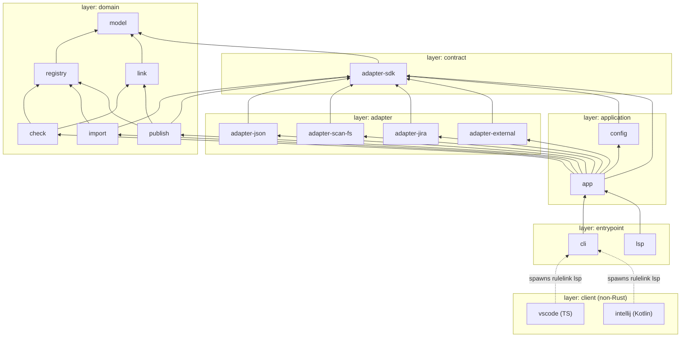
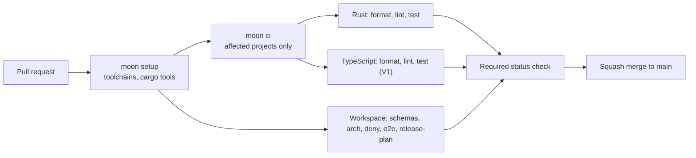

# 01 — Repository and code structure

> Cross-cutting technical specification: how the code of every component lives in a single repository, how it is built, tested and kept consistent. It turns the crate breakdown of [Global architecture](../architecture/00-global-architecture.md) (section 5) into a concrete monorepo layout and toolchain.
> See also: [Release lifecycle](02-release-lifecycle.md), [Runtime lifecycle](../architecture/10-runtime-lifecycle.md), [09 Project and configuration](../architecture/09-project-configuration.md).

## 1. Role and scope

**Responsibilities**

- Define the monorepo layout: where each crate, extension, SDK, skill and deliverable lives.
- Choose the build and task orchestration tooling, and justify it.
- Fix the conventions shared by every crate: naming, manifest settings, internal layout, tests.
- Enforce the dependency rules of the hexagonal architecture automatically.
- Define the quality gates that run on every pull request.

**Out of scope**

- Release and versioning: see [Release lifecycle](02-release-lifecycle.md). Runtime behaviour: see [Runtime lifecycle](../architecture/10-runtime-lifecycle.md).
- The internal design of each component: see [architecture/01 to 11](../architecture/00-global-architecture.md).

## 2. Release frame

| Feature                                                                    | MVP | V1  | V2  |
| -------------------------------------------------------------------------- | :-: | :-: | :-: |
| Cargo workspace with all Rust crates, shared manifest settings             |  ●  |     |     |
| moon workspace orchestrating Rust tasks, affected-only CI                  |  ●  |     |     |
| `xtask` crate (schema generation, architecture test)                       |  ●  |     |     |
| `skills/` directory, installable from the monorepo                         |  ●  |     |     |
| Committed JSON Schemas with drift check                                    |  ●  |     |     |
| Quality gates: fmt, clippy, nextest, deny, schema drift, architecture test |  ●  |     |     |
| pnpm workspace (VS Code extension, TypeScript adapter SDK)                 |     |  ●  |     |
| Python adapter SDK (uv)                                                    |     |  ●  |     |
| `cargo-semver-checks` on published crates, `cargo-hack` feature matrix     |     |  ●  |     |
| Mirror repositories for the GitHub Action and the GitLab CI component      |     |     |  ●  |
| Gradle build for the IntelliJ plugin                                       |     |     |  ●  |

## 3. Technical constraints

- One repository, one `Cargo.lock`, one toolchain version per language, pinned in files under version control.
- A fresh clone must build and test with two commands once `rustup` is installed: `moon setup` then `moon run :test`. Cargo alone must still work (`cargo test --workspace`), so that a Rust contributor never needs to learn moon.
- PR CI time target: under 10 minutes for a change confined to one crate, under 20 minutes for a full run.
- Every generated artefact committed to the repository (JSON Schemas, OpenAPI document) is checked for drift in CI.
- No code generation at build time that requires network access.

## 4. Tooling choice

### 4.1 Verdict

**Use a Cargo workspace as the backbone, orchestrated by moon.** Cargo stays the build system for Rust; moon adds what Cargo lacks once the repository holds several languages: a project graph across Rust, TypeScript and Kotlin, task inheritance, affected-only runs in CI, output caching, and toolchain pinning for Node and pnpm.

| Option                         | Strengths                                                                                                                                | Weaknesses for Rulelink                                                           | Verdict                                                   |
| ------------------------------ | ---------------------------------------------------------------------------------------------------------------------------------------- | --------------------------------------------------------------------------------- | --------------------------------------------------------- |
| Cargo workspace alone + `just` | Native, zero learning cost                                                                                                               | No project graph across languages, no affected detection, no caching outside Rust | Enough for the MVP only; rejected as the long-term base   |
| **Cargo workspace + moon**     | Written in Rust, delegates to Cargo instead of replacing it, polyglot (Rust, TypeScript and others), affected-only CI, toolchain pinning | One more tool and configuration to learn                                          | **Proposed**                                              |
| Nx                             | Mature, rich ecosystem                                                                                                                   | Node-centric; Rust support through community plugins                              | Rejected: Node becomes mandatory for a Rust-first product |
| Turborepo                      | Simple, fast                                                                                                                             | JavaScript workspaces only                                                        | Rejected                                                  |
| Bazel / Buck2                  | Hermetic, scales to very large repositories                                                                                              | High setup and maintenance cost; replaces Cargo builds with `rules_rust`          | Rejected: disproportionate for a solo project             |
| Pants                          | Good Python and Go support                                                                                                               | Rust is not a first-class language                                                | Rejected                                                  |

Why moon from the MVP, when the MVP is pure Rust: its configuration is a few small YAML files, and adopting it before the TypeScript extension (V1) avoids a migration. Tasks stay thin wrappers around `cargo`, `pnpm` and `gradle`. If moon ever becomes a burden, removing it means replacing those wrappers with a `justfile`, with no change to the code.

### 4.2 Toolchain pinning

| Tool                                                                  | Pinned in                                       | Installed by                        |
| --------------------------------------------------------------------- | ----------------------------------------------- | ----------------------------------- |
| Rust (stable, components `clippy`, `rustfmt`)                         | `rust-toolchain.toml`                           | rustup (required on the machine)    |
| Node.js, pnpm                                                         | `.moon/toolchains.yml`                          | moon (via proto)                    |
| Python, uv                                                            | `.python-version`, `sdks/python/pyproject.toml` | uv                                  |
| JDK, Gradle                                                           | `editors/intellij/gradle/wrapper`               | Gradle wrapper                      |
| Cargo tools (`cargo-nextest`, `cargo-deny`, `release-plz`, `dist`...) | `.config/cargo-tools.toml`                      | `cargo binstall`, from `moon setup` |

The exact name and schema of the moon toolchain file differ between moon v1 and v2; the v2 layout is assumed here and must be verified at implementation time.

## 5. Repository layout

```text
rulelink/
├── Cargo.toml                  # Cargo workspace: members, shared package settings, dependencies, lints, profiles
├── Cargo.lock
├── rust-toolchain.toml
├── deny.toml                   # cargo-deny: licences, advisories, bans, sources
├── release-plz.toml            # release configuration (see 02-release-lifecycle)
├── dist-workspace.toml         # binary distribution configuration (see 02-release-lifecycle)
├── .moon/
│   ├── workspace.yml           # project globs, VCS, constraints
│   ├── toolchains.yml          # Node, pnpm versions
│   └── tasks/
│       ├── rust.yml            # tasks inherited by every Rust project
│       └── node.yml            # tasks inherited by every TypeScript project
├── crates/                     # domain, application and entry-point crates
│   ├── model/                  # rulelink-model (published)
│   ├── registry/               # rulelink-registry
│   ├── link/                   # rulelink-link
│   ├── check/                  # rulelink-check
│   ├── import/                 # rulelink-import
│   ├── publish/                # rulelink-publish
│   ├── adapter-sdk/            # rulelink-adapter-sdk (published)
│   ├── config/                 # rulelink-config
│   ├── app/                    # rulelink-app
│   ├── lsp/                    # rulelink-lsp (V1, library mounted by the CLI)
│   └── cli/                    # rulelink-cli, binary "rulelink" (published)
├── adapters/                   # one crate per adapter family
│   ├── json/  scan-fs/  git/  external/
│   └── jira/  confluence/  csv/  github/  gitlab/      # V1
├── editors/
│   ├── vscode/                 # V1, pnpm package
│   └── intellij/               # V2, Gradle build
├── sdks/
│   ├── python/                 # V1, external adapter helpers
│   └── typescript/             # V1, external adapter helpers, pnpm package
├── skills/                     # Agent Skills: rulelink-consult, rulelink-retrodoc, ...
├── ci/
│   ├── github-action/          # action.yml, mirrored to its own repository
│   └── gitlab-component/       # templates/, mirrored to a GitLab project
├── schemas/                    # generated JSON Schemas and OpenAPI, committed
├── xtask/                      # maintainer automation, Rust
├── examples/
│   └── demo-repo/              # the brief's example repository, used by end-to-end tests
├── tests/
│   └── e2e/                    # end-to-end tests of the binary
├── testdata/                   # shared fixtures: rule files, code corpora, recorded HTTP responses
├── docs/
│   ├── product/                # product overview, features and releases
│   ├── architecture/           # global architecture, components, runtime lifecycle
│   ├── repository/             # repository structure, release lifecycle
│   └── book/                   # user documentation (mdBook)
├── pnpm-workspace.yaml         # V1
└── .github/workflows/          # CI, release, mirrors
```

Folder names are short; package names carry the `rulelink-` prefix (`crates/registry` → `rulelink-registry`, `adapters/jira` → `rulelink-adapter-jira`).

## 6. Project graph and layering

### 6.1 Graph



### 6.2 Enforcement

Each moon project carries a `layer` tag. The rules of [architecture/00](../architecture/00-global-architecture.md) (section 5) become machine-checked in two complementary ways:

| Check                                                                                         | Tool                                                                                              | What it catches                                                                         |
| --------------------------------------------------------------------------------------------- | ------------------------------------------------------------------------------------------------- | --------------------------------------------------------------------------------------- |
| Layer relationships between projects                                                          | moon project constraints on tags (exact configuration keys to be verified at implementation time) | A domain project depending on an adapter, an adapter depending on `app`                 |
| Forbidden dependencies inside domain crates                                                   | `cargo xtask arch` reading `cargo metadata`                                                       | `tokio`, `reqwest` or any I/O crate reachable from `model`, `registry`, `link`, `check` |
| `fn main` or process-level code (signal handlers, runtime creation) outside `cli` and `xtask` | `cargo xtask arch` (section 6.3)                                                                  | A server or domain crate that starts its own process                                    |
| Licences, advisories, duplicate versions                                                      | `cargo deny check`                                                                                | GPL dependency in the MIT core, vulnerable crate                                        |

`cargo xtask arch` is the authoritative check for Rust: it runs with Cargo alone, so it also protects contributors who do not use moon.

### 6.3 Libraries, applications and entry points

A Rust package is a **library** when it has a `src/lib.rs` only, and an **application** when it has a `src/main.rs` and therefore produces an executable. Only applications need an entry point. The classification below answers where `main()` is needed: in a single place, `rulelink-cli`.

| Package                                                                                                      | Component | Kind                                 | Entry point                                                    | Published           | Release        |
| ------------------------------------------------------------------------------------------------------------ | --------- | ------------------------------------ | -------------------------------------------------------------- | ------------------- | -------------- |
| `rulelink-model`                                                                                             | 01        | Library                              | None                                                           | crates.io           | MVP            |
| `rulelink-registry`                                                                                          | 01        | Library                              | None                                                           | crates.io           | MVP            |
| `rulelink-link`                                                                                              | 03        | Library                              | None                                                           | crates.io           | MVP            |
| `rulelink-check`                                                                                             | 04        | Library                              | None                                                           | crates.io           | MVP            |
| `rulelink-import`                                                                                            | 05        | Library                              | None                                                           | crates.io           | MVP (file), V1 |
| `rulelink-publish`                                                                                           | 06        | Library                              | None                                                           | crates.io           | V1             |
| `rulelink-adapter-sdk`                                                                                       | 02        | Library                              | None                                                           | crates.io           | MVP            |
| `rulelink-config`                                                                                            | 09        | Library                              | None                                                           | crates.io           | MVP            |
| `rulelink-app`                                                                                               | 09        | Library                              | None (hosts the `Entrypoint` trait and `Bootstrap`, see below) | crates.io           | MVP            |
| `rulelink-adapter-*` (`json`, `scan-fs`, `git`, `external`, `jira`, `confluence`, `csv`, `github`, `gitlab`) | 02 to 06  | Library, one per adapter family      | None                                                           | crates.io           | MVP to V2      |
| `rulelink-lsp`                                                                                               | 08        | Library (server loop)                | None: mounted by `rulelink lsp`                                | crates.io           | V1             |
| `rulelink-cli`                                                                                               | 09        | **Application**, binary `rulelink`   | **`src/main.rs`**                                              | crates.io, binaries | MVP            |
| `xtask`                                                                                                      | Tooling   | Application, run by `cargo xtask`    | `src/main.rs` (maintainer tool, never distributed)             | No                  | MVP            |
| `rulelink-e2e` (`tests/e2e`)                                                                                 | Tooling   | Test crate, no executable of its own | None                                                           | No                  | MVP            |

Outside the Cargo workspace:

| Package                              | Kind                                                                                    | Entry point                                 | Release |
| ------------------------------------ | --------------------------------------------------------------------------------------- | ------------------------------------------- | ------- |
| External adapters (any language)     | Application started by the CLI as a child process, speaking the JSON-RPC protocol of 02 | Their own, owned by their author            | V1      |
| `editors/vscode`, `editors/intellij` | Extensions hosted by the IDE, spawning `rulelink lsp`                                   | IDE manifest (`package.json`, `plugin.xml`) | V1, V2  |
| `sdks/typescript`, `sdks/python`     | Libraries for external adapter authors                                                  | None                                        | V1      |
| `skills/*`, `ci/*`                   | Content (Markdown, YAML), not code                                                      | None                                        | MVP     |

Consequences:

- **One entry point, one `main()`.** ADR-004 (a single binary, with LSP as a subcommand) makes `rulelink-cli` the only product executable. `rulelink-lsp` stays a library: the CLI links it behind the `lsp` Cargo feature (section 7.2) and calls its `Entrypoint` implementation. A second binary is added only if a process must ship on its own, which nothing in the MVP or V1 requires.
- **No library creates a process.** Libraries never install signal handlers, build a Tokio runtime, initialise tracing or read `std::env::args`. This is what `cargo xtask arch` checks for the domain crates (section 6.2); it is extended to the server crates, which must not define `fn main`.
- **Where the shared skeleton lives.** The `Entrypoint` trait and `Bootstrap` ([Runtime lifecycle](../architecture/10-runtime-lifecycle.md), section 4.1) are a module `runtime` of `rulelink-app`, because `rulelink-lsp` implements the trait and already depends on `app`. `main()` in `rulelink-cli` is then three lines: build the `Entrypoint` chosen by the subcommand, call `Bootstrap::execute`, exit with the returned code.
- **Every library is published.** A library has no executable of its own, so its only distribution channel is crates.io. Each library crate therefore carries a complete manifest (`description`, `license`, `repository`, `readme`, `rust-version`), documented public items (`missing_docs` is already a warning) and a public API that is deliberate, not accidental. The crate names must be reserved on crates.io before the first release.
- **A new executable needs a justification.** Candidates (a daemon, a standalone LSP binary) must name the distribution channel that the single binary cannot serve, and add a row to the table above.

## 7. Cargo workspace conventions

### 7.1 Root manifest

```toml
[workspace]
resolver = "3"
members = ["crates/*", "adapters/*", "xtask", "tests/e2e"]
default-members = ["crates/cli"]

[workspace.package]
version = "0.1.0"               # lockstep version of the binary and internal crates (see 02-release-lifecycle)
edition = "2024"
rust-version = "1.85"           # MSRV, see 02-release-lifecycle for the policy
license = "MIT"
repository = "https://github.com/E-Jacques/rulelink"

[workspace.dependencies]
rulelink-model = { path = "crates/model", version = "1" }
rulelink-adapter-sdk = { path = "crates/adapter-sdk", version = "1" }
serde = { version = "1", features = ["derive"] }
thiserror = "2"
tokio = { version = "1", default-features = false }
# ... every third-party version is declared once here

[workspace.lints.rust]
unsafe_code = "forbid"
missing_docs = "warn"

[workspace.lints.clippy]
all = { level = "deny", priority = -1 }
pedantic = { level = "warn", priority = -1 }
unwrap_used = "deny"

[profile.release]
lto = "thin"
codegen-units = 1
strip = true

[profile.dist]
inherits = "release"
lto = "fat"
```

Each member manifest inherits with `version.workspace = true`, `edition.workspace = true`, `lints.workspace = true`, and declares dependencies as `serde.workspace = true`. Every library crate and the CLI are published to crates.io (see [Release lifecycle](02-release-lifecycle.md)), so that third parties can build on them; only `xtask` and `rulelink-e2e` set `publish = false`.

### 7.2 Cargo features

| Crate                  | Feature                                                                                 | Effect                                                                | Release |
| ---------------------- | --------------------------------------------------------------------------------------- | --------------------------------------------------------------------- | ------- |
| `rulelink-cli`         | `adapter-jira`, `adapter-confluence`, `adapter-csv`, `adapter-github`, `adapter-gitlab` | Compiles the matching adapter in; all enabled in distributed binaries | V1      |
| `rulelink-cli`         | `lsp`                                                                                   | Compiles the server subcommand in; enabled by default                 | V1      |
| `rulelink-adapter-sdk` | `conformance`                                                                           | Exposes the conformance kit to adapter test suites                    | V1      |
| `rulelink-model`       | `schema`                                                                                | Derives `schemars::JsonSchema`; off for lightweight consumers         | MVP     |

`cargo hack check --each-feature` (V1) guarantees that every feature compiles on its own.

### 7.3 Internal crate layout

Four crate templates cover the whole workspace.

| Template                                      | Layout                                                                                                                                                    | Rules                                                                                                                                                                     |
| --------------------------------------------- | --------------------------------------------------------------------------------------------------------------------------------------------------------- | ------------------------------------------------------------------------------------------------------------------------------------------------------------------------- |
| Domain crate (`registry`, `link`, `check`...) | `src/lib.rs` (public surface, re-exports only), `src/error.rs`, one module per mechanism (`lifecycle/`, `ids/`, `query/`), `tests/` for integration tests | Synchronous, no I/O; every public item documented                                                                                                                         |
| Adapter crate (`adapters/*`)                  | `src/lib.rs` exposing one `AdapterFamily`, `src/client/` (remote API), `src/mapping/` (to the model), `tests/conformance.rs`                              | Depends only on `rulelink-adapter-sdk`; must pass the conformance kit                                                                                                     |
| Binary crate (`cli` only)                     | `src/main.rs`, one module per command group, no business logic                                                                                            | The only `main()` of the product. Translates arguments into `AppCommand`s (09); calls `Bootstrap::execute` ([Runtime lifecycle](../architecture/10-runtime-lifecycle.md)) |
| Server crate (`lsp`)                          | `src/lib.rs` exposing an `Entrypoint` implementation, `src/server.rs`, one module per request family, no business logic                                   | Library mounted by the CLI as the `lsp` subcommand (ADR-004); owns the server loop, not the process                                                                       |

Test conventions:

| Kind            | Location                                                       | Tooling                                           |
| --------------- | -------------------------------------------------------------- | ------------------------------------------------- |
| Unit            | `#[cfg(test)] mod tests` next to the code                      | `cargo nextest`                                   |
| Integration     | `<crate>/tests/*.rs`                                           | `cargo nextest`                                   |
| Snapshot        | `<crate>/tests/snapshots/`                                     | `insta`                                           |
| Shared fixtures | `testdata/` at the root                                        | Read through a small `testdata` helper in `xtask` |
| End to end      | `tests/e2e/` against the built binary and `examples/demo-repo` | `assert_cmd`, `insta`                             |
| Property        | Inside unit tests                                              | `proptest`                                        |

## 8. Non-Rust packages

| Package                | Location                        | Tooling                                                              | Built and tested by                | Release |
| ---------------------- | ------------------------------- | -------------------------------------------------------------------- | ---------------------------------- | ------- |
| VS Code extension      | `editors/vscode`                | pnpm, `vsce`, `ovsx`                                                 | moon `node` tasks                  | V1      |
| TypeScript adapter SDK | `sdks/typescript`               | pnpm                                                                 | moon `node` tasks                  | V1      |
| Python adapter SDK     | `sdks/python`                   | uv                                                                   | moon task wrapping `uv run pytest` | V1      |
| IntelliJ plugin        | `editors/intellij`              | Gradle wrapper, IntelliJ Platform Gradle Plugin                      | moon task wrapping `./gradlew`     | V2      |
| Skills                 | `skills/<name>/SKILL.md`        | `cargo xtask skills-lint` (front matter, links, minimum CLI version) | moon task                          | MVP     |
| GitHub Action          | `ci/github-action`              | Composite action, no build                                           | Mirror job (section 10)            | V2      |
| GitLab CI component    | `ci/gitlab-component/templates` | YAML                                                                 | Mirror job (section 10)            | V2      |

## 9. Tasks and CI

### 9.1 Task catalogue

Tasks are declared once per language in `.moon/tasks/*.yml` and inherited by every project of that language (a declarative counterpart of the **Template Method**: the skeleton is shared, each project only overrides what differs).

| Task      | Rust command                                                | TypeScript command                 | Release |
| --------- | ----------------------------------------------------------- | ---------------------------------- | ------- |
| `format`  | `cargo fmt --check -p <crate>`                              | `pnpm biome format`                | MVP     |
| `lint`    | `cargo clippy -p <crate> --all-targets -- -D warnings`      | `pnpm biome lint`                  | MVP     |
| `test`    | `cargo nextest run -p <crate>`                              | `pnpm vitest run`                  | MVP     |
| `build`   | `cargo build -p <crate>`                                    | `pnpm build`                       | MVP     |
| `semver`  | `cargo semver-checks -p <crate>` (published library crates) | —                                  | V1      |
| `package` | —                                                           | `vsce package --target <platform>` | V1      |

Workspace-level tasks (root project):

| Task           | Command                                          | Purpose                                                                               | Release |
| -------------- | ------------------------------------------------ | ------------------------------------------------------------------------------------- | ------- |
| `schemas`      | `cargo xtask schemas`                            | Regenerates `schemas/`; CI fails if the result differs from the committed files       | MVP     |
| `arch`         | `cargo xtask arch`                               | Dependency rules (section 6.2)                                                        | MVP     |
| `deny`         | `cargo deny check`                               | Licences and advisories                                                               | MVP     |
| `e2e`          | `cargo nextest run -p rulelink-e2e`              | End-to-end tests                                                                      | MVP     |
| `docs-check`   | Mermaid validation of every folder under `docs/` | Keeps this dossier renderable                                                         | MVP     |
| `release-plan` | `dist plan`                                      | Dry run of the release on every PR (see [Release lifecycle](02-release-lifecycle.md)) | MVP     |

### 9.2 Pull request pipeline



`moon ci` computes the affected projects from the changed files and the project graph, so a change in `adapters/jira` does not rerun the VS Code tests. Workspace-level tasks always run, because they guard global invariants.

## 10. Deliverables that need their own repository

Some distribution channels require a dedicated repository. The monorepo stays the single source; a release job pushes a copy.

| Deliverable         | Constraint                                                                         | Mirror                                                                                                                     |
| ------------------- | ---------------------------------------------------------------------------------- | -------------------------------------------------------------------------------------------------------------------------- |
| GitHub Action       | GitHub Marketplace lists only actions whose `action.yml` is at the repository root | `E-Jacques/check-action`, tags `v1`, `v1.x.y`                                                                              |
| GitLab CI component | The GitLab CI/CD Catalog requires a GitLab project with `templates/`               | `gitlab.com/<org>/ci`, tags `1.x.y`                                                                                        |
| Homebrew formula    | A tap is a separate repository                                                     | `E-Jacques/homebrew-tap`, updated by `dist`                                                                                |
| Skills              | Not required: `npx skills` and APM can install from a repository path              | Optional `E-Jacques/rulelink-skills` mirror if a tool needs a dedicated repository (to be verified at implementation time) |

Mirror repositories are read-only for humans; their README points to the monorepo for issues and contributions.

## 11. Decisions

| #       | Decision                                                                                   | Status   | Rationale                                                    |
| ------- | ------------------------------------------------------------------------------------------ | -------- | ------------------------------------------------------------ |
| ADR-013 | Single monorepo for every component, deliverable and the design dossier                    | Proposed | One source, atomic changes across CLI, skills and extensions |
| ADR-014 | Cargo workspace orchestrated by moon; Cargo alone remains sufficient for Rust contributors | Proposed | Polyglot graph and affected CI without replacing Cargo       |
| ADR-015 | Dependency rules enforced by `cargo xtask arch` (authoritative) and moon tag constraints   | Proposed | Hexagonal rules that do not rely on review discipline        |

## 12. Tests and acceptance criteria

- A fresh clone on Linux, macOS and Windows passes `moon run :test` and `cargo test --workspace`.
- Adding `tokio` to `rulelink-registry` makes `cargo xtask arch` fail with a message naming the rule.
- A change confined to `adapters/jira` triggers only the Jira, `app`, entry-point and workspace-level tasks in CI.
- PR pipeline under 10 minutes for a single-crate change, measured over the last 20 merged PRs.

## 13. Open points

No open points remain.

- **Remote task cache**: not introduced. The local moon cache is enough. If CI time becomes a pain point, the build tooling itself can be reconsidered, not only the cache.
