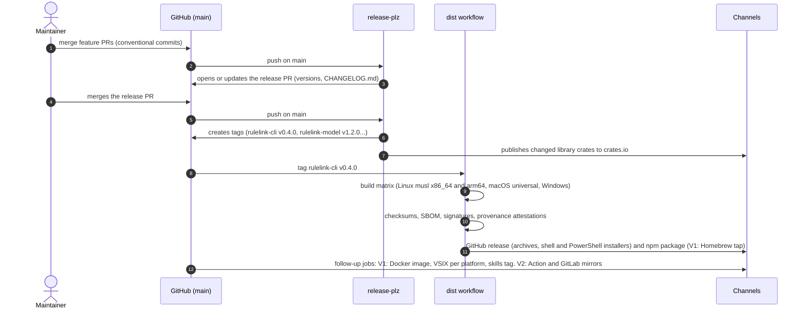
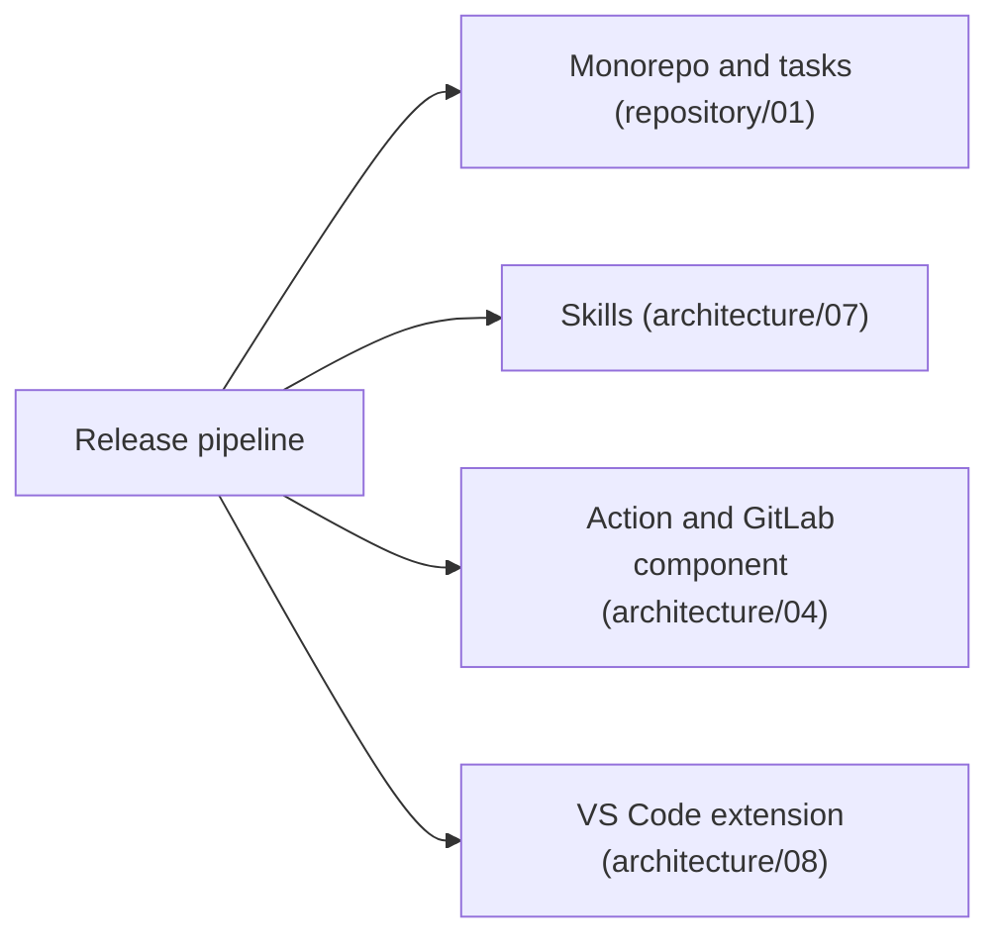

# 02 — Release lifecycle

> How a change becomes a versioned, distributed and supported release: branching, versioning, release pipeline, channels, compatibility and supply-chain security.
> See also: [Repository structure](01-repository-structure.md), [Runtime lifecycle](../architecture/10-runtime-lifecycle.md), [Features and releases](../product/02-features-and-releases.md).

## 1. Role and scope

**Responsibilities**

- Define the branching and commit conventions.
- Version every artefact and public contract.
- Specify the release pipeline and the distribution channels.
- Define compatibility, deprecation and support policies.
- Secure the supply chain of published artefacts.

**Out of scope**

- Repository layout and CI quality gates: see [Repository structure](01-repository-structure.md).
- Process behaviour at runtime: see [Runtime lifecycle](../architecture/10-runtime-lifecycle.md).

## 2. Release frame

| Feature | MVP | V1 | V2 |
|---|:-:|:-:|:-:|
| Release pipeline: release-plz + dist, GitHub releases, npm package | ● | | |
| Shell and PowerShell installers (amends ADR-0001, see ADR-0004) | ● | | |
| Docker image | | ● | |
| crates.io publication of every library crate | ● | | |
| Signed artefacts, SBOM, build provenance attestations | ● | | |
| Homebrew, Scoop, winget | | ● | |
| VS Code extension release (per-platform VSIX) | | ● | |
| Nightly pre-release channel | | ● | |
| `rulelink self update` for script-installed binaries | | ● | |

## 3. Technical constraints

| Topic | Target |
|---|---|
| Release pipeline, tag to published binaries | < 45 min |
| Release dry run on every PR | Required status check |
| Artefacts | Reproducible from a tag, with checksums, SBOM and provenance |

## 4. Delivery lifecycle

### 4.1 Branching and commits

- Trunk-based development on `main`, short-lived branches, squash merge.
- Conventional Commits (`feat:`, `fix:`, `feat!:`), checked in CI; release-plz derives version bumps and changelogs from them.
- `main` is always releasable: every quality gate from [Repository structure](01-repository-structure.md) is required.

### 4.2 Versioning matrix

Public contracts are versioned independently of the binary, because they evolve at a different pace and have external consumers ([architecture/00](../architecture/00-global-architecture.md), section 9.7).

| Artefact | Scheme | Strategy | Published to |
|---|---|---|---|
| `rulelink` binary (`rulelink-cli`) | SemVer, `0.x` until the format is frozen | Lockstep with every internal crate (`workspace.package.version`) | GitHub releases (archives, shell and PowerShell installers), npm, crates.io (V1: Docker, Homebrew) |
| Other library crates (`registry`, `link`, `check`, `import`, `publish`, `config`, `app`, `lsp`, `adapters/*`) | Same as the binary | Lockstep, published in dependency order by release-plz | crates.io |
| `xtask`, `rulelink-e2e` | — | `publish = false` | — |
| `rulelink-model` | SemVer, `1.x` from the first public release | Independent, checked by `cargo-semver-checks` | crates.io |
| `rulelink-adapter-sdk` | SemVer | Independent, checked by `cargo-semver-checks` | crates.io |
| Rule file format | Integer (`"format": 1`) | Bumped only on breaking change | JSON Schema in `schemas/` |
| External adapter protocol | `major.minor` (`1.0`) | Negotiated at `initialize` ([architecture/02](../architecture/02-sources-of-truth.md)) | JSON Schema |
| JSON output schemas | `name/vN` | One version per breaking change | JSON Schema |
| Skills | Tag aligned on the binary's minor (`v0.3.0`) | Declare a minimum binary version | Monorepo tag, optional mirror |
| VS Code extension | SemVer, own version | Bundles a pinned binary version | VS Code Marketplace, Open VSX |
| GitHub Action (V2) | Major tag `v1`, plus `v1.x.y` | Independent | Mirror repository |

### 4.3 Release pipeline



| Step | Tool | Release |
|---|---|---|
| Version bumps, changelogs, tags, crates.io | release-plz | MVP |
| Cross-platform binaries, shell and PowerShell installers, npm wrapper | dist (formerly cargo-dist) | MVP |
| Homebrew | dist | V1 |
| Release dry run on every PR | `dist plan` ([Repository structure](01-repository-structure.md), section 9.1) | MVP |
| Docker image | GitHub Actions, multi-arch build from the release binaries | V1 |
| Signatures and provenance | GitHub artifact attestations; SBOM with `cargo-cyclonedx` | MVP |
| VS Code extension | `vsce publish --target <platform>`, `ovsx publish` | V1 |
| Scoop, winget | Manifests generated from the release | V1 |

**Risk on dist.** The dist repository has seen little activity since mid-2025. The release workflow is isolated in a single file and dist only produces artefacts; if it becomes unmaintained, a hand-written GitHub Actions matrix (`cargo zigbuild` for Linux, native runners for macOS and Windows) replaces it without touching release-plz or the channels.

### 4.4 Channels

| Channel | Source | Audience | Release |
|---|---|---|---|
| Stable | Tagged releases | Everyone | MVP |
| Nightly | Last green `main`, pre-release tag `nightly` | Early adopters, the author's own projects | V1 |

### 4.5 Compatibility, deprecation and support

| Policy | Rule |
|---|---|
| Rule file format | A binary reads every earlier format; `rulelink migrate` rewrites to the current one. Writing an older format is not supported |
| External adapter protocol | A binary supports the current and the previous minor versions; a major change keeps the previous major for 12 months |
| CLI flags and commands | Deprecated items print a warning for at least one minor release before removal; removals only in a major release (or a `0.x` minor before 1.0) |
| JSON outputs | Stable within a schema version; a new version is opt-in (`--format json --schema-version 2`) for one minor release before becoming the default |
| MSRV | Latest stable Rust minus two minor versions; raising it is a minor change, noted in the changelog |
| Support | Fixes on the latest minor; security fixes back-ported to the previous minor |
| Skills | A skill refuses to run below its declared minimum binary version ([architecture/07](../architecture/07-agent-integration.md)) |

### 4.6 Supply-chain security

- `cargo deny check` (advisories, licences, sources) on every PR and nightly.
- GitHub Actions pinned by commit SHA; Dependabot or Renovate for updates.
- Release binaries signed and published with checksums, SBOM and provenance attestations, so `gh attestation verify` can check them.
- crates.io publication through trusted publishing from CI, with no long-lived token where the registry supports it (to be verified at implementation time).

## 5. Entry points

### 5.1 CLI

| Command | Options | Effect | Release |
|---|---|---|---|
| `rulelink version` | `--json` | Version, commit, build date, target, supported rule formats, protocol versions, JSON schema versions | MVP |
| `rulelink self update` | `--channel stable\|nightly`, `--check` | Updates a binary installed by the shell or PowerShell installer; refuses and names the package manager otherwise | V1 |

Example `rulelink version --json`:

```json
{
  "schema": "rulelink/version/v1",
  "version": "0.4.0",
  "commit": "3f2c9ab",
  "target": "x86_64-unknown-linux-musl",
  "rule_formats": [1],
  "adapter_protocol": ["1.0"],
  "install_method": "shell-installer"
}
```

### 5.2 Maintainer commands (`xtask`)

| Command | Effect | Release |
|---|---|---|
| `cargo xtask schemas` | Regenerates `schemas/` from the Rust types | MVP |
| `cargo xtask arch` | Checks the dependency rules ([Repository structure](01-repository-structure.md), section 6.2) | MVP |
| `cargo xtask skills-lint` | Validates skill front matter, links and minimum versions | MVP |
| `cargo xtask release-check` | Verifies that format, protocol and schema versions in `version --json` match `schemas/` | MVP |
| `cargo xtask mirror <action\|gitlab>` | Prepares the mirror repository content (used by CI) | V2 |

## 6. Interactions



## 7. Tests and acceptance criteria

- `dist plan` succeeds on every PR; a full release dry run (`release-plz release --dry-run`) runs nightly.
- `cargo xtask release-check` passes on every release PR.
- The `smoke-test` workflow runs on every tag, between the build and the npm publish: the built archive starts on Linux, macOS (x86_64 and arm64) and Windows, the shell and PowerShell installers are present, parse and point at the release being built, and the npm tarball declares the `rulelink` binary. Once `init` and `check` exist, it also runs `init` then `check` in a clean repository (flip `FULL_FLOW`).
- Installation test from the brief: first `check` in under 15 minutes for 3 external developers, using any of the shell installer, the PowerShell installer or the npm package, and including one `check` run in a CI workflow the developer writes by hand.

## 8. Open points

No open points remain.

- **`rulelink-model` 1.0**: released as soon as ADR-003 (English keys) is validated and the MVP has run on the internal-use build for 4 weeks.
